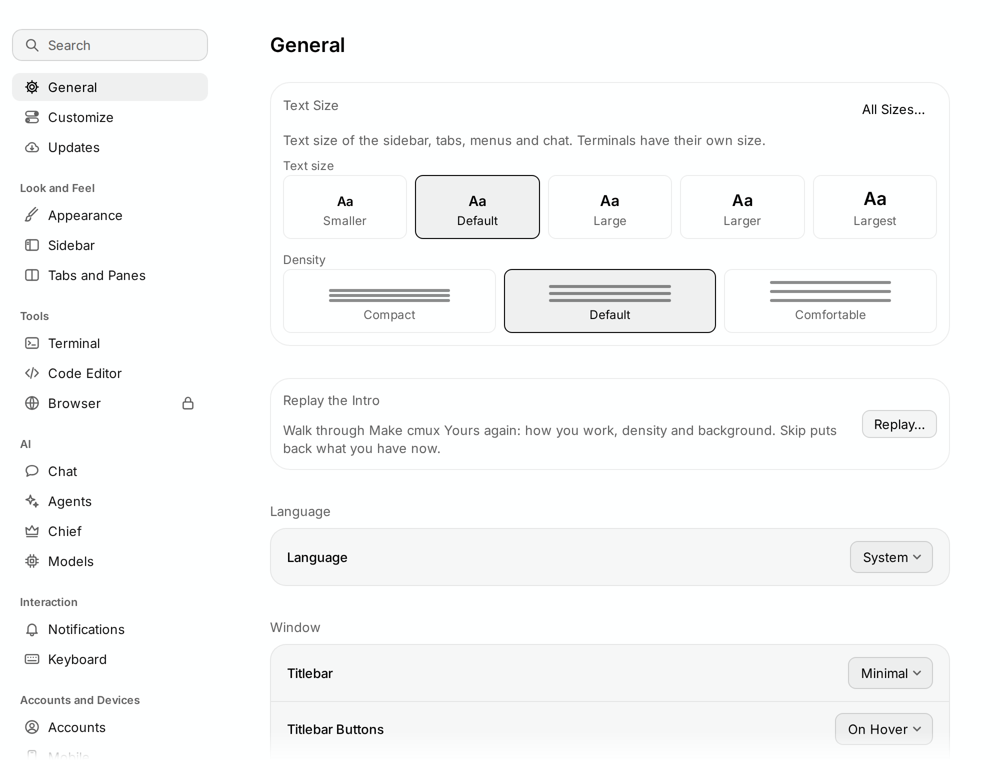

Carries #51488 for ask-b9fd9d4f9c. Stacked on #50975.

Waiting on Leo: UI

## Verification on the carry head

Head `9794398440a789dfa9bf7ae74024f8925a2be362` includes the onboarding front door at `64597046cae41cbb29c290d36dbb72ab968ea30b` and feat-cmux-next at `88fce28c55e391fef4dff30bd070144581e3d4aa`, including upstream Skip restoration. The integrated Skip tests use the front door's density IDs and offered background fixture. Comparing with the same resolved base (`9431b021b9d4fbe17929fff69f5d2391af07c26c`, local verification commit) gives exactly the eight original Replay row paths.

- Replay and Text Size passed in isolated Bun processes. They check placement and verify that Replay invokes `home.makeItYours` without writing a setting.
- Webviews typecheck passed across 7,993 files, including the closed-kit TypeScript check. The pre-push gate and its web lint step passed.
- Six Settings test files failed on both carry and combined base. The eight named failing assertions in Devices, lazy card loading, the mock provider, row summaries, sidebar sections and Theme had identical assertion output on both. These were the six files that remained red in the earlier run of all 128 Settings files.
- Chromium rendered light and dark Settings > General galleries on this exact head. Both were pixel-identical to the prior captures, including the published light screenshot below.

## Earlier GitHub checks on #51488

The [original Web run](https://github.com/manaflow-ai/cmux/actions/runs/45156801799) reported the home-channels design token, an Intl formatter lint, and suite failures in the SDK sign-in test, VM-image APT mirror test, and workflow runner-pool test. The webviews typecheck runner shut down during checkout. Two real-acpmux harness cases timed out before recording a passing assertion. Those timeouts give no result for the Replay row.

The [protocol run](https://github.com/manaflow-ai/cmux/actions/runs/45156800940/job/137631700741) failed the SDK descriptor/catalog comparison, the [inventory run](https://github.com/manaflow-ai/cmux/actions/runs/45156800875/job/137632110573) failed the signed CLI file read, and the [iOS job](https://github.com/manaflow-ai/cmux/actions/runs/45156800780/job/137636930073) reported a cancelled runner and no verdict. These historical checks ran on the old head.

## Screenshot

Settings > General on the carry head, with Replay the Intro directly below Text Size.

Original #51488 description (session attribution is on the original)

Leo: "and i guess they can maybe replay it to return to the walk of the settings"

Decision d-eedbe6969c (ask-b9fd9d4f9c): "Settings > General, top: Replay the intro". This is a row that reopens the Make cmux Yours step on the current settings, the same way the palette's `home.makeItYours` from #50975 does. It never touches the first-run flag.

Stacked on #50975 (`lane/onboarding-front-door`), because that PR adds `home.makeItYours`. Once #50975 merges, retarget this PR to `feat-cmux-next`.

## What changed
- **New card.** General gets a second lead card, `replayIntro` (`ReplayIntroCard.tsx`). It has a title, a one-line detail, and a **Replay…** button that runs `home.makeItYours` through `cmux.app.action.run`. The Swift binding (`OnboardingHandlers.swift`) shows the onboarding presenter at `.makeItYours`. It writes no setting and leaves the first-run flag alone. The step's own Skip puts back what was set when it opened.
- **Placement.** Text Size stays the first card, by the Nov 20 design and its test. Replay the Intro sits right under it, still above every row. A section action would have drawn at the bottom of the section, so this is a lead card instead.
- **Layout files.** `page-layout.json` gives General `lead: ["textSize", "replayIntro"]` and a card note. The generated Swift page layout is regenerated, and the export's `page` gets the same lead entry. The export was already behind on six unrelated rows before this change; I only edited the lead list.
- **Strings.** Three `settingsPage.replayIntro.*` strings are added in all 21 locales of the settings catalog: en is translated, the rest are needs_review.
- **Tests.** A new `replayIntroCard.test.tsx` checks two things: General's cards open on Text Size then Replay the Intro, and clicking Replay sends exactly `{ action: "home.makeItYours" }` and writes nothing.

Nothing is removed and no default changes.

## Tests
- `bun test src/pages/settings/replayIntroCard.test.tsx src/pages/settings/textSizeCard.test.tsx`: 5 pass, 0 fail.
- `bun test src/pages/settings` on this head: 709 pass, 1 skip, 33 fail. The 33 failures are in eight files (harnessesCard 12, providerAccounts 9, customizeChecklistCard 5, devices 2, rowSummary 2, polishStates 1, sidebarSections 1, themePane 1). The same eight files on the base, #50975's head `129c94a527a`, fail the same 33 tests (41 pass, 33 fail), and the two sets of failing test names match exactly. This change adds no failure.
- `cmux-ci compile-check --ref 970b0b88e60 --app` (for the regenerated Swift page layout): passed in 152 s.

## Changelog
- Settings > General has a new Replay the Intro card, right under Text Size. It walks you through Make cmux Yours again on your current settings, and Skip puts back what you had.

🤖 Generated with [Claude Code](https://claude.com/claude-code)

Agent session: [agent session](https://cmux.com/deeplink/agent?id=aid-b74639bb2d21c59a6a8b&model=claude-opus-5-5)

🤖 Generated with [Claude Code](https://claude.com/claude-code)
