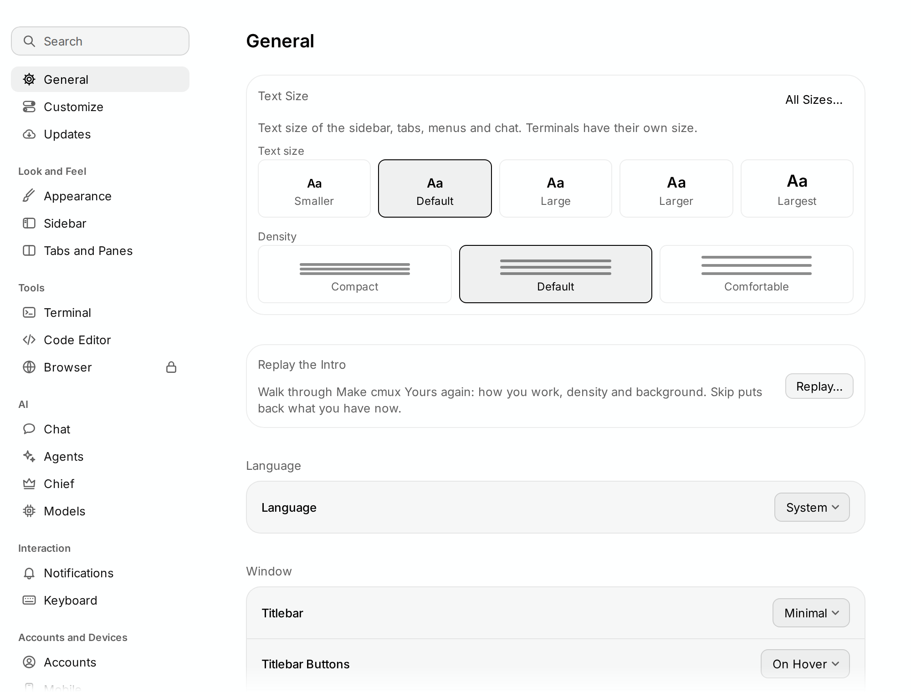

Waiting on Leo: UI

[The updated Replay branch](https://github.com/manaflow-ai/cmux/tree/lane/replay-intro-settings-row-carry) contains both bases. This screenshot and the local check results apply to that branch.

## Verification on the carry head

Head `397922431c8deab98622d7620f9482b8a84a92e5` includes the onboarding front door at `64597046cae41cbb29c290d36dbb72ab968ea30b` and feat-cmux-next at `0c7c8c1ef08cbdd71e9d74f55b5134e640b011db`. Against the combined bases, only the original eight Replay row files differ.

- Replay and Text Size test files passed in isolated Bun processes. They check placement and verify that Replay invokes `home.makeItYours` without writing a setting.
- Webviews typecheck passed across 7,988 files, including the closed-kit TypeScript check. The pre-push gate passed.

- Across all 128 Settings test files, six files failed after isolated retries. The eight failing assertions in Devices, lazy card loading, the mock provider, row summaries, sidebar sections, and Theme produced identical named TAP failure signatures on the combined base at `28d5d3c687afd71a574b3de28c9176310d0c599f`. Three other files passed on isolated retry.

- The design-token ratchet also passed on this carry head.

## Earlier GitHub checks on #51488

The [original Web run](https://github.com/manaflow-ai/cmux/actions/runs/45156801799) reported the home-channels design token, an Intl formatter lint, and suite failures in the SDK sign-in test, VM-image APT mirror test, and workflow runner-pool test. The webviews typecheck runner shut down during checkout. Two real-acpmux harness cases timed out before recording a passing assertion. Those timeouts give no result for the Replay row.

The [protocol run](https://github.com/manaflow-ai/cmux/actions/runs/45156800940/job/137631700741) failed the SDK descriptor/catalog comparison, the [inventory run](https://github.com/manaflow-ai/cmux/actions/runs/45156800875/job/137632110573) failed the signed CLI file read, and the [iOS job](https://github.com/manaflow-ai/cmux/actions/runs/45156800780/job/137636930073) reported a cancelled runner and no verdict. These historical checks ran on the old head.

## Screenshot

Settings > General on the carry head, with Replay the Intro directly below Text Size.

