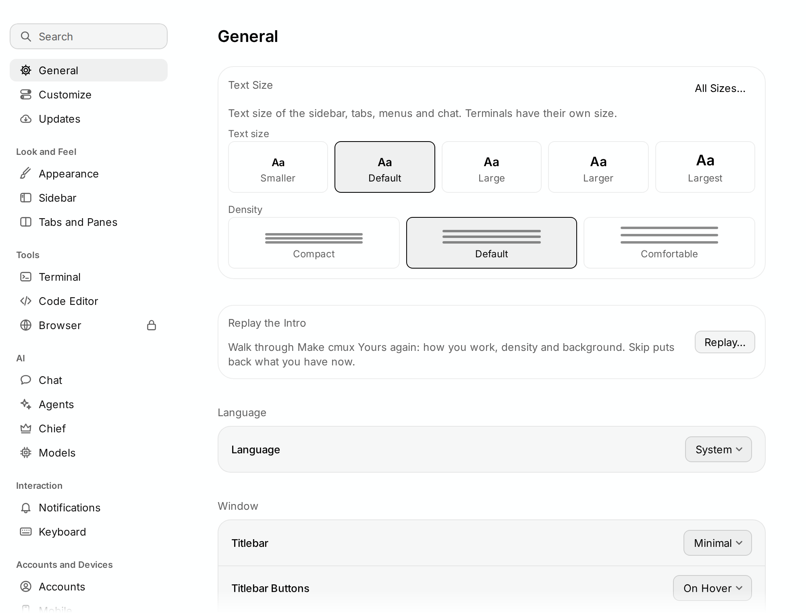

Updated carry branch for #51488 and `ask-b9fd9d4f9c`. [Pushed commit](https://github.com/manaflow-ai/cmux/commit/9794398440a789dfa9bf7ae74024f8925a2be362).

## Verification on the carry head

Head `9794398440a789dfa9bf7ae74024f8925a2be362` includes the onboarding front door at `64597046cae41cbb29c290d36dbb72ab968ea30b` and feat-cmux-next at `88fce28c55e391fef4dff30bd070144581e3d4aa`, including upstream Skip restoration. The integrated Skip tests use the front door's density IDs and offered background fixture. Comparing with the same resolved base (`9431b021b9d4fbe17929fff69f5d2391af07c26c`, local verification commit) gives exactly the eight original Replay row paths.

- Replay and Text Size passed in isolated Bun processes. They check placement and verify that Replay invokes `home.makeItYours` without writing a setting.
- Webviews typecheck passed across 7,993 files, including the closed-kit TypeScript check. The pre-push gate and its web lint step passed.
- Six Settings test files failed on both carry and combined base. The eight named failing assertions in Devices, lazy card loading, the mock provider, row summaries, sidebar sections and Theme had identical assertion output on both. These were the six files that remained red in the earlier run of all 128 Settings files.
- Chromium rendered light and dark Settings > General galleries on this exact head. Both were pixel-identical to the prior captures, including the published light screenshot below.

The broker refused the original branch push, body edit, and the replacement PR against `lane/onboarding-front-door`. The branch is published. The original PR head still carries the old hosted checks.

Waiting on Leo: UI
