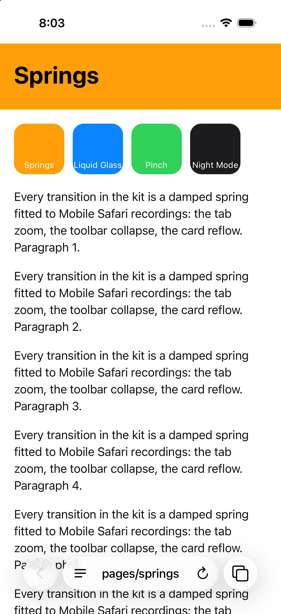
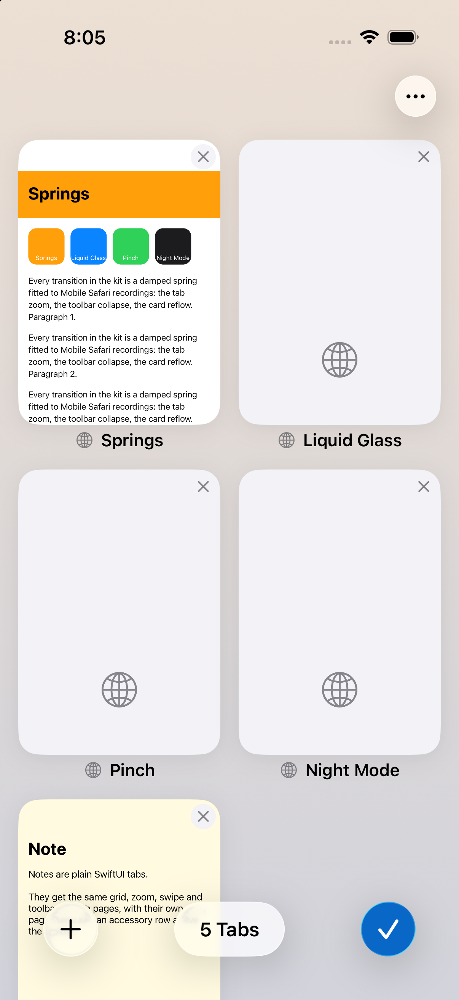

# CmuxTabsKit

CmuxTabsKit gives an iOS 26+ SwiftUI app a Mobile Safari style tab
experience for any tab content: web pages, terminals, notes, or anything else.
It came out of the cmux-next iOS browser and has no dependency on cmux
transport or models.

<p>


</p>

## What you get

- **Live page, edge to edge.** The page sits under a floating glass toolbar
  with three shapes: the back | forward capsule, the address capsule, and the
  tabs circle.
- **Collapsing toolbar.** Scrolling down shrinks the toolbar into the URL
  pill; scrolling up or tapping the pill expands it. The springs are measured
  from Safari.
- **Address editing.** The field rides on the keyboard, and the page is
  covered by suggestions (yours, or the default list of open tabs plus a
  Search row).
- **Page menu.** A glass droplet that grows out of the menu glyph.
- **Back | forward morph.** The back circle widens into a capsule when
  forward history exists. With `providesHistoryMenus`, long-pressing back or
  forward lists the history.
- **Tab grid.** Two columns of cards with a title row and close button. Cards
  reflow when you close a tab. The bottom bar has (+), a tab count and Done,
  and there is a "Close All Tabs" menu.
- **Zoom transition.** The page shrinks into its card and grows back out.
  It is one interruptible spring: a second tap reverses it mid-flight, and a
  pinch can grab it. Before zooming in, the grid scrolls so the card is fully
  on screen. Your content is laid out at full size inside the moving rect; it
  is never re-laid out or rebuilt.
- **Pinch.** Pinch in on a page to go to the grid; pinch out on a card to
  open it. Tracking is 1:1 with rubber banding, and release keeps the finger
  velocity.
- **Toolbar swipe.** Swiping sideways on the address capsule moves to the
  neighboring tab. Swiping past the last tab creates a new one.
- **Status bar.** The style follows each tab's `statusBarStyle`.
- **Reduce Motion.** Spatial animations become short crossfades.

## Install

Add the package (local path or this repository) and depend on the
`CmuxTabsKit` product. It requires Swift 6.2 tools and iOS 26.

## Minimal example

```swift
import CmuxTabsKit
import SwiftUI

@MainActor
@Observable
final class MyTabs: TabsDataSource {
    private(set) var tabs: [TabsKitTab] = [
        TabsKitTab(id: "1", kind: "note", title: "Hello", systemImage: "note.text",
                   address: .title("Hello"), features: [.pageMenu]),
    ]
    private(set) var activeTabID: String? = "1"
    let newTabOptions = [TabsKitNewTabOption(id: "note", title: "New Note", systemImage: "note.text", kind: "note")]

    func activate(_ id: String) { activeTabID = id }

    func close(_ id: String) {
        tabs.removeAll { $0.id == id }
        if activeTabID == id { activeTabID = tabs.last?.id }
    }

    func createTab(_ option: TabsKitNewTabOption) async -> String? {
        let id = UUID().uuidString
        tabs.append(TabsKitTab(id: id, kind: option.kind, title: "Note", systemImage: "note.text",
                               address: .title("Note"), features: [.pageMenu]))
        activeTabID = id
        return id
    }

    // Laid out at the full screen size; draw under the status bar and the toolbar.
    func content(for tab: TabsKitTab, context: TabsKitContentContext) -> some View {
        ScrollView {
            Text(tab.title).font(.largeTitle).padding(.top, context.safeAreaInsets.top + 16)
        }
        .tabsKitReportsScroll(context)  // collapses and expands the toolbar
        .background(.background)
    }

    // The default card shows `thumbnail(for:)`. Here the content itself is the card.
    func card(for tab: TabsKitTab) -> some View {
        Text(tab.title).font(.largeTitle).frame(maxWidth: .infinity, maxHeight: .infinity).background(.background)
    }
}

struct ContentView: View {
    @State private var tabs = MyTabs()
    var body: some View { TabsView(source: tabs) }
}
```

Give `TabsView` the whole screen: it handles the safe area and the keyboard
itself.

## The data source

`TabsDataSource` is a `@MainActor` protocol. Conform an `@Observable` class
to it: the view re-renders from whatever it reads.

| Member | Required | Purpose |
| --- | --- | --- |
| `tabs`, `activeTabID` | yes | Tabs in grid order (new tabs go last) and the tab on screen. |
| `newTabOptions` | yes | The (+) entries. One option makes a button, several make a menu. The first option is what a swipe past the last tab, and closing the last tab, create. |
| `activate`, `close`, `createTab` | yes | Selection and lifecycle. `createTab` appends the tab, makes it active and returns its id. Return nil to refuse; the grid stays as it was. |
| `content(for:context:)` | yes | The live page. It is laid out at `context.pageSize` and scaled by the kit, so it must not depend on its on-screen size. |
| `card(for:)` | no | The card content, laid out at full size and scaled down. The default card is `TabsKitThumbnailCard`. |
| `thumbnail(for:)`, `overviewWillAppear()` | no | Snapshots for the default card. Refresh them in `overviewWillAppear`. |
| `accessory(for:context:)` | no | A row above the toolbar for the active tab, such as a composer or a key bar. |
| `editingBackground(_:)` | no | Covers the page while the address is being edited. The default is `TabsKitAddressSuggestions`. |
| `goBack`, `goForward`, `navigate`, `reloadOrStop` | no | Toolbar actions. |
| `providesHistoryMenus`, `history(_:for:)`, `goToHistoryItem` | no | Long-press menus on back and forward. |
| `pageMenu(for:)` | no | Page menu groups made of `TabsKitMenuItem`s. |

### Describing a tab

`TabsKitTab` carries the following:

- **`kind`** is an open set, for example `.web`, `.terminal` or
  `TabsKitTabKind("note")`.
- **`title`**, **`subtitle`** and **`systemImage`** label the card and the
  suggestions.
- **`address`** sets the capsule's text:
  - `.url(display:editingText:isSearch:)` for a page with an address.
  - `.placeholder(_)` for an empty page: a dimmed placeholder with a
    magnifying glass.
  - `.title(_:subtitle:monospaced:)` for a page without an address, such as
    a terminal or a note. Tapping it opens the page menu.
- **`navigation`** holds `canGoBack`, `canGoForward`, `isLoading`,
  `progress` and `isZoomedIn`. When `isZoomedIn` is true, a slow pinch-in
  zooms the content instead of opening the grid.
- **`features`** says which controls the tab offers: `.history`, `.reload`,
  `.addressEditing`, `.pageMenu`, or `.web` for all of them.
- **`statusBarStyle`** is the tab's status bar style. For a web page, use
  `TabsKitStatusBarStyle(over: topColor)`.

### Content context

`TabsKitContentContext` tells your content:

- **`safeAreaInsets`**: the status bar height at the top and the toolbar
  height at the bottom.
- **`isInteractive`**: the page is settled and takes input.
- **`isZoomGestureActive`**: a pinch is driving the tab zoom. Disable your
  own pinch zoom while it is true; the demo turns off the web view's pinch
  recognizer.
- **`isToolbarCollapsed`**: the toolbar is collapsed into the pill.

Call `context.reportScroll(fingerDelta:)` with finger travel (positive means
the finger moves down) to collapse and expand the toolbar. For a SwiftUI
`ScrollView`, `.tabsKitReportsScroll(context)` does this for you.

### Programmatic grid

`TabsView(source:isShowingOverview:)` takes an optional two-way binding.
Setting it runs the same zoom as the tabs button, and the kit sets it when
the user opens or closes the grid.

## Theme

```swift
var theme = TabsKitTheme()
theme.colors.accent = .orange
theme.motion.collapse = .spring(response: 0.3, dampingFraction: 0.9)
TabsView(source: tabs).tabsKitTheme(theme)
```

The defaults are measured Safari values:

- `Colors`: label, page background, grid wallpaper, card close button and
  accent.
- `Metrics`: toolbar insets, the pill, the menu and the screen radius.
- `Motion`: collapse, expand, keyboard, menu, reflow and swipe springs.

Some values are not themable because they come from the device recordings:

- The tab zoom springs are `ZoomSpring` in `Logic/TabZoom.swift`. Opening
  the grid uses 0.37 / 0.875; closing it uses 0.39 / 0.99 with a launch
  velocity; reversals use their own springs.
- The grid geometry is `OverviewLayout`.

## Status bar

SwiftUI's own root controller ignores the requested style. Use
`TabsKitHostingController(rootView:)` as the window's root, or observe
`.onTabsKitStatusBarStyleChange` in your own hosting controller.

## Demo

`Demo/` is an XcodeGen project with:

- Four local web pages, each a `WKWebView` served from memory by a
  `tabskit://` scheme handler, with real back/forward history and
  long-press history menus.
- A "note" tab kind written in SwiftUI. It has a custom card, an accessory
  row and its own page menu.

```sh
cd Demo
xcodegen generate
xcodebuild -project CmuxTabsKitDemo.xcodeproj -scheme CmuxTabsKitDemo \
  -destination 'generic/platform=iOS Simulator' build
```

Launch the demo with the `-showGrid` argument to open the grid once the
first page has loaded.

## Tests

`swift test` runs on a Mac; the pure logic is platform neutral. The tests
cover:

- The zoom state machine: reversals, launch velocity, settling, and
  repeated toggles.
- The pinch tracker: 1:1 tracking, rubber banding, and release without a
  velocity discontinuity.
- The grid layout and the scroll-into-view rule.
- The back | forward state.

For the UI on a simulator, run
`xcodebuild test -scheme CmuxTabsKit -destination 'platform=iOS Simulator,…'`.
