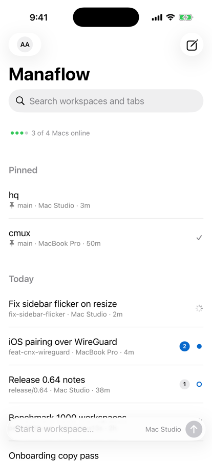
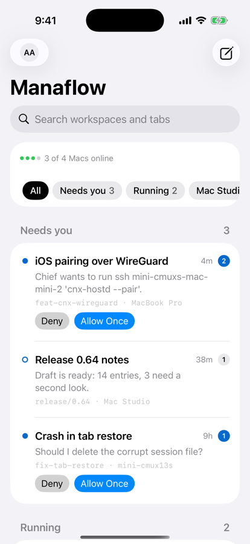
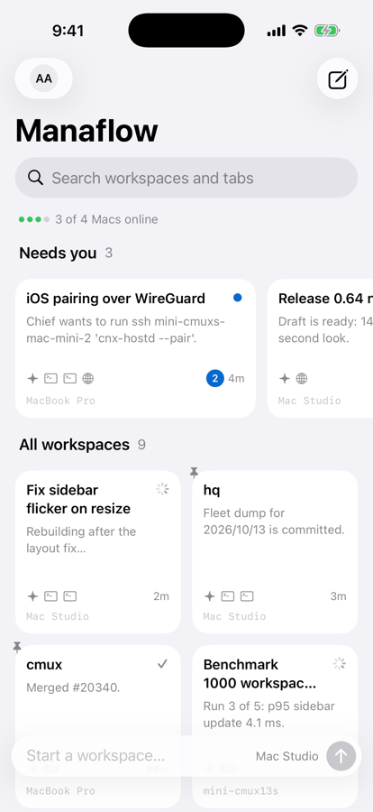
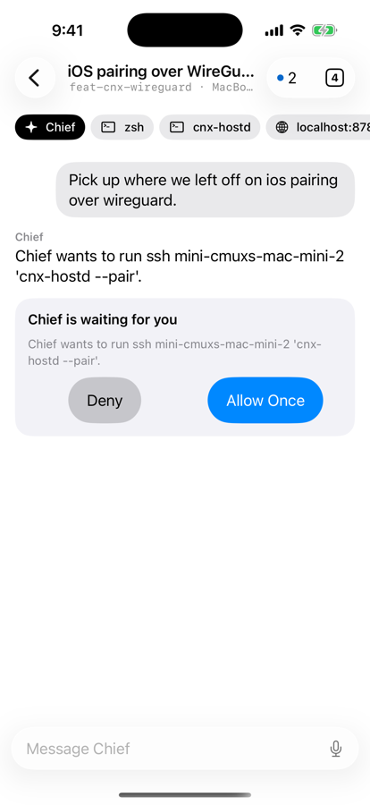

# CmuxWorkspacesKit

Three candidate designs for the cmux-next iOS workspaces home. None uses a
sidebar or a hamburger menu: the workspace list is the root of a navigation
stack, opening a workspace is a push, and Back or an edge swipe returns.

<p>




</p>

| Design | Layout |
| --- | --- |
| Recents | The Claude/ChatGPT history list as the home screen: Pinned, Today, Yesterday, Previous 7 days. Two-line rows (name, then branch · Mac · age). A prompt box at the bottom creates a workspace and sends the text to Chief. |
| Triage | Mail-style: filter chips (All, Needs you, Running, one per Mac), then Needs you, Running and Everything else. Rows show the latest message, and a waiting prompt can be answered from the row. |
| Cards | Needs-you workspaces ride a horizontal strip; the rest fill a two-column grid of cards that show the latest message and the tab kinds. |

Shared by all three:

- One accent color. Status is told apart by shape: a spinner (working), a
  filled dot (needs you), a ring (review) and a check (done). Badges use the
  accent only when something is blocking. The only other hue is the green
  Mac-online dot.
- The team name is the large title; its title menu switches teams and invites.
- The avatar (top left) holds account and settings. The pencil (top right)
  creates a workspace instantly; a long press offers another Mac, a branch or
  a clone.
- Press and hold a workspace for Pin, Rename, Mark as Done, Copy Branch Name,
  Open on Mac and Close. List rows also have trailing swipes; there are no
  leading swipes, so the edge swipe back never competes with a row.
- Inside a workspace, the dot-and-count button jumps to the next workspace
  that needs you.
- While Macs connect, cached rows stay on screen; the empty state appears only
  once the list is known to be empty.

## Use

```swift
WorkspacesHomeView(store: WorkspacesStore.sample(), design: .recents)
```

`WorkspacesStore` holds teams, Macs and workspaces; `WorkspaceGrouping` is the
pure grouping, filtering and search logic (tested on macOS with `swift test`).
`WorkspaceDetailView` is a stand-in for the workspace page; a real app hosts
CmuxTabsKit there.

## Demo

```bash
cd Demo && xcodegen generate
```

Build the `CmuxWorkspacesDemo` scheme for an iOS 26 simulator. The app opens
on a design picker; inside a design, tap the avatar and choose Switch Design.
Launch with `-design recents|triage|cards` to open a design directly, and add
`-workspace wg` to push a workspace.
