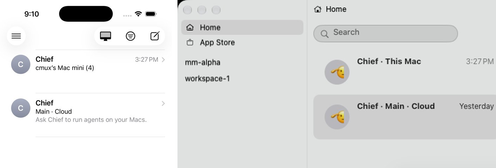
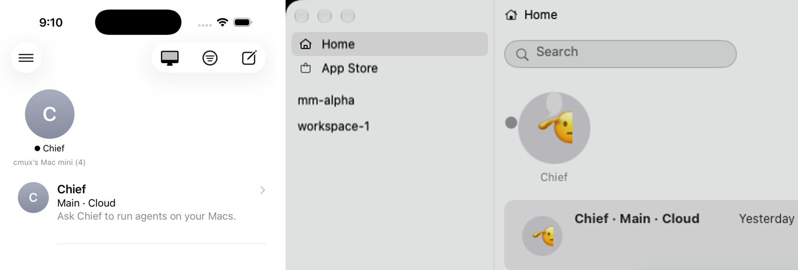

# Home parity: cmux-next macOS Home and the iPhone Home

User direction (2026-10-21): "I don't like the fact that there are Home rows for agent
chats, it's confusing. Home should be exact information parity with macOS."

## Where the Mac's Home list comes from

The Mac's Home sidebar (`HomeSidebarView`, MessagesLab's `CmuxSidebarView`) draws a
`HomeSidebarModel`. With an owner that serves `home-inbox` (capability `home-inbox-v1`),
the model takes each conversation's kind, name, unread count, pin, pin order, unread mark,
mute and list order from the owner's rows (`HomeInboxSource`, `HomeInboxMapping`). There are
two owners: the Chief home's daemon (local conversations) and the build's daemon (the
person's Cloud inbox, through its Cloud lease). Source of truth:

- `Packages/macOS/CmuxNext/Sources/CmuxNextHome/Sidebar/HomeSidebarView.swift`
- `Packages/macOS/CmuxNext/Sources/CmuxNextHome/Conversations/HomeSidebarModel.swift`
- `Packages/macOS/CmuxNext/Sources/CmuxNextHome/Conversations/HomeChiefRoster.swift`
- `Packages/macOS/CmuxNext/Sources/CmuxNextHomeEngine/HomeInboxSource.swift`, `HomeSidebarSource.swift`, `HomeInboxMapping.swift`
- `Packages/macOS/CmuxNext/Sources/CmuxNextApp/TopPages/TopHomePageView.swift` (`wireList`: menus, actions)
- `Packages/Shared/CmuxMessagesLab/Sources/MessagesLabSidebar/Vendor/appkit-native/SidebarView.swift` (`menu(at:)`)
- `cmux-tui/spec/commands.md`, `home-inbox`

The phone now reads the same `home-inbox` rows from the same Mac's Chief home daemon over the
link (the `chief` channel, `MacHomeFeed`) and draws them as they come. It derives no kind, name,
order, unread or Chief state of its own, so the two lists cannot drift.

## macOS Home inventory

| Part | What the Mac shows |
| --- | --- |
| Header | Search capsule ("Search"), the Unread toggle (`line.3.horizontal.decrease.circle`, filled while on; the only filter), the compose button (New Message; right-click: New Chief, Invite). In the avatar-only width the search and buttons fold into the band. |
| Pinned grid | Messages' pinned tiles, up to 9, 3 per row. Pinned rows in the owner's pin order; the Main Chief leads. Each tile: the avatar (the Chief's picture or text, else initials), the name, a typing bubble while a Chief works, a preview bubble while unread, the unread dot, a muted look. |
| New Message draft row | Only while a New Message draft is open on the Mac. |
| Rows | Every other conversation, newest first (the owner's order). Each row: unread dot gutter, avatar (Chief avatar, or up to 3 member avatars for a group), title (`name`, else "Untitled"), the tag after the name for a Chief ("Main", where it runs: "This Mac", "Cloud" or a server, then a non-default engine), the time ("1:46 PM", "Yesterday", weekday, short date), a two-line preview (an agent's Markdown without markers; a reaction reads as "X loved …"; a reply shows the reply arrow), dimmed when muted, the typing bubble while a Chief works. |
| Kinds | `chief` (owner and one Chief), `direct`, `channel` (titled group), `group`. Local conversations and the Cloud inbox in one list. |
| Search | Filters title, member names and preview. While searching there is no pinned grid; matching pinned conversations lead the rows. A "Teammates" section lists teammates with no DM yet. |
| Unread toggle | Only unread conversations (unread messages or Mark as Unread). |
| Row menu | Pin / Unpin; Mark as Read / Mark as Unread; Hide / Show Alerts (Cloud rows only). Chief rows add "Usage…" and "Archive Chief". Group rows add Group Info, Rename, Add People, Leave. |
| Under the list | A quiet note when the Cloud did not answer ("Cloud conversations are not available right now."); "Message Requests (N)" while there are Cloud requests. |
| Agent chats | Not in Home. They are tabs inside workspaces. |
| Empty state | The list is empty (MessagesLab draws nothing extra). |

## iPhone Home now

- The pinned grid: the Mac's pinned conversations in the owner's order, 3 per row, up to 9.
- Then every other conversation of the Mac's list in the owner's order, as Messages rows. The
  Cloud Chief is one of them, tagged "Main · Cloud" and placed by its newest message, as the Mac
  merges its Cloud rows; a Chief of this Mac is tagged with the Mac's name where the Mac says
  "This Mac".
- Search (pull-down drawer), the Unread toggle and compose in the bar. Compose opens the Chief
  with the keyboard up, as before (the phone starts no conversations).
- Long-press menu on a tile or row: Pin / Unpin, Mark as Read / Mark as Unread. Both write the
  person's list state on the Mac's owner (`conversation-inbox-op`), so the Mac's Home changes too.
- Tapping a row opens that conversation: the Mac Chief's own conversation is the Mac Chief;
  any other conversation opens over its own `chief` channel to that Mac.
- The agent-chat rows are gone. Agent chats stay in their workspaces (Workspaces tab), as on the Mac.
- The Mac menu (only with more than one Mac) chooses whose Home shows. It is the same setting as
  Workspaces' Mac filter and links that Mac, so its Chief and its Home show. Home has no
  "All Macs": a Mac's Home is one Mac's list, and merging several Macs' lists would be a list
  the Mac never shows.

## Parity table

| macOS element | iPhone element | Notes |
| --- | --- | --- |
| Pinned grid, owner's pin order, ≤ 9 tiles | Pinned grid (`LazyVGrid`, 3 columns), same order, ≤ 9 | `MacHomeList` |
| Hosted Chief row "Chief · Main · Cloud", by time | Cloud Chief row "Main · Cloud", by time | From the account's Cloud, as before |
| Tile: avatar, name, typing bubble, preview bubble, unread dot, muted | Same | Typing from `chief_state == working` |
| Rows newest first | Same order (the owner's) | |
| Row title (`name`, else "Untitled") | Same | |
| Chief tag "This Mac" | The Mac's name (as Workspaces names it) | "This Mac" would be wrong on a phone |
| Chief tag "Main" | "Main" on the Cloud Chief (else on the Mac's Chief) | The Mac's own main-Chief choice is not on the wire; the phone uses the same rule as `HomeChiefRoster.make` (Hosted Chief, else this Mac's) |
| Chief's avatar (picture or pet) | Avatar text ("C") | Pictures are not read over the link (known gap) |
| Time label | Same rules (`MessagesStamp`) | |
| Preview (Markdown without markers) | Same | Reactions' "X loved …" text is not in `home-inbox` |
| Unread dot / count, Mark as Unread | Same (`max(unread, marked ? 1 : 0)`) | |
| Muted look | Bell in the gutter | Local rows are never muted |
| Search: no grid, pinned first | Same | Teammates section: not on the phone (no DMs over the link) |
| Unread toggle | Unread toggle | |
| Compose (New Message) | Compose (Chief, keyboard up) | Unchanged: the phone starts no conversations |
| Row menu: Pin / Unpin, Mark as Read / Unread | Same, written to the Mac's owner | |
| Chief menu: Usage…, Archive Chief | Not on the phone | Mac-only pages and Cloud ops |
| Group menu: Info, Rename, Add, Leave | Not on the phone | No group conversations reach the phone (scope) |
| Cloud note under the list | Cloud status line (existing) | |
| Message Requests (N) | Not on the phone | Cloud DMs never cross the link |
| Cloud inbox rows (DMs, groups, Hosted Chief) | Only the Cloud Chief tile | The `chief` channel allows only the local owner's rows |
| Agent chats: inside workspaces | Inside workspaces (Workspaces tab) | Home rows for agent chats removed |

What the phone leaves out is what the `chief` channel policy refuses on purpose
(`cmux-next-ios/rust/crates/cmux-mobile-host/src/chief_policy.rs`): conversations with another
human, the person's Cloud inbox, and Mac-only actions.

## Live check (simulator and a hidden rig Mac over the real link)

- Phone: one headless iOS 26.5 simulator on mini-cmux15, Demo build of this branch (built on mini-cmux8s).
- Mac: the hidden rig app `cmux-mobile-e2e-0ca9584e` on mini-cmux15 (isolated config, `open -g -j`),
  started with this branch's `cmux-mobile-host` (`CMUX_NEXT_MOBILE_HOST_BIN`). Same dev account.
- Path: phone → WireGuard (TURN) → `cmux-mobile-host` → the Chief home daemon. No local socket.
- Driver: `verify/multimac/home_parity_live.py --rig local`. It reads the Mac's own `home-inbox` on the
  Mac and takes the Mac window's snapshot through its debug socket, never through the phone.

| Step | Phone | Mac (read on the Mac) |
| --- | --- | --- |
| Home | Chief (cmux's Mac mini (4), 3:27 PM), then Chief · Main · Cloud. No agent-chat rows. | Chief · This Mac (3:27 PM), then Chief · Main · Cloud |
| Pin on the phone | Chief moves into the pinned grid | `pinned: true`; the Mac's grid shows Chief |
| Mark as Unread on the phone | Unread dot on the tile | `marked_unread: true`; the Mac's tile shows the dot |
| Mark as Read on the phone | Dot gone | `marked_unread: false` |
| Unpin on the phone | Back among the rows | `pinned: false` |

Result: PASS. Stills, phone left and Mac right (the Mac crop is its Home list only):

Seen differences: the Mac draws its Chiefs' pet avatar, the phone the avatar text; the Mac shows the
Cloud Chief's time ("Yesterday"), the phone none until the Cloud Chief's conversation loads.
