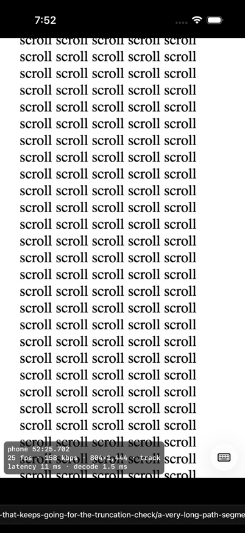
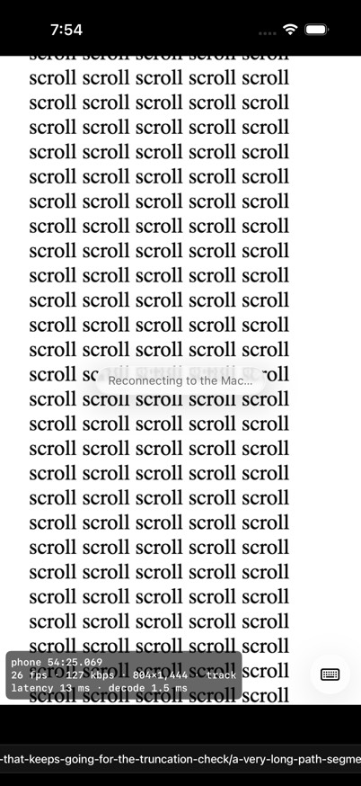
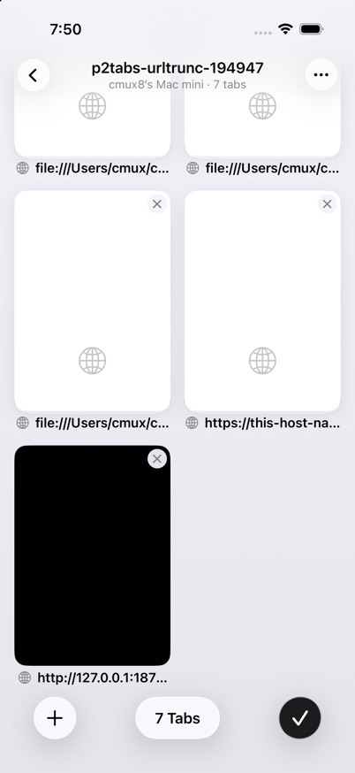
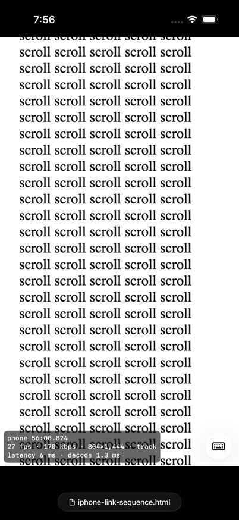
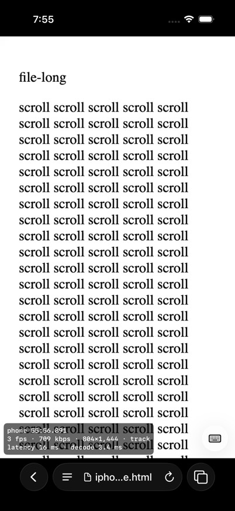
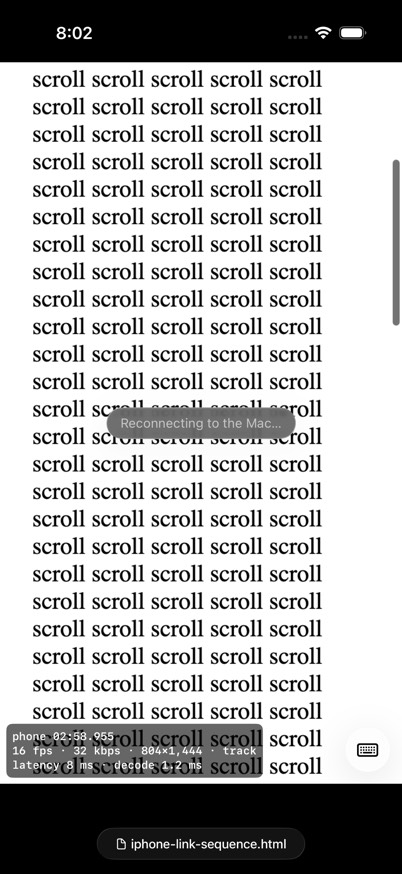
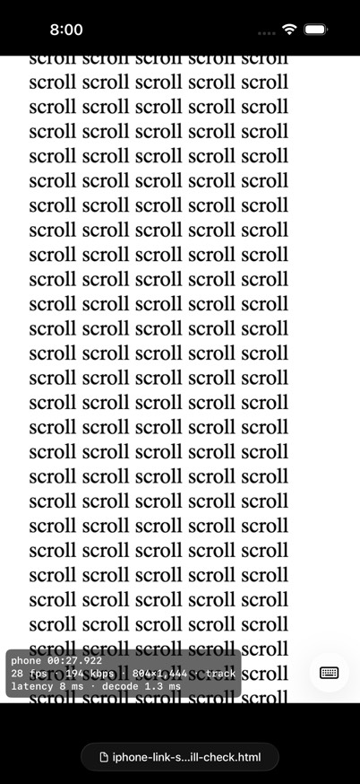
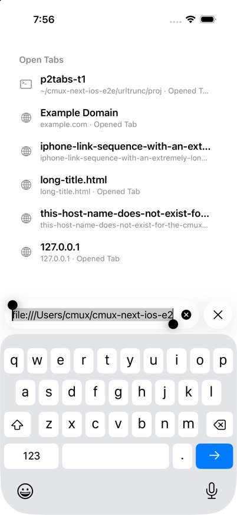
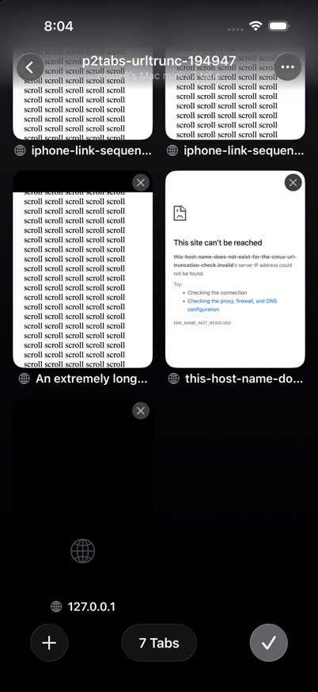
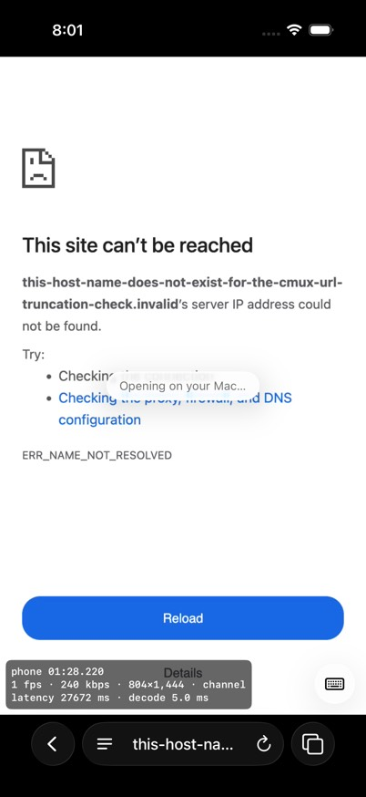

# Long URLs in the browser toolbar

Branch `fix-cmux-next-ios-url-truncation`, PR #24708, 2026-10-23. The user's report: "URL gets overflowed if it's too long. We should truncate it beyond a certain beauty-preserving width." Their screenshot showed a full-width strip with `…har/Development/cmuxterm-hq/worktrees/feat-cnx-ios/cnx-ios/verify/iphone…` running off both edges while the page said "Reconnecting to the Mac…".

## Cause

The strip is not a different view. It is the toolbar's collapsed mini pill (Safari's: a finger drag up on the page collapses the bar). The bug has two parts:

1. **No cap on the collapsed pill.** `ToolbarLayout.make` sized it as `labelWidth × 0.74 + 2 × 19`, and the label was `.fixedSize(horizontal:)` while collapsed, so it never truncated. Any long label made the pill as wide as the text.
2. **The label for a `file:` URL was the whole URL.** The app's label was `url.host() ?? absoluteString`. A `file:` URL has no host, so the label was the full path.

Reconnecting only made it likely. On the dead stream a person drags the page to get it to respond, and that drag collapses the bar. The expanded capsule was already capped (it showed `file:///Users/c…`).

## Fix

- CmuxTabsKit: the collapsed pill hugs its label, but never wider than the space between the side controls (`screen − 2 × (34 + back + 8)`, 222 pt on a 402 pt phone, 142 pt with back | forward). The label is drawn at a capped width and truncates inside it.
- `TabsKitAddress.displayLabel(for:)` gives Safari's label: the host without `www.`, a local file's name, or otherwise the URL, truncated. A file address shows a small document glyph and truncates in the middle, which keeps the extension.
- The app uses it for every browser tab: `WorkspaceTabsSource`, `BrowserTab.host` and `StreamedBrowserModel.displayHost`. A page whose title is just its URL or path gets the short label in the tab grid and in Open Tabs.
- While editing, the field holds the full URL, selected and scrollable. That was already the case, and it is checked below.

## Rig

- **Phone:** the Demo build (`dev.cmux.mobile.urltrunc`) in one headless iPhone 17 Pro simulator, iOS 26.5, named `cmux-urltrunc`, on the laptop. Base is `177632a0c1dc` (origin/feat-cmux-next); the fix is this branch. Both were built on mini-cmux11s with Xcode 26.6. No TapKit was used.
- **Mac:** the hidden tagged cmux-next app `urltrunc-mac` (fleet job `e32963dd4897b6e5d1c03070`, feat-cmux-next `090347693d45`) on mini-cmux8s, launched with `open -g -j -n` and an isolated config by `rmac.py`.
- **Link:** the real link (WireGuard over TURN). No socket or loopback shortcuts.
- **Pages:** the Mac opened 6 browser tabs, which streamed to the phone:
  - an https URL with a 450-character path and query;
  - a `file:` page under a 180-character path ending in `iphone-link-sequence.html`;
  - a `file:` page with a 90-character file name;
  - a page with a 113-character `<title>`;
  - an unresolvable host (the error page);
  - a server that never answers (loading).
- **Reconnecting:** quit the rig app with the bar collapsed, wait for "Reconnecting to the Mac…", read the bar, drag again, read it again, expand, then relaunch.
- **Measurement:** the bar's frames come from the accessibility tree (axe), in points. A 402 pt screen with 16 pt margins means x ≥ 16 and x + width ≤ 386.
- **Driver:** `~/cmux-next-ios-e2e/urltrunc/ut.py`. Raw numbers are in `url-truncation/results.json`.

## Before (base build)

| State | Label | Pill x, width (pt) | Inside 16 pt margins |
| --- | --- | --- | --- |
| Expanded | `file:///Users/c…` (the whole URL, tail-truncated) | 90, 222 | yes |
| Collapsed | the whole `file:` URL | **-484, 1370** | **no** |
| Reconnecting, collapsed | the whole `file:` URL | **-484, 1370** | **no** |

Grid cards for file pages read `file:///Users/cmux/c…`.

  

## After (fix build), light and dark

Every frame measured: 30 bar frames (6 pages, expanded and collapsed, plus reconnecting), light and dark. All are inside the margins. The widest pill is 222 pt at x = 90 (90 pt margins).

| Case | State | Label | Pill x, width | Margins L / R | Inside |
| --- | --- | --- | --- | --- | --- |
| after-error-dark | expanded | this-host-name-does-not-exist-for-the-cmux-url-t | 90, 222 | 90 / 90 | yes |
| after-error-dark | collapsed | this-host-name-does-not-exist-for-the-cmux-url-t | 90, 222 | 90 / 90 | yes |
| after-error-light | expanded | this-host-name-does-not-exist-for-the-cmux-url-t | 90, 222 | 90 / 90 | yes |
| after-error-light | collapsed | this-host-name-does-not-exist-for-the-cmux-url-t | 90, 222 | 90 / 90 | yes |
| after-file-long-dark | expanded | iphone-link-sequence.html | 90, 222 | 90 / 90 | yes |
| after-file-long-dark | collapsed | iphone-link-sequence.html | 96.7, 208.7 | 96.7 / 96.6 | yes |
| after-file-long-light | expanded | iphone-link-sequence.html | 90, 222 | 90 / 90 | yes |
| after-file-long-light | collapsed | iphone-link-sequence.html | 96.7, 208.7 | 96.7 / 96.6 | yes |
| after-file-long-name-dark | expanded | iphone-link-sequence-with-an-extremely-long-file | 90, 222 | 90 / 90 | yes |
| after-file-long-name-dark | collapsed | iphone-link-sequence-with-an-extremely-long-file | 90, 222 | 90 / 90 | yes |
| after-file-long-name-light | expanded | iphone-link-sequence-with-an-extremely-long-file | 90, 222 | 90 / 90 | yes |
| after-file-long-name-light | collapsed | iphone-link-sequence-with-an-extremely-long-file | 90, 222 | 90 / 90 | yes |
| after-file-long-reconnect-dark | expanded | iphone-link-sequence.html | 90, 222 | 90 / 90 | yes |
| after-file-long-reconnect-dark | collapsed | iphone-link-sequence.html | 96.7, 208.7 | 96.7 / 96.6 | yes |
| after-file-long-reconnect-dark | collapsed2 | iphone-link-sequence.html | 96.7, 208.7 | 96.7 / 96.6 | yes |
| after-file-long-reconnect-light | expanded | iphone-link-sequence.html | 90, 222 | 90 / 90 | yes |
| after-file-long-reconnect-light | collapsed | iphone-link-sequence.html | 96.7, 208.7 | 96.7 / 96.6 | yes |
| after-file-long-reconnect-light | collapsed2 | iphone-link-sequence.html | 96.7, 208.7 | 96.7 / 96.6 | yes |
| after-http-long-dark | expanded | example.com | 90, 222 | 90 / 90 | yes |
| after-http-long-dark | collapsed | example.com | 143.7, 114.7 | 143.7 / 143.6 | yes |
| after-http-long-light | expanded | example.com | 90, 222 | 90 / 90 | yes |
| after-http-long-light | collapsed | example.com | 143.7, 114.7 | 143.7 / 143.6 | yes |
| after-loading-dark | expanded | 127.0.0.1 | 90, 222 | 90 / 90 | yes |
| after-loading-dark | collapsed | 127.0.0.1 | 157.7, 86.7 | 157.7 / 157.6 | yes |
| after-loading-light | expanded | 127.0.0.1 | 90, 222 | 90 / 90 | yes |
| after-loading-light | collapsed | 127.0.0.1 | 157.7, 86.7 | 157.7 / 157.6 | yes |
| after-title-long-dark | expanded | long-title.html | 90, 222 | 90 / 90 | yes |
| after-title-long-dark | collapsed | long-title.html | 133.7, 134.7 | 133.7 / 133.6 | yes |
| after-title-long-light | expanded | long-title.html | 90, 222 | 90 / 90 | yes |
| after-title-long-light | collapsed | long-title.html | 133.7, 134.7 | 133.7 / 133.6 | yes |

- The reconnecting overlay appeared 1.7 s (light) and 1.0 s (dark) after the Mac app quit. The pill stayed at 96.7, 208.7 through two drags and the expand.
- Editing: the field (20, 510, 274 × 48) holds the full URL, selected, and scrolls (`after-file-long-light-editing.jpg`).
- Grid: cards read `example.com` / `Example Domain`, `iphone-link-sequence.html`, `iphone-link-sequen…`, `An extremely long…`, `this-host-na…` and `127.0.0.1`, each on one line inside its 177 pt card.
- Not inside the caps: the collapsed title pill near the cap may truncate a few characters early. The collapsed label can show its old width for one frame after an address change.

      

## Tests

- CmuxTabsKit `swift test` on mini-cmux8s (Xcode 26.6): 59 tests in 12 suites passed, including the new `AddressLabelTests` (label rules; the pill cap at 402 pt; a 2000 pt label stays at 222 pt with ≥ 16 pt margins; back | forward; a tiny screen).
- CmuxMobileKit in the iOS simulator on mini-cmux11s (`verify/termqa/cmux_mobile_kit-test-ios.sh`):
  - `CmuxMobileWorkspacesTests`: 103 tests passed, including the new `BrowserAddressLabelTests`.
  - `BrowserDisplayHostTests` passed.
  - One run had `closingATabWithARunningProgramAsks` fail on the Mac answer's timing (5.4 s, under load 118). That test is unchanged by this PR, and it passed on the run before and the run after.
- Red first: the tests were committed in `785a8eea13f1` before the fix. They do not build against the base sources, which lack `CollapsedPill` and `displayLabel(for:)`.
