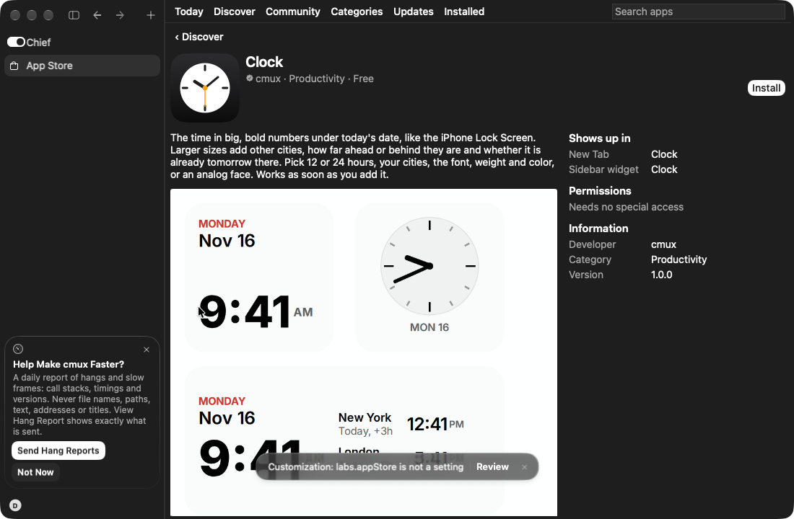
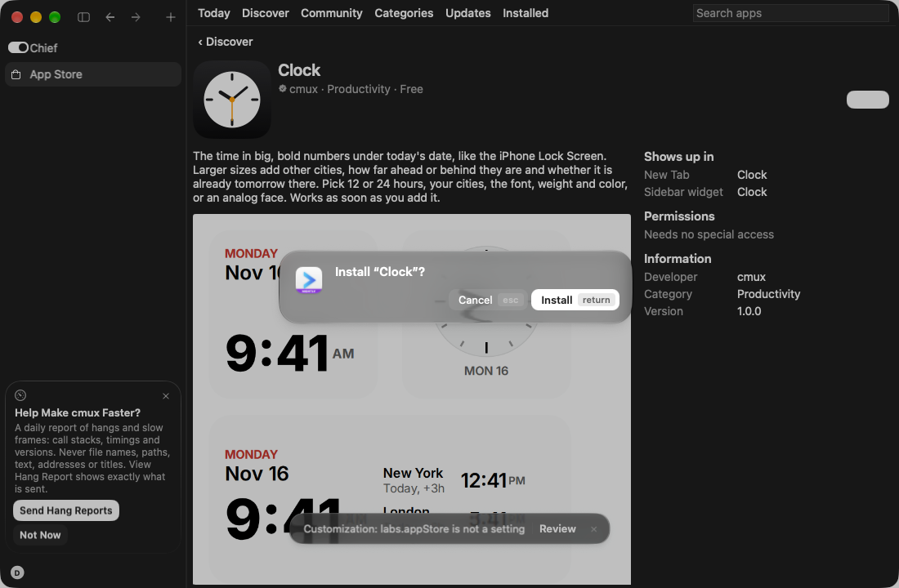
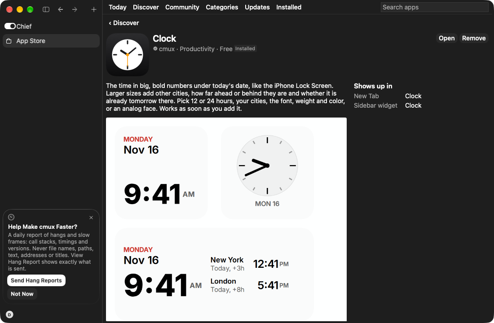
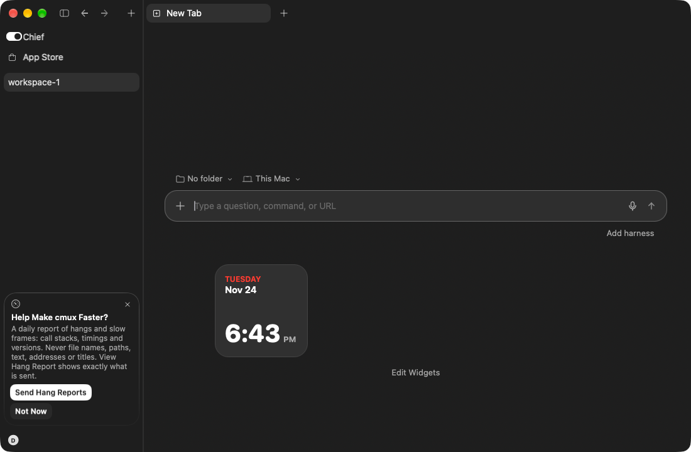

# The native App Store install, clicked through

This is a receipt that an app installs from the native App Store by clicks alone. It was recorded in the published
cmux NEXT nightly 4551439305901 (commit `86f5bbbb0cf2`), with a fresh home on a fleet display worker
(fleet step `fd590e671137b9c6ba53ad79`), using the store's native surface (tunable
`apps.store.surface=native`). Every click is a real pointer event on the element's accessibility id. No install
RPC is involved.

Steps file: cmuxterm-hq `build-fleet/pr_capture/states/nightly/appstore-native-install-click.json`.

To reproduce it from a cmuxterm-hq checkout:

```
python3 build-fleet/fresh-home --nightly latest --cmux <cmux checkout> \
  --steps build-fleet/pr_capture/states/nightly/appstore-native-install-click.json
```

## What happened

| Step | Element | Result | Screenshot |
| --- | --- | --- | --- |
| Open the Clock listing (`appStore.show {"app":"cmux/clock"}`) | `cmux.appStore.install.cmux/clock` shows | ok |  |
| Click Install | `cmux.appStore.install.cmux/clock` | ok: the consent card "Install "Clock"?" opens |  |
| Click the card's Install | `cmux.dialog.button.confirm` | ok: the listing shows an Installed badge, Open and Remove |  |
| Click Open | `cmux.appStore.open.cmux/clock` | ok: a New Tab opens with the Clock widget, showing the worker's live date and time |  |

The app stayed up through all 23 steps, and no crash report was written.

## What this run caught

- **Install crashed the app on the nightly before this one.** Nightly 4533834483401 (`a3a24c86ac8c`) died with
  SIGTRAP within a second of the Install click, in every run, with or without hover steps. The crash report,
  which fresh-home now keeps (cmuxterm-hq#24500), puts the trap in ClickTrace's mouse-down monitor. That is the
  `Int(Double)` conversion of a click point that is not a number, which #53589 fixed. This run is the first
  nightly with the fix, and Install works.
- **The steps file asked for things the listing does not have.** It expected an
  `cmux.appStore.installed.<app>` id (only the Installed tab's rows set it) and called `apps.installed.list` on
  the release socket (a daemon store op that the socket answers `method_not_found`). It also set
  `labs.appStore`, which is no longer a setting, and every shot shows its "not a setting" toast.
  cmuxterm-hq#25201 now reads "installed" from the listing's Remove and Open, and drops that setting.
