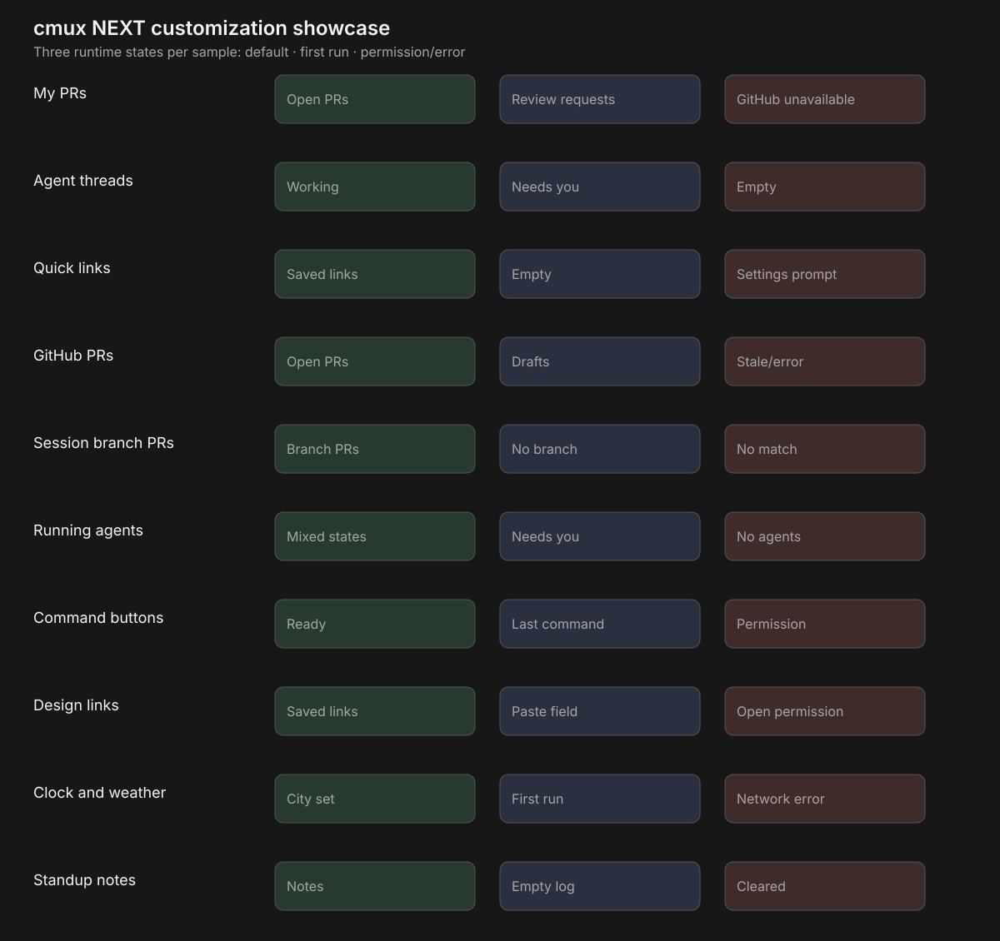

# Customization showcase gallery

These are the capture states for the ten samples in the showcase catalog. They are intentionally
short: each sample is checked in its useful state, its empty/first-run state, and its failure or
permission state. Use `cmux ext shot --json` for the PNG and scene outline when dogfooding.

| Sample | Default | Empty / first run | Error / permission |
| --- | --- | --- | --- |
| My PRs | Open PRs, review badge, ordered rows | No PRs | GitHub unavailable or login field |
| Agent threads | Working and needs-you groups | No active chats | Agent read scope prompt |
| Quick links | Three saved links | “No links yet” | Settings edit prompt |
| GitHub PRs | Open and draft PR rows | Nothing open | Stale list with retry row |
| Session branch PRs | PRs for the current branch | Chat has no branch | No matching PRs |
| Running agents | Mixed working, waiting, and done | No agents running | Terminal focus refusal |
| Command buttons | Three action buttons | No command has run | Run-actions scope toast |
| Design links | Saved Figma and Linear rows | Paste-link field | Open-actions scope toast |
| Clock and weather | Clock, date, city, temperature | City field | Network error text |
| Standup notes | A short note list | Empty log | Cleared confirmation |

The gallery is evidence for the runtime states; the source files remain the copy-paste artifacts.
