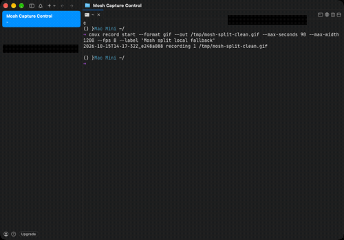
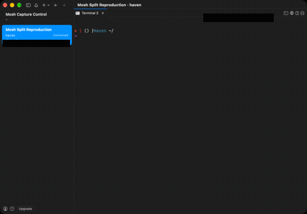
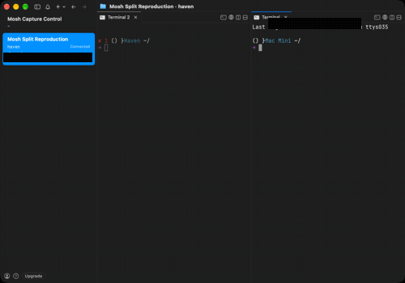

# Mosh split local-fallback evidence

This fork documents and fixes one concrete behavior:

```text
cmux mosh <host>
  -> user invokes Cmd+D or the Split command
  -> cmux creates a local shell instead of preserving remote Mosh context
```

This is not a crash. It is a silent local fallback: the Mosh workspace remains
on the left, while the new pane identifies the local Mac.

## Live reproduction

Captured on 2026-10-15 from a freshly created `cmux mosh haven` workspace,
then the visible **Split Right** control. The GIF and both stills come from the
same continuous recording; account and connection-specific details have been
redacted, while the `haven` and `Mac Mini` host labels remain visible.
The GIF begins with the actual `cmux mosh haven` invocation before showing the
resulting workspace and split.



### Before split



The selected `Mosh Split Reproduction` workspace has one terminal on `haven`.

### After Split Right



The left pane remains the `haven` Mosh terminal. The new right pane identifies
itself as `Mac Mini`, demonstrating that the split created a local shell rather
than another Mosh-backed terminal.

## Scope

This fork prevents the misleading local fallback. It does not claim to create a
second Mosh connection; the behavior of future remote splits is a separate
product decision.
