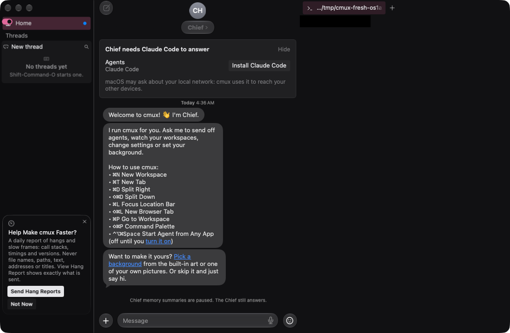

# The customization demo, recorded

Each look below was recorded in the published cmux NEXT nightly (1.0.0-nightly.4489317235601) on a
fresh home, on a fleet capture Mac, from the profile files at commit `b663e121155`. A clip is the window while the look is
applied and a fresh New Tab opens; the screenshot is its last frame.

In these captures the theme and sidebar of each look apply, but none of the three looks shows its own
New Tab page: the published nightly answers `newTab.default` late or with its default page. The
remaining looks (`hosts`, the last demo, glass, widgets) are not recorded yet.

| Look | Clip | Screenshot | Reproduce on your Mac | Fleet step | What it shows |
| --- | --- | --- | --- | --- | --- |
| Claude | [clip](https://raw.githubusercontent.com/manaflow-ai/cmux/pr-media/48899/looks-claude.mp4) |  | `examples/customize-demo/demo.sh --nightly --only looks/claude.json` | `0e83bf676c81683e8a48e32d` (8 frames) | Dark warm theme, clay toggle and selection, a **Claude** usage section at the foot of the sidebar. It took about four minutes after `customize use` to repaint; the first two frames are still the default light window. The New Tab action timed out (`action.run` past its 2 s deadline) and the new tab was a blank terminal, so Claude's own home page is not in this capture. |
| Codex | [clip](https://raw.githubusercontent.com/manaflow-ai/cmux/pr-media/48899/looks-codex.mp4) |  | `examples/customize-demo/demo.sh --nightly --only looks/codex.json` | `cf91a77e2cadfa2136230510` (3 frames) | White page, light gray sidebar, a **Threads** rail with New thread and search. The New Tab action ran, but the page shown is the default Chief home, not a Codex page. |
| Studio | [clip](https://raw.githubusercontent.com/manaflow-ai/cmux/pr-media/48899/looks-studio.mp4) |  | `examples/customize-demo/demo.sh --nightly --only looks/studio.json` | `edf42c7da7fd70292a47ac69` (3 frames) | Dark window, magenta accent on the toggle and the selected Home row, the same **Threads** rail. The New Tab action timed out, so the start page with one button per agent is not in this capture; the default Chief home shows instead. |

To show one look in your installed NIGHTLY, run its command, look, then press Enter: the script puts
your own setup back. Run the next look only after that reset completes.

To record them again:

```sh
python3 examples/customize-demo/record-steps.py --ref "$(git rev-parse HEAD)" --frames 3 --hold 12 \
  --output-dir /tmp/demo-states
cmux-ci capture --nightly latest --state /tmp/demo-states/looks-claude.json
```

`record-steps.py` writes one state per look, under the runner's 60-step limit; run each state once
and keep its receipt. Each still takes about two minutes on the capture Mac, so keep `--frames` small.
`ffmpeg -f concat` joins a state's `shots/` into the clip. `--video` needs a whole capture Mac,
which a lane VM can't lease.
