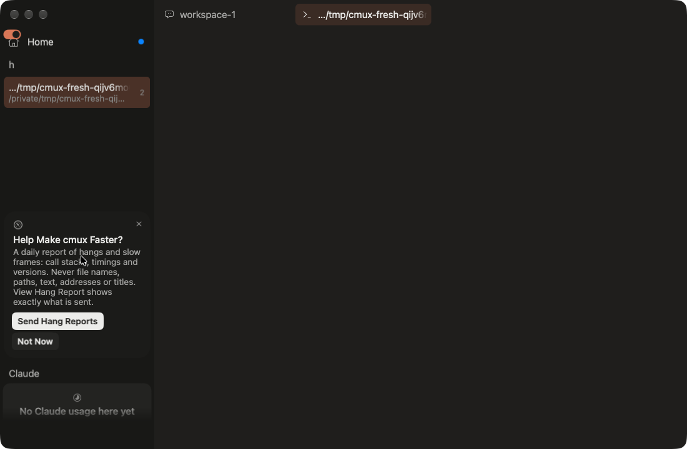
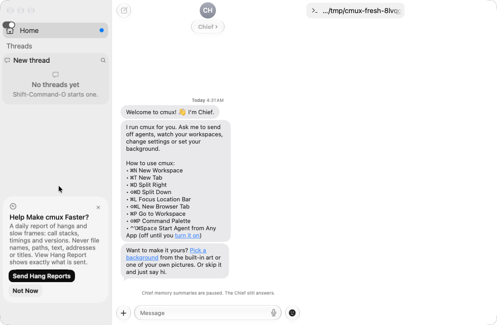

# The customization demo, recorded

Leo asked for one clip per look. Each clip below was recorded in the published cmux NEXT nightly
(1.0.0-nightly.4500914846101, commit `8815f4c8e527`) on a fresh home on a fleet display worker, from the
profile files at `6f41f2bd26e` (#50138, which adds the gallery, showcase and starter looks to the demo).
A clip is the window before the look, then three frames 4 s apart after `customize use` and a New Tab;
the screenshot is its last frame. The window is the whole frame: the capture shoots only the cmux window.

Only three looks are recorded so far. From 10:15Z to 12:45Z on 2026-11-22 the controller refused every
nightly capture with `invalid ci-step: source depot disk reserve unavailable`: the capture depot on the
controller is full (41 GiB free against a 40 GiB reserve plus one bundle) and its retention runs after that
check. The rest wait on the depot fix (hq handbook `cleaner-starved-on-a-full-disk.md`).

## Recorded

| Look | Clip | Screenshot | Reproduce on your Mac | Fleet step | What it shows |
| --- | --- | --- | --- | --- | --- |
| gallery/claude-code-sidebar.json | [clip](https://raw.githubusercontent.com/manaflow-ai/cmux/pr-media/PRNUM/gallery-claude-code-sidebar.mp4) |  | `examples/customize-demo/demo.sh --nightly --only gallery/claude-code-sidebar.json` | `35b3230420febc3d3233c185` (17/17 steps ok) | The sidebar widens to 284 pt; the profile applied (`customize use` ok, the New Tab action ok). A fresh home has no sessions or project folders, so the folder groups and nested sessions this pack sets up have nothing to show: the sidebar holds only Chief. The New Tab page is the default one (this pack sets no page). |
| gallery/codex-sidebar.json | [clip](https://raw.githubusercontent.com/manaflow-ai/cmux/pr-media/PRNUM/gallery-codex-sidebar.mp4) |  | `examples/customize-demo/demo.sh --nightly --only gallery/codex-sidebar.json` | `6889f9be1b028f989267d9fa` (16/17 steps ok) | **Not applied.** `customize use` refused the profile: `customize/cmux-app.json:16:44: /implements/cmux.section~11/options/maxRows: 60 is greater than the maximum of 50`. The dark window is the preview that stays live; the Codex threads sidebar never appears. Bug in the profile at `6f41f2bd26e` (#50138), not in the capture. |
| gallery/material.json | [clip](https://raw.githubusercontent.com/manaflow-ai/cmux/pr-media/PRNUM/gallery-material.mp4) |  | `examples/customize-demo/demo.sh --nightly --only gallery/material.json` | `327c07194e7786d2defa78f1` (15/17 steps ok, verdict fail) | **Not shown.** The lavender Material tint reached the sidebar, but the app's background service did not start ("cmux couldn't start its background service") and both New Tab actions were refused (`newTab.page unavailable: Click a tab first`), so no gooey tabs or page. Home did not render within 90 s. Run again once the depot is back. |

## Not recorded yet

Each row is blocked on the depot fix. Generate the states, then run the row's command once and keep its
receipt (`CMUX_AGENT_ID` names the lease owner):

```sh
python3 examples/customize-demo/record-steps.py --ref 6f41f2bd26e136a17ff0bb0436b112fdf682acae \
  --frames 3 --hold 12 --output-dir /tmp/demo-states-6f41f2bd26e1
```

`looks/hosts.json` waits on #47972 as well; record it from that PR's merged head.

| Look | Capture command |
| --- | --- |
| looks/claude.json | `cmux-ci capture --nightly latest --state /tmp/demo-states-6f41f2bd26e1/looks-claude.json` |
| looks/codex.json | `cmux-ci capture --nightly latest --state /tmp/demo-states-6f41f2bd26e1/looks-codex.json` |
| looks/studio.json | `cmux-ci capture --nightly latest --state /tmp/demo-states-6f41f2bd26e1/looks-studio.json` |
| looks/hosts.json | `cmux-ci capture --nightly latest --state /tmp/demo-states-6f41f2bd26e1/looks-hosts.json` |
| gallery/claude-code-session-recents.json | `cmux-ci capture --nightly latest --state /tmp/demo-states-6f41f2bd26e1/gallery-claude-code-session-recents.json` |
| gallery/rex-whole.json | `cmux-ci capture --nightly latest --state /tmp/demo-states-6f41f2bd26e1/gallery-rex-whole.json` |
| gallery/shadcn.json | `cmux-ci capture --nightly latest --state /tmp/demo-states-6f41f2bd26e1/gallery-shadcn.json` |
| gallery/apple.json | `cmux-ci capture --nightly latest --state /tmp/demo-states-6f41f2bd26e1/gallery-apple.json` |
| gallery/hairline.json | `cmux-ci capture --nightly latest --state /tmp/demo-states-6f41f2bd26e1/gallery-hairline.json` |
| last-demo/cockpit.json | `cmux-ci capture --nightly latest --state /tmp/demo-states-6f41f2bd26e1/last-demo-cockpit.json` |
| last-demo/collection.json | `cmux-ci capture --nightly latest --state /tmp/demo-states-6f41f2bd26e1/last-demo-collection.json` |
| last-demo/focus.json | `cmux-ci capture --nightly latest --state /tmp/demo-states-6f41f2bd26e1/last-demo-focus.json` |
| last-demo/tiling.json | `cmux-ci capture --nightly latest --state /tmp/demo-states-6f41f2bd26e1/last-demo-tiling.json` |
| glass/chrome.json | `cmux-ci capture --nightly latest --state /tmp/demo-states-6f41f2bd26e1/glass-chrome.json` |
| glass/liquid.json | `cmux-ci capture --nightly latest --state /tmp/demo-states-6f41f2bd26e1/glass-liquid.json` |
| glass/mica.json | `cmux-ci capture --nightly latest --state /tmp/demo-states-6f41f2bd26e1/glass-mica.json` |
| glass/tinted.json | `cmux-ci capture --nightly latest --state /tmp/demo-states-6f41f2bd26e1/glass-tinted.json` |
| widgets/widgets.json | `cmux-ci capture --nightly latest --state /tmp/demo-states-6f41f2bd26e1/widgets-widgets.json` |
| gallery/basalt.json | `cmux-ci capture --nightly latest --state /tmp/demo-states-6f41f2bd26e1/gallery-basalt.json` |
| gallery/claude-code-agents.json | `cmux-ci capture --nightly latest --state /tmp/demo-states-6f41f2bd26e1/gallery-claude-code-agents.json` |
| gallery/claude-code-cli.json | `cmux-ci capture --nightly latest --state /tmp/demo-states-6f41f2bd26e1/gallery-claude-code-cli.json` |
| gallery/claude-code-cloud.json | `cmux-ci capture --nightly latest --state /tmp/demo-states-6f41f2bd26e1/gallery-claude-code-cloud.json` |
| gallery/claude-code-composer-controls.json | `cmux-ci capture --nightly latest --state /tmp/demo-states-6f41f2bd26e1/gallery-claude-code-composer-controls.json` |
| gallery/claude-code-composer.json | `cmux-ci capture --nightly latest --state /tmp/demo-states-6f41f2bd26e1/gallery-claude-code-composer.json` |
| gallery/claude-code-export.json | `cmux-ci capture --nightly latest --state /tmp/demo-states-6f41f2bd26e1/gallery-claude-code-export.json` |
| gallery/claude-code-inactive-archive.json | `cmux-ci capture --nightly latest --state /tmp/demo-states-6f41f2bd26e1/gallery-claude-code-inactive-archive.json` |
| gallery/claude-code-modes.json | `cmux-ci capture --nightly latest --state /tmp/demo-states-6f41f2bd26e1/gallery-claude-code-modes.json` |
| gallery/claude-code-notification-levels.json | `cmux-ci capture --nightly latest --state /tmp/demo-states-6f41f2bd26e1/gallery-claude-code-notification-levels.json` |
| gallery/claude-code-open-in-editor.json | `cmux-ci capture --nightly latest --state /tmp/demo-states-6f41f2bd26e1/gallery-claude-code-open-in-editor.json` |
| gallery/claude-code-project-picker.json | `cmux-ci capture --nightly latest --state /tmp/demo-states-6f41f2bd26e1/gallery-claude-code-project-picker.json` |
| gallery/claude-code-session-worktree.json | `cmux-ci capture --nightly latest --state /tmp/demo-states-6f41f2bd26e1/gallery-claude-code-session-worktree.json` |
| gallery/claude-code-side-question.json | `cmux-ci capture --nightly latest --state /tmp/demo-states-6f41f2bd26e1/gallery-claude-code-side-question.json` |
| gallery/claude-code-transcript-width.json | `cmux-ci capture --nightly latest --state /tmp/demo-states-6f41f2bd26e1/gallery-claude-code-transcript-width.json` |
| gallery/claude-code-transcript.json | `cmux-ci capture --nightly latest --state /tmp/demo-states-6f41f2bd26e1/gallery-claude-code-transcript.json` |
| gallery/claude-code-whole.json | `cmux-ci capture --nightly latest --state /tmp/demo-states-6f41f2bd26e1/gallery-claude-code-whole.json` |
| gallery/codex-threads.json | `cmux-ci capture --nightly latest --state /tmp/demo-states-6f41f2bd26e1/gallery-codex-threads.json` |
| gallery/docket.json | `cmux-ci capture --nightly latest --state /tmp/demo-states-6f41f2bd26e1/gallery-docket.json` |
| gallery/ember.json | `cmux-ci capture --nightly latest --state /tmp/demo-states-6f41f2bd26e1/gallery-ember.json` |
| gallery/folio.json | `cmux-ci capture --nightly latest --state /tmp/demo-states-6f41f2bd26e1/gallery-folio.json` |
| gallery/hush.json | `cmux-ci capture --nightly latest --state /tmp/demo-states-6f41f2bd26e1/gallery-hush.json` |
| gallery/kerf.json | `cmux-ci capture --nightly latest --state /tmp/demo-states-6f41f2bd26e1/gallery-kerf.json` |
| gallery/linen.json | `cmux-ci capture --nightly latest --state /tmp/demo-states-6f41f2bd26e1/gallery-linen.json` |
| gallery/prism.json | `cmux-ci capture --nightly latest --state /tmp/demo-states-6f41f2bd26e1/gallery-prism.json` |
| gallery/rex-activity.json | `cmux-ci capture --nightly latest --state /tmp/demo-states-6f41f2bd26e1/gallery-rex-activity.json` |
| gallery/rex-appearance.json | `cmux-ci capture --nightly latest --state /tmp/demo-states-6f41f2bd26e1/gallery-rex-appearance.json` |
| gallery/rex-hosts.json | `cmux-ci capture --nightly latest --state /tmp/demo-states-6f41f2bd26e1/gallery-rex-hosts.json` |
| gallery/rex-new-tab.json | `cmux-ci capture --nightly latest --state /tmp/demo-states-6f41f2bd26e1/gallery-rex-new-tab.json` |
| gallery/rex-palette.json | `cmux-ci capture --nightly latest --state /tmp/demo-states-6f41f2bd26e1/gallery-rex-palette.json` |
| gallery/rex-pane-operations.json | `cmux-ci capture --nightly latest --state /tmp/demo-states-6f41f2bd26e1/gallery-rex-pane-operations.json` |
| gallery/rex-panes.json | `cmux-ci capture --nightly latest --state /tmp/demo-states-6f41f2bd26e1/gallery-rex-panes.json` |
| gallery/rex-preferences.json | `cmux-ci capture --nightly latest --state /tmp/demo-states-6f41f2bd26e1/gallery-rex-preferences.json` |
| gallery/rex-session-operations.json | `cmux-ci capture --nightly latest --state /tmp/demo-states-6f41f2bd26e1/gallery-rex-session-operations.json` |
| gallery/rex-session-picker.json | `cmux-ci capture --nightly latest --state /tmp/demo-states-6f41f2bd26e1/gallery-rex-session-picker.json` |
| gallery/rex-tabs.json | `cmux-ci capture --nightly latest --state /tmp/demo-states-6f41f2bd26e1/gallery-rex-tabs.json` |
| gallery/rex-terminal.json | `cmux-ci capture --nightly latest --state /tmp/demo-states-6f41f2bd26e1/gallery-rex-terminal.json` |
| gallery/rex-toolbar.json | `cmux-ci capture --nightly latest --state /tmp/demo-states-6f41f2bd26e1/gallery-rex-toolbar.json` |
| gallery/starter-actions-and-keys.json | `cmux-ci capture --nightly latest --state /tmp/demo-states-6f41f2bd26e1/gallery-starter-actions-and-keys.json` |
| gallery/starter-chat-style.json | `cmux-ci capture --nightly latest --state /tmp/demo-states-6f41f2bd26e1/gallery-starter-chat-style.json` |
| gallery/starter-sidebar-view.json | `cmux-ci capture --nightly latest --state /tmp/demo-states-6f41f2bd26e1/gallery-starter-sidebar-view.json` |
| gallery/starter-theme-file.json | `cmux-ci capture --nightly latest --state /tmp/demo-states-6f41f2bd26e1/gallery-starter-theme-file.json` |
| gallery/starter-thinking-dots.json | `cmux-ci capture --nightly latest --state /tmp/demo-states-6f41f2bd26e1/gallery-starter-thinking-dots.json` |
| gallery/tachyon.json | `cmux-ci capture --nightly latest --state /tmp/demo-states-6f41f2bd26e1/gallery-tachyon.json` |
| gallery/tandem.json | `cmux-ci capture --nightly latest --state /tmp/demo-states-6f41f2bd26e1/gallery-tandem.json` |
| showcase/cockpit.json | `cmux-ci capture --nightly latest --state /tmp/demo-states-6f41f2bd26e1/showcase-cockpit.json` |
| showcase/collection.json | `cmux-ci capture --nightly latest --state /tmp/demo-states-6f41f2bd26e1/showcase-collection.json` |
| showcase/focus.json | `cmux-ci capture --nightly latest --state /tmp/demo-states-6f41f2bd26e1/showcase-focus.json` |
| showcase/ide.json | `cmux-ci capture --nightly latest --state /tmp/demo-states-6f41f2bd26e1/showcase-ide.json` |
| showcase/leo-daylight.json | `cmux-ci capture --nightly latest --state /tmp/demo-states-6f41f2bd26e1/showcase-leo-daylight.json` |
| showcase/leo-dusk.json | `cmux-ci capture --nightly latest --state /tmp/demo-states-6f41f2bd26e1/showcase-leo-dusk.json` |
| showcase/leo-neon.json | `cmux-ci capture --nightly latest --state /tmp/demo-states-6f41f2bd26e1/showcase-leo-neon.json` |
| showcase/right-handed.json | `cmux-ci capture --nightly latest --state /tmp/demo-states-6f41f2bd26e1/showcase-right-handed.json` |
| showcase/tiling.json | `cmux-ci capture --nightly latest --state /tmp/demo-states-6f41f2bd26e1/showcase-tiling.json` |

## Earlier recording (1.0.0-nightly.4489317235601, profiles at `b663e121155`)

In these the theme and sidebar of each look apply, but none of the three shows its own New Tab page: that
nightly answered `newTab.default` late or with its default page.

| Look | Clip | Screenshot | Reproduce on your Mac | Fleet step | What it shows |
| --- | --- | --- | --- | --- | --- |
| Claude | [clip](https://raw.githubusercontent.com/manaflow-ai/cmux/pr-media/48899/looks-claude.mp4) |  | `examples/customize-demo/demo.sh --nightly --only looks/claude.json` | `0e83bf676c81683e8a48e32d` (8 frames) | Dark warm theme, clay toggle and selection, a **Claude** usage section at the foot of the sidebar. It took about four minutes after `customize use` to repaint; the first two frames are still the default light window. The New Tab action timed out (`action.run` past its 2 s deadline) and the new tab was a blank terminal, so Claude's own home page is not in this capture. |
| Codex | [clip](https://raw.githubusercontent.com/manaflow-ai/cmux/pr-media/48899/looks-codex.mp4) |  | `examples/customize-demo/demo.sh --nightly --only looks/codex.json` | `cf91a77e2cadfa2136230510` (3 frames) | White page, light gray sidebar, a **Threads** rail with New thread and search. The New Tab action ran, but the page shown is the default Chief home, not a Codex page. |
| Studio | [clip](https://raw.githubusercontent.com/manaflow-ai/cmux/pr-media/48899/looks-studio.mp4) |  | `examples/customize-demo/demo.sh --nightly --only looks/studio.json` | `edf42c7da7fd70292a47ac69` (3 frames) | Dark window, magenta accent on the toggle and the selected Home row, the same **Threads** rail. The New Tab action timed out, so the start page with one button per agent is not in this capture; the default Chief home shows instead. |

To show one look in your installed NIGHTLY, run its command, look, then press Enter: the script puts
your own setup back. Run the next look only after that reset completes.

`record-steps.py` writes one state per look, under the runner's 60-step limit; run each state once
and keep its receipt. Each takes about two minutes on the capture Mac once a worker takes it, so keep
`--frames` small. `ffmpeg -f concat` joins a state's `shots/` into the clip. `--video` needs a whole
capture Mac with CuaDriver (`--on fleet`), which a lane VM can't lease; `cmux-ci capture --nightly` does
not take `--video`.
