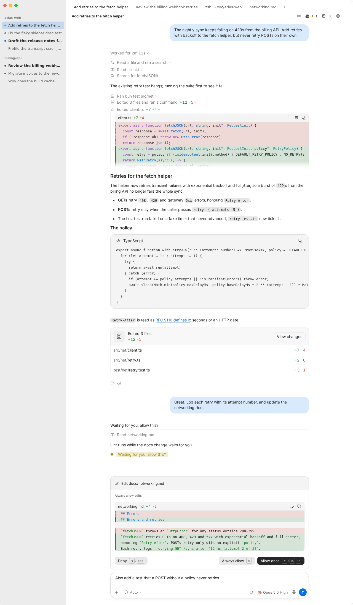
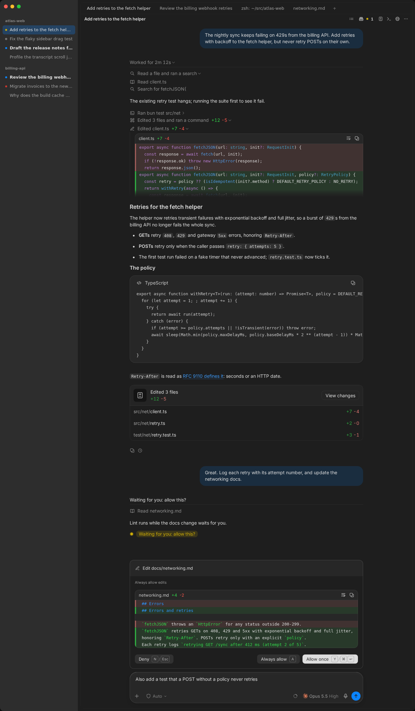

# Apple





cmux as a first-party macOS 26 (Tahoe) app, the way Notes, Mail and Xcode's navigator look: a
translucent source-list sidebar over the desktop beside an opaque content card, SF Pro at the
system's 13 pt in the chrome and 14 pt in the chat, SF Mono for code, systemBlue for selection,
focus, Send and links, labels in Apple's label colors, the grouped background behind Settings and
pages, a Messages-style prompt bubble, the system spinner for work in progress and spring motion
at the standard speed. It ships Light (the default, as on a new Mac) and Dark.

It is built only from public surfaces, so you can copy any part of it:

| File | What it does |
| --- | --- |
| `cmux-setup.json` | Picks the theme file; sets the chat in the system font (SF Pro) at 14 px with a 1.45 line height, code at 0.9 (SF Mono, the chat's default `ui-monospace`), a 720 px column, no minimap; the sidebar as a source list: sections by folder under plain headings, one-line rows with their icon, detailed status symbols, a count on a collapsed section; Safari's capsule address field |
| `themes/apple.json` | Default, Light. Content `#FFFFFF` (textBackgroundColor), text `#262626` (labelColor, black at 85%), systemBlue `#007AFF`, selection `#B3D7FF`, the sidebar `#ECECEC` at 80% over behind-window glass, the grouped background `#F2F2F7` for Settings, New Tab, Home and pages, the Apple System Colors Light terminal theme |
| `themes/apple-dark.json` | Dark. Content `#1E1E1E`, text `#DDDDDD` (white at 85%), systemBlue `#0A84FF`, selection `#3F638B`, the sidebar `#2D2D2D` at 80%, grouped `#1C1C1E`, code and diffs on Xcode's Default (Dark) `#1F1F24`, the Apple System Colors terminal theme |
| `agent-pane/theme.css` | The 18 px accent-tinted prompt bubble with no edge, cards on the quaternary fill with a separator hairline, secondary text, links in linkColor (systemBlue a step toward the label), and macOS menus (pending, below): `cmux.agentPane.style/1` tokens only, every color mixed from the theme's own |
| `customize/` | A hover card laid out like a macOS popover (bold title and age, then gray secondary lines) and source-list rows in regular weight with the native spinner |
| `markdown/theme.css` | The Markdown viewer's paint: bold headings with no rule, code on the quaternary fill with 8 px corners, quotes on a gray bar. Only `--cmux-md-*` properties on `:root`, every color mixed from the page's own |

The rest of cmux wears the look too. The terminal is SF Mono at 12 pt (the face and size the system's own terminal opens in) with the base terminal theme's system palette; the Markdown viewer opens in the system face at 15 px with the chat's line height and code scale in a 94-character column, and `markdown/theme.css` paints it; diffs use theme colors with change bars; sidebar group colors are glass tints.

Both theme files set the same proportions, from Tahoe's own: a 52 pt unified toolbar, a 240 pt
sidebar with 28 pt rows, 13 pt chrome text, Safari's 12 pt tab titles in a 30 pt strip with tabs
that share it evenly, a 1 pt split divider and an 8 pt gutter around the content card
(`appearance.chromeStyle: "card"`), the focused pane ringed in the accent, and SwiftUI's default
animation (a critically damped 0.55 s spring) for color changes.

```sh
cmux setup install github.com/manaflow-ai/cmux-apple-look
cmux settings set appearance.themeFile apple-dark    # apple (Light) is the default
cmux setup remove manaflow-ai/apple-look
```

While it is installed, its `customize/` view stands in for your own sidebar view, if you have one;
`cmux setup remove` puts yours back.

## Contrast

Every pair is checked to WCAG AA, resolved opaque (body text 4.5:1, UI 3:1), in both theme files:
the text on every surface the look sets (the sidebar over a black, white and mid-gray desktop
too), the secondary and dim text over the page and over a card, links on the page and inside the
bubble, the bubble's text, the selection, and the menu rows. Apple's own secondaryLabel (50%) and
tertiaryLabel (26%) fall under 4.5:1 on white, so the chat's secondary text is the darkest step
of them that passes (74% and 66% of the label).

## With a newer cmux

The setup carries only settings every current cmux NEXT build has, because `cmux setup install`
refuses a key the running build does not know. These are in review; each sits in the files as a
comment naming its pull request:

| Part | Where | Needs |
| --- | --- | --- |
| Safari and Finder's rounded capsule tabs | `"appearance.tabShape": "rounded"` in the theme files | cmux #46780 |
| A source list's accent-tinted selected row, with Send and links blue | `"appearance.selection"` in the theme files | cmux #46516 |
| macOS 26 menus and popovers: 10 px corners, 5 px inset, 22 pt rows, an inset 6 px highlight, gray shortcuts at the right, bold gray section headers, 10 px separator inset | the `--menu-*` tokens in `agent-pane/theme.css`, set now and inert until then | cmux #46846 |
| The real iMessage bubble: solid systemBlue with white text | `--cv-user-bubble-text` with an accent tint, in `agent-pane/theme.css`'s comment | cmux #46490 |

## Not yet possible

| Part | Why |
| --- | --- |
| A Messages-style composer: a capsule field with the send button inside it | `agentPane.composerLook` (#46738) offers auto, codex and claude only |
| Apple's source-list row and header shapes as one preset | `sidebar.look` (#46805) offers cmux, claude, codex and studio only |
| A white label on the accent-blue highlighted menu row, as NSMenu draws it | No menu row ink token in #46846; the highlight is a pale accent capsule under the label instead |
| An SF Symbol on every row by kind (a bubble for a chat, a terminal for a shell) | A row decoration cannot tell a row's kind, and setting `icon` would replace the icon you chose |
| Tahoe's large window corner and Liquid Glass toolbar buttons | The window corner radius and the toolbar's controls are not public surfaces |
| tertiaryLabel's true 26% for the quietest text | It is under 4.5:1 on white and on `#1E1E1E`; the look uses the quietest step that passes |
| A per-scheme stylesheet (`light-dark()`) | The stylesheet is mixed from the theme's colors, so one file covers both |

How looks like this one are written: [look-addons.md](https://github.com/manaflow-ai/cmux/blob/639a429492936ae3b4f0d4a1e6d7fbf66e708520/docs/cmux-next/look-addons.md).
