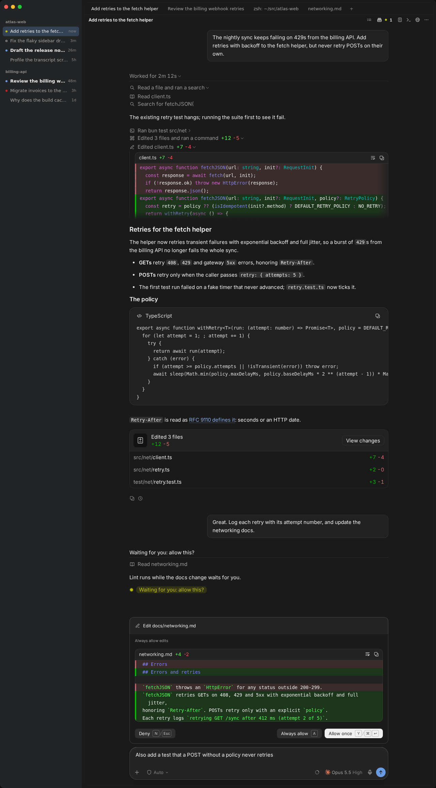
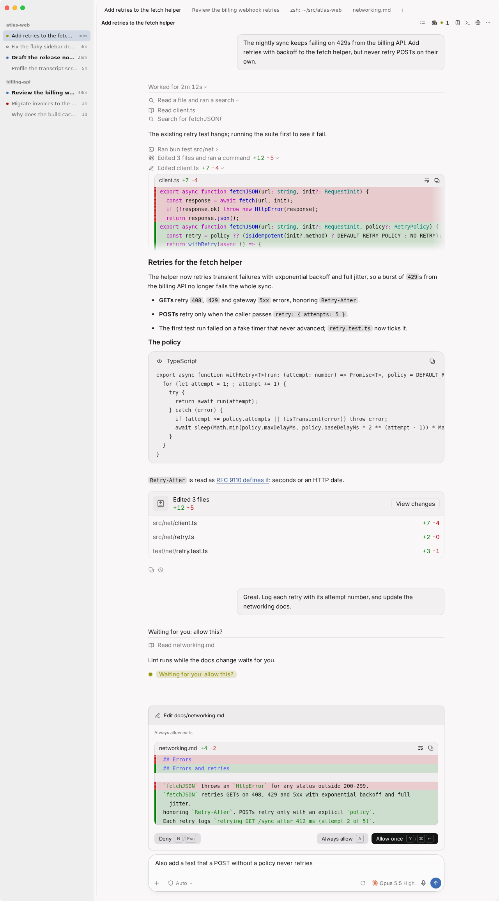

# Basalt





A quiet, near-black agent-editor look. The chat gets nearly all of the window: a #1a1a1a page,
a slightly cooler #232425 sidebar behind a 1 pt line that lists your chats under their
repository, one line each with a small status dot and its age, and pin and archive controls
that appear only on hover. Your prompt sits in a bordered box with 12 px corners; tool calls
and thoughts fold into one gray line you can open ("Explored 5 files"); each turn ends with
the files it changed. One soft steel blue (#699be1) marks Run, Send and focus, with dark ink on
it; links are a paler blue. Menus are opaque, roomy (30 px rows) and gray, never blue. Motion
is fast and spatial. It ships Dark (the default) and Light.

It is built only from public surfaces, so you can copy any part of it:

| File | What it does |
| --- | --- |
| `cmux-setup.json` | Picks the theme file; sets the chat in the system font at 15 px on a 1.6 line, code at 0.9, a 760 px column, no minimap, tool calls folded, the branch and machine pickers under the composer at its left, the session rail pushing the chat aside, the changed files card under each turn (that turn only); the sidebar grouped by folder under plain headings, one line per chat with its age, status as a plain dot, pin and archive on hover, a compact hover card; a 6 px address field |
| `themes/basalt.json` | Default, Dark. Page `#1a1a1a`, text `#f0f0f0`, the sidebar `#232425` behind a 1 pt line, code, diffs and the terminal on `#181818`, accent `#699be1` with dark ink, selection `#2f4766`, diff and status colors (`#80b38d`, `#ea7485`, `#e8b773`) as the terminal palette |
| `themes/basalt-light.json` | Light. Page `#f9f7f8`, text `#141414`, the sidebar `#eeeeee`, code on `#fcfcfc`, accent `#3d6db3` with white on it, selection `#cddcf0`, the same palette taken down until it reads on the light page |
| `agent-pane/theme.css` | The bordered prompt box (a fill 3% off the page, a 10% edge, 12 px corners), cards on the same quiet fill, gray secondary text at 70% and 60%, links in the accent pulled a fifth toward the text, and the editor's menus (pending, below): `cmux.agentPane.style/1` tokens only, every color mixed from the theme's own |
| `customize/` | A hover card laid out like the editor's thread card (the title and age, then the branch and folder lines, each with a gray icon) and rows in regular weight with a plain status dot |
| `markdown/theme.css` | The Markdown viewer's paint: code in the bordered box's 8 px corners on a quiet gray, headings with no rule, quotes on a gray line; nothing blue but links. Only `--cmux-md-*` properties on `:root`, every color mixed from the page's own |

The rest of cmux wears the look too. The terminal is Menlo at 12 pt (the face and size an editor's terminal opens in on a Mac) with a full sixteen-color palette at a quiet chroma, colors 1 to 7 and 9 to 14 held to WCAG AA over its page (8, the dim gray, to 3:1); the Markdown viewer opens in the system face at 15 px with the chat's line height and code scale in a 92-character column, and `markdown/theme.css` paints it; diffs use theme colors with change bars; sidebar group colors come from the theme's palette.

Both theme files set the same proportions, measured at the references' 2x scale: a 40 pt title
bar, a 260 pt sidebar with 30 pt rows, the 13 pt interface size the editor ships with, 13 pt tab
titles in a 40 pt strip with tabs from 120 to 240 pt, a 1 pt divider and no gutter
(`appearance.chromeStyle: "flat-sidebar-line"`), the focused pane shown by its tab, and colors
that ease out in 150 ms at the fast animation speed.

```sh
cmux setup install github.com/manaflow-ai/cmux-basalt-look
cmux settings set appearance.themeFile basalt-light    # basalt (Dark) is the default
cmux setup remove manaflow-ai/basalt-look
```

While it is installed, its `customize/` view stands in for your own sidebar view, if you have one;
`cmux setup remove` puts yours back.

## Contrast

Every pair is checked to WCAG AA, resolved opaque (body text 4.5:1, UI 3:1), in both theme files:
the text on every surface the look sets, the secondary and dim text over the page and over a
card, links on the page and inside the prompt box, the box's text, Send's glyph on the accent,
the terminal colors used for diff counts and status, the selection, and the menu rows. The
light theme's gray steps and yellow are darker than the dark theme's, because the same mixes
fall under 4.5:1 on a near-white page.

## With a newer cmux

The setup carries only settings every current cmux NEXT build has, because `cmux setup install`
refuses a key the running build does not know. These are in review; each sits in the files as a
comment naming its pull request:

| Part | Where | Needs |
| --- | --- | --- |
| Tabs as small rounded pills | `"appearance.tabShape": "rounded"` in the theme files | cmux #46780 |
| The selected sidebar row as a gray fill (`#2f3031`, `#e1e1e1`), not the accent | `"appearance.selection": "neutral"` in the theme files | cmux #46516 |
| The editor's menus: 10 px corners, a 6 px inset, 30 px rows, a gray 6 px highlight, gray regular section labels, gray shortcuts and second lines, 12 px separator inset | the `--menu-*` tokens in `agent-pane/theme.css`, set now and inert until then | cmux #46846 |
| 26 pt toolbar buttons, rows inset 8 pt, a 42 pt composer, no hairline under the title bar | `appearance.metrics.*` lines at the end of each theme file | cmux #46861 |

## Not yet possible

| Part | Why |
| --- | --- |
| A bordered composer with + and the model on its one line | `agentPane.composerLook` (#46738) offers auto, codex and claude only |
| Chats under their repository as one sidebar preset | `sidebar.look` (#46805) offers cmux, claude, codex and studio only; `sidebar.groupBy: "folder"` comes closest |
| Tabs living in the title bar itself, with no strip under it | The title bar and the tab strip are separate rows; the look gives both 40 pt in the page's color so they read as one |
| Animated three-dot running marks on a row | `appearance.statusIndicator.style` has arc, native, dot and braille; the look uses the dot |
| Shortcut glyphs as separate small key caps in menus and tooltips | No menu token draws a shortcut's background |
| A separate, slightly lighter card fill for the prompt box in Light | The stylesheet mixes from the theme's colors only, so one mix makes the box a shade darker than the light page, as the dark theme's is a shade lighter |

How looks like this one are written: [look-addons.md](https://github.com/manaflow-ai/cmux/blob/639a429492936ae3b4f0d4a1e6d7fbf66e708520/docs/cmux-next/look-addons.md).

## References

The look was drawn from 19 captures in the private cmux design references: colors
sampled from their pixels, sizes measured on them. The captures themselves, by number, are on
the look's private references page.

| Ref | What this look took from it |
| --- | --- |
| R1 | The page `#1a1a1a`, the sidebar `#232425` and its 518 px (259 pt) width, the text steps `#f0f0f0`, `#bababa`, `#9d9d9d`, the composer and popover fill `#212121`, a row's label beside a gray description |
| R2 | The hover card's layout (title, then branch and folder lines with gray icons) for `customize/`; pin and archive replacing the age on hover (`sidebar.controlsOnHover`); the age at a row's right |
| R3 | The Run button `#699be1` with dark ink, so the accent and its on-accent ink; the amber attention dot `#e8b773`, the diff counts `#80b38d` and `#ea7485` as the terminal palette |
| R4 | 30 pt menu rows with gray shortcuts at the right; the prompt box `#212121` with its 1 pt `#313131` edge and 12 pt corners; the sidebar line `#333435`; the 40 pt title bar |
| R5 | A menu's section label in regular gray and its rows' gray second lines (`--menu-label-*`, `--menu-subtitle-color`) |
| R6 | The menu panel `#181818` (the editor's ground, so code and diffs too), its 1 pt `#323232` edge, a 10 pt corner measured on the curve, `#292929` separators inset about 13 pt, the label gray `#9a9a9a`, submenu chevrons |
| R7 | The tab pill `#242424`, 26 pt tall in the 40 pt bar (the pending rounded tab shape), link blue `#7090bb`, the unread dot `#608cca`, two panes sharing one sidebar |
| R8 | Tool rows as a verb in the text color and its detail in gray, "Thought 2s" as a fold: the two gray steps and `transcriptView: "normal"` |
| R9 | "1 File Changed" with Review under the answer (`agentPane.editedFiles.show: "always"`), the checklist under the prompt box |
| R10 | Last Agent Turn kept apart from all changes (`agentPane.editedFiles.scope: "turn"`) |
| R11 | The diff beside the chat with its own tabs, on the darker editor ground |
| R12 | Settings on the page itself with `#232323` grouped cards, so the settings surface is the page |
| R13 | The palette's `#262626` highlighted row (the 6% hover mix) and its match blue `#86aee4` (palette 12) |
| R14 | The light theme's sidebar `#eeeeec` and page `#f9f7f8`, and the 13 pt default UI font size |
| R15 | Light: text `#141414`, sidebar `#eeeeee`, the selected row `#e1e1e1`, slate links `#4b6983`, chats under repository headings |
| R16 | The bordered prompt box and the composer in Light |
| R17 | Two chats side by side under one repository-grouped sidebar, in Light |
| R18 | A picker's gray metadata beside each row, a gray (not blue) highlighted row |
| R19 | How it is used: quiet hierarchy from near-black fills, thin lines and low-contrast labels; status read from the sidebar; quick, spatial pane changes over decoration (the fast motion) |
