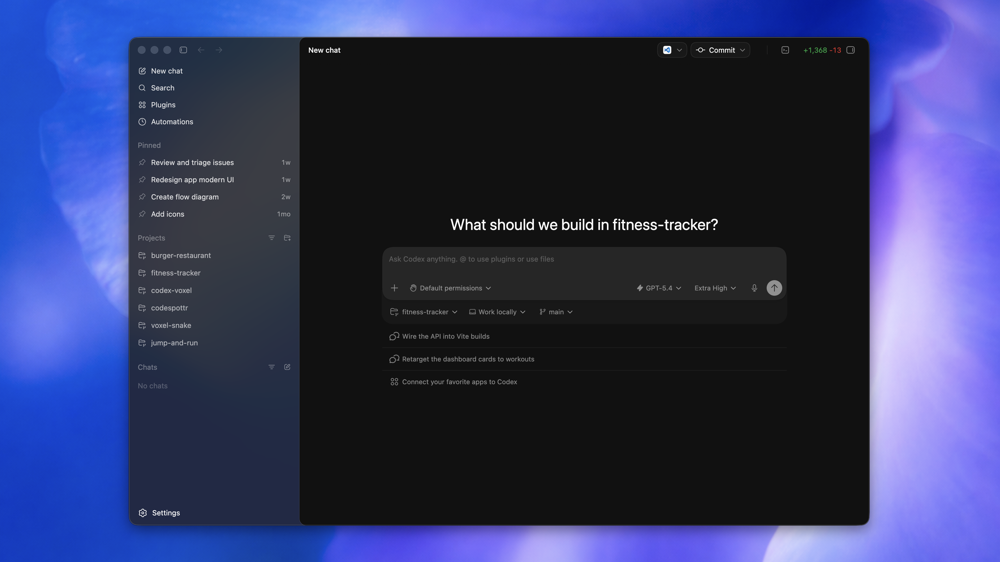

# Codex composer



```sh
cmux setup install github.com/manaflow-ai/cmux/examples/looks/chatgpt/composer@feat-cmux-next
```

Open a chat and type a multiline draft. The prompt card grows with the draft and draws its border and fill from the active color scheme. The composer exposes dictation and displays context usage when the session supplies it.

The desktop groups Add and access at the left and model, effort, microphone and Send at the right. The stylesheet adapts the Codex demo’s rounded card. The host chooses which controls appear and their order.

[Published desktop screenshot](https://learn.chatgpt.com/images/codex/app/codex-app-basic-dark.webp) · [Empty desktop composer with controls](https://github.com/manaflow-ai/cmux-design-references/blob/3d0278494adbf4d67517f168aecf8add198c4bcd/apps/codex/live/composer-codex-empty-input-controls.png)

To preview from this folder, run `cmux customize use ./preview.json`. Run `cmux customize apply` to keep it or `cmux customize discard` to return to the applied setup.
