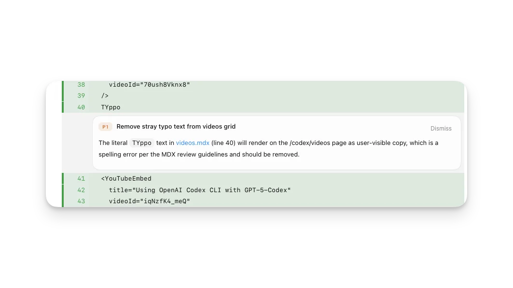

# Diff review



After a turn edits files, expand its file summary and select **View changes**. The setup scopes the summary to that turn and opens diffs in unified layout with line numbers, change backgrounds and plus/minus markers. A diff attached to a chat accepts line comments from the gutter. Save a comment, then send the comments together to the chat. Open Session Info to see the side panel push the transcript aside.

The reference attaches a finding to its changed line. The host opens the diff in its own viewer and supplies the comment editor. Automated findings and their severity come from the coding agent.

```sh
cmux setup install github.com/manaflow-ai/cmux/examples/looks/chatgpt/diff-review@feat-cmux-next
```

[Review guide](https://developers.openai.com/codex/app/review/) · [Desktop reference](https://developers.openai.com/images/codex/app/inline-code-review-light.webp)

To preview from this folder, run `cmux customize use ./cmux-setup.json`. Run `cmux customize apply` to keep it or `cmux customize discard` to return to the applied setup.
