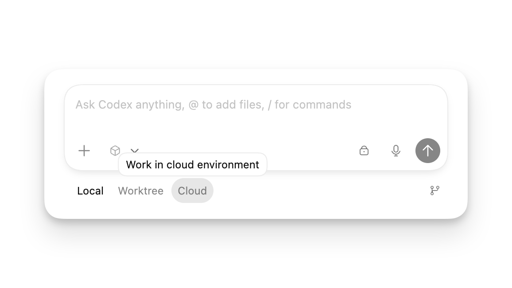

# Execution modes



Start a thread in a project. Choose **This Mac** in the machine picker to work in its checkout. For an isolated branch, open the folder picker and choose **New Worktree**. The host creates the checkout and supplies the resulting folder to the chat. Choose **Cloud** in the machine picker to run on a configured cloud machine. The environment chip displays the selected location.

The setup places the chip on the left and uses the native local preference for new chats. An explicit choice, including a previously saved location, can determine where a chat starts. The reference shows an earlier three-way selector. In the host, the checkout and the machine are independent choices. Cloud jobs use the host’s cloud account.

```sh
cmux setup install github.com/manaflow-ai/cmux/examples/looks/chatgpt/execution-modes@feat-cmux-next
```

[Worktree guide](https://developers.openai.com/codex/app/worktrees/) · [Source screenshot](https://developers.openai.com/images/codex/app/modes-light.webp)

To preview from this folder, run `cmux customize use ./cmux-setup.json`. Run `cmux customize apply` to keep it or `cmux customize discard` to return to the applied setup.
