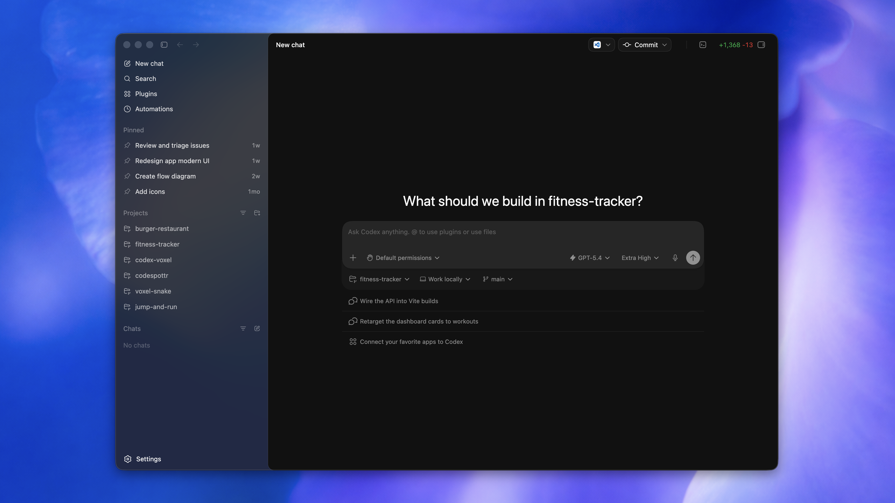

# Codex model and reasoning picker



```sh
cmux setup install github.com/manaflow-ai/cmux/examples/looks/chatgpt/model-reasoning@feat-cmux-next
```

Focus a chat and press Control–Shift–M to open Switch Model. The full picker uses a compact provider rail. Select a provider and model, then choose an effort level if the model offers reasoning settings. To preview from this folder, run `cmux customize use ./preview.json` and choose `cmux customize apply` or `cmux customize discard`.

The desktop captures show a provider rail and an effort slider. The host gets available models, supported efforts and the current selection from the session. The package binds the same action as the Codex demo and leaves those choices live.

**Optional separate reasoning control.** On builds with a renderer for `cmux.composer.model.picker/1`, use `cmux customize use ./with-composer-interface.json` and then `cmux customize apply`. This variant adds a searchable composer picker with a separate reasoning menu to the same settings and shortcuts. The first SDK checkpoint supplies the manifest and daemon contract. The PR also tracks the renderer that must consume the contribution. [Picker SDK and renderer work](https://github.com/manaflow-ai/cmux/pull/48802)

[Published desktop screenshot](https://learn.chatgpt.com/images/codex/app/codex-app-basic-dark.webp) · [Desktop provider rail](https://github.com/manaflow-ai/cmux-design-references/blob/3d0278494adbf4d67517f168aecf8add198c4bcd/apps/codex/live/composer-model-picker-provider-rail.png) · [Desktop effort slider](https://github.com/manaflow-ai/cmux-design-references/blob/3d0278494adbf4d67517f168aecf8add198c4bcd/apps/codex/live/composer-effort-slider-popover.png)
