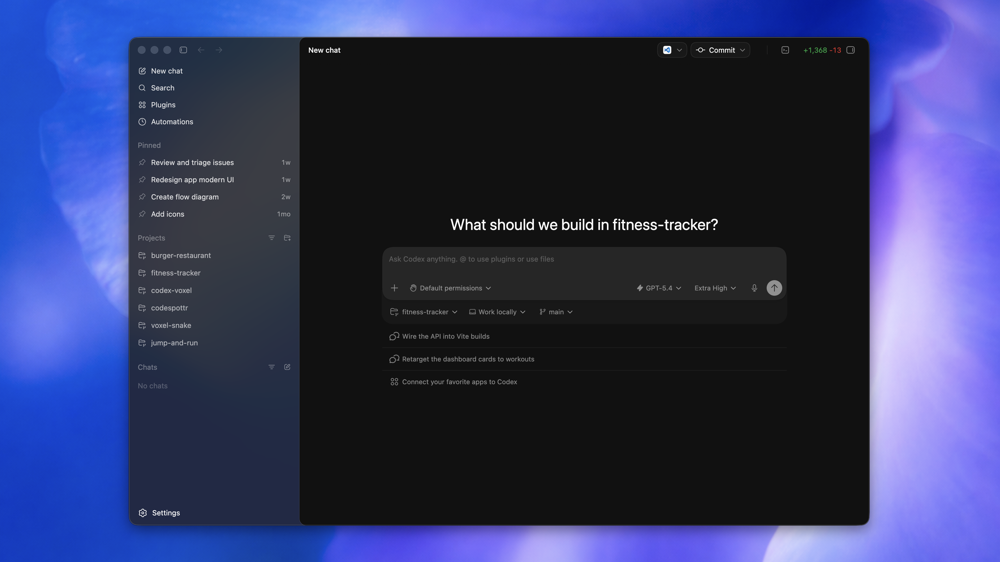

# Codex Add menu



```sh
cmux setup install github.com/manaflow-ai/cmux/examples/looks/chatgpt/plus-menu@feat-cmux-next
```

Focus a chat and click **+**, or press Control–Option–Command–A. Choose a file and check the attachment strip before sending. The popover uses 28-point rows and fits narrow windows. Available actions follow the session’s attachment, project, plan, goal and command capabilities.

The desktop Add menu groups files and folders, app attachments, projects, Goal, Plan mode, skill recording and Sketch above Plugins. The host supplies its own action list and grouping. This package styles the live list and enables the strip. Desktop-only entries such as Sketch require a corresponding host action.

[Published desktop screenshot](https://learn.chatgpt.com/images/codex/app/codex-app-basic-dark.webp) · [Open desktop Add and Plugins menu](https://github.com/manaflow-ai/cmux-design-references/blob/3d0278494adbf4d67517f168aecf8add198c4bcd/apps/codex/live/composer-plus-menu-add-actions-and-plugins.png)

To preview from this folder, run `cmux customize use ./preview.json`. Run `cmux customize apply` to keep it or `cmux customize discard` to return to the applied setup.
