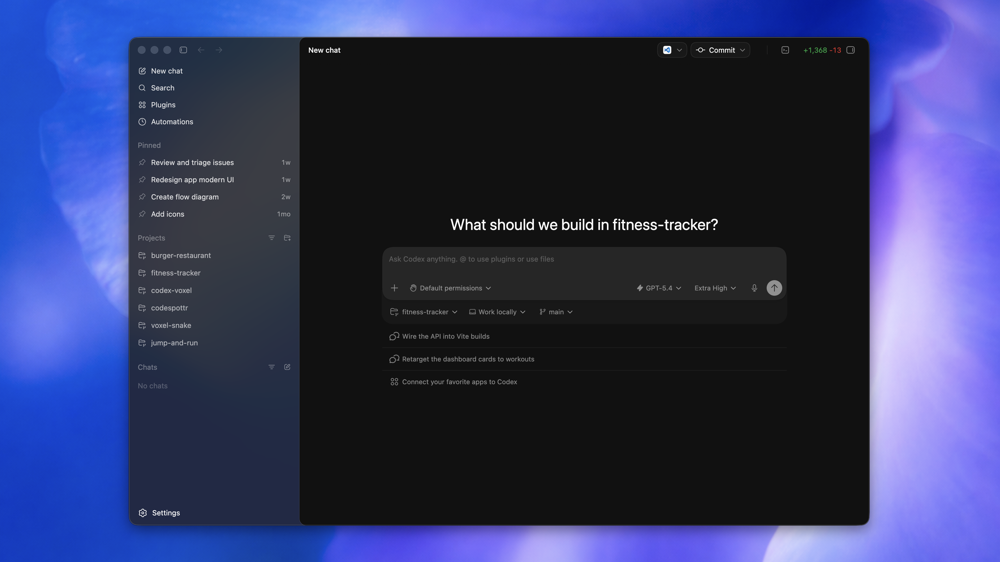

# Codex project and environment pickers



```sh
cmux setup install github.com/manaflow-ai/cmux/examples/looks/chatgpt/project-environment@feat-cmux-next
```

In a new agent chat with folder selection available, click the folder control or press Control–Option–Command–O. Search recent folders or open one from disk. Open the computer control with Control–Option–Command–K and select an available machine. In the session, the machine and folder chip sits on the left below the tabs.

To preview these settings and menu styles from this folder, run `cmux customize use ./preview.json` and choose `cmux customize apply` or `cmux customize discard`.

**Optional project toolbar button.** On builds with `cmux.composer.toolbar/1`, use `cmux customize use ./with-composer-interface.json` and then `cmux customize apply`. This variant adds **Work in a project** beside the draft when the composer offers its project action. The button and the project entry in Add open the same picker. [Toolbar interface and renderer](https://github.com/manaflow-ai/cmux/commit/0eac9cba4e421626ef6f5999cc64ad4f84517a4f)

The desktop folder picker shows Search folders, the current folder, recents and Open folder. Its location menu switches between local and cloud work. The installed picker uses folders and machines configured in cmux. Creating or managing a hosted Codex environment requires the service itself.

[Published desktop screenshot](https://learn.chatgpt.com/images/codex/app/codex-app-basic-dark.webp) · [Desktop recent-project search](https://github.com/manaflow-ai/cmux-design-references/blob/3d0278494adbf4d67517f168aecf8add198c4bcd/apps/codex/live/composer-folder-picker-recent-projects.png) · [Desktop cloud and local picker](https://github.com/manaflow-ai/cmux-design-references/blob/3d0278494adbf4d67517f168aecf8add198c4bcd/apps/codex/live/composer-cloud-location-menu.png)
