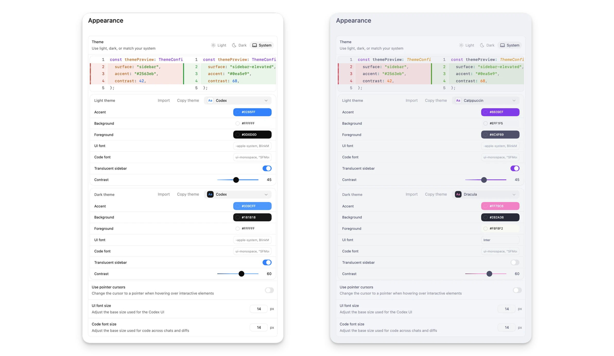

# Settings



Open Session Info in a chat. The Settings section opens the native preferences window, its appearance and chat font controls, or the shortcut editor. Changes take effect through the host settings page. The source groups appearance, model providers and local environments in its preferences. Provider credentials and execution environments remain managed by their respective services.

```sh
cmux setup install github.com/manaflow-ai/cmux/examples/looks/chatgpt/settings@feat-cmux-next
```

[Source reference](https://developers.openai.com/codex/app/settings/) · [Source app screenshot](https://developers.openai.com/images/codex/app/theme-selection-light.webp)

To preview from this folder, run `cmux customize use ./preview.json`. Run `cmux customize apply` to keep it or `cmux customize discard` to return to the applied setup.
