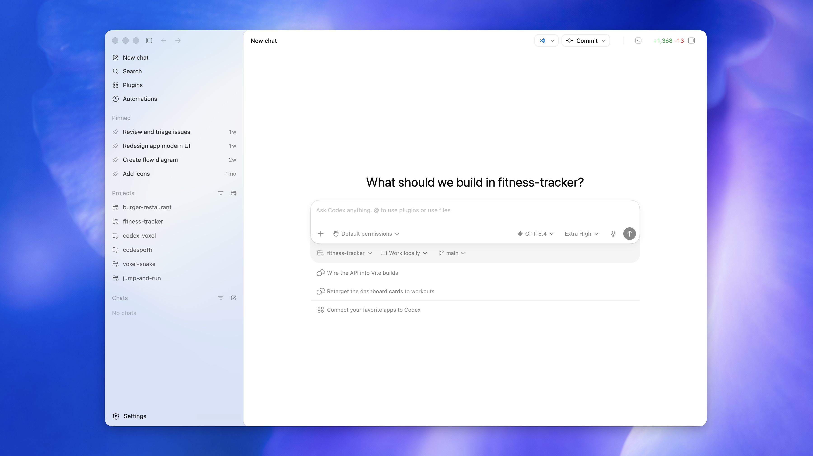

# Keyboard shortcuts



Use Shift-Command-O for a new Codex thread, Shift-Command-A to archive the active chat, Control-Shift-M for the model picker, and Control-Shift-G for review. Command-/ opens the shortcut editor. Command-Option-Shift-O opens the composer folder picker. The source has additional contextual bindings. This package applies the bindings in keybindings.json on macOS. Previous and next operate on sidebar tabs in cmux.

```sh
cmux setup install github.com/manaflow-ai/cmux/examples/looks/chatgpt/shortcuts@feat-cmux-next
```

[Source reference](https://developers.openai.com/codex/app/commands/) · [Source app screenshot](https://developers.openai.com/images/codex/app/codex-app-basic-light.webp)

To preview from this folder, run `cmux customize use ./preview.json`. Run `cmux customize apply` to keep it or `cmux customize discard` to return to the applied setup.
