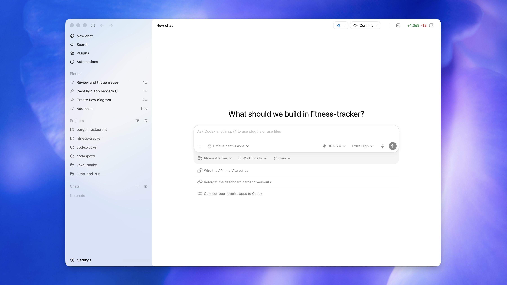

# Codex sidebar



Install the sidebar on its own.

```sh
cmux setup install github.com/manaflow-ai/cmux/examples/looks/chatgpt/sidebar@feat-cmux-next
```

From this directory, use `cmux customize use ./cmux-setup.json` to preview it. Choose `cmux customize apply` to keep it or `cmux customize discard` to return to the applied settings.

**Mapped.** The installed desktop reference puts active work first, then Projects and Recents. This setup opens the native Priority list above grouped projects. Loose workspaces appear in Recents by latest activity. With more than five top-level groups, use Show More to reveal the rest. Point at a chat to see its row controls. The folder grouping, timestamp and hover treatments build on the Codex demo.

The profile requests a 330-point sidebar and 24-point workspace rows. These are reproduction choices based on the proportions of the captured list. The Priority section has its own native row sizing. Project grouping uses cmux sidebar groups, so putting an existing loose workspace in a group moves it from Recents to Projects.

**Layout difference.** The desktop capture has a narrow icon rail alongside the project column. This profile uses one expanded sidebar. The available Rail setting collapses that same sidebar.

[Original image](https://developers.openai.com/images/codex/app/codex-app-basic-light.webp) · [Projects and chats](https://learn.chatgpt.com/docs/projects?surface=app)
