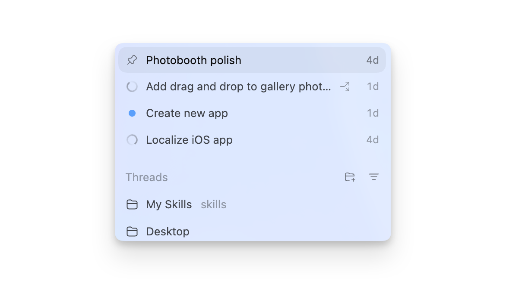

# Codex threads and tasks



Install the thread and task controls on their own.

```sh
cmux setup install github.com/manaflow-ai/cmux/examples/looks/chatgpt/threads-tasks@feat-cmux-next
```

From this directory, use `cmux customize use ./cmux-setup.json` to preview it. Choose `cmux customize apply` to keep it or `cmux customize discard` to return to the applied settings.

**Mapped.** Press ⇧⌘O to start a Codex thread using the existing demo's New Agent Chat binding. Open the native New Tab page and pick an existing chat to resume it. During a turn that publishes a task list, the checklist stays below the latest message. The running-work tray above the composer exposes background agents when the harness reports them.

**Presentation difference.** Codex groups finished background work into transcript cards. This profile uses the native task list and subagent tray. Starting a thread alone does not create a checklist or background agent.

[Original sidebar image](https://developers.openai.com/images/codex/app/multitask-light.webp) · [Desktop features](https://developers.openai.com/codex/app/features/)
