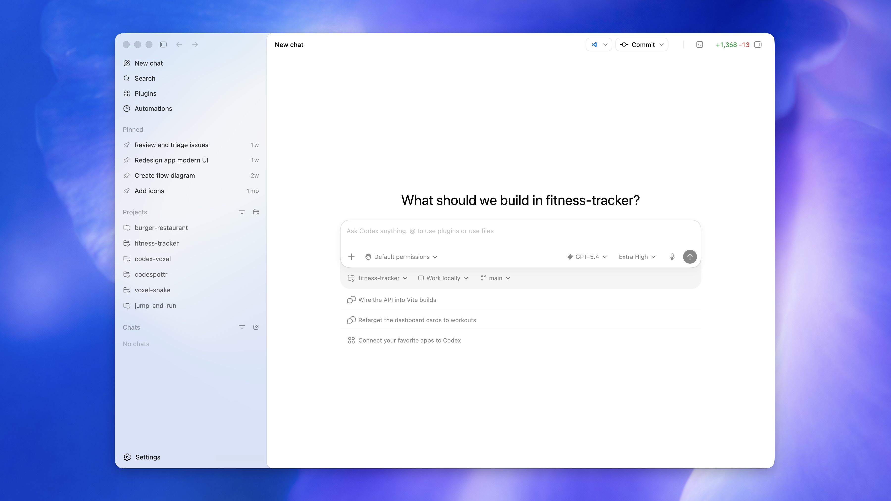

# Codex desktop



Install the complete light look from the NEXT branch.

```sh
cmux setup install github.com/manaflow-ai/cmux/examples/looks/chatgpt/whole@feat-cmux-next
```

Open a new tab, pick a project, and start a Codex chat. Priority surfaces active work above Projects and Recents. Use the composer to attach a file, choose a working folder or machine and switch models. Review a turn’s edits from its changed-files summary. Session Info shows usage, an editor chooser for local checkouts, and preferences. Shift-Command-A archives the focused conversation.

This combines the existing Codex demo's light theme and New Tab with the [individual features](../). The sidebar uses native rows so row actions target the selected chat. Worktrees and cloud machines have separate controls. The optional composer-interface profiles in the model and project guides target builds with those interfaces. The Settled fold has a separate opt-in in the archiving guide.

[Source app](https://developers.openai.com/codex/app/) · [Desktop screenshot](https://developers.openai.com/images/codex/app/codex-app-basic-light.webp)

To preview from this folder, run `cmux customize use ./preview.json`. Run `cmux customize apply` to keep it or `cmux customize discard` to return to the applied setup.
