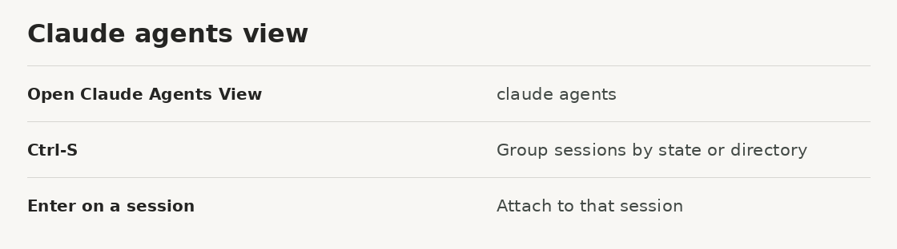

# Claude agents view

Choose **Open Claude Agents View** in the cmux palette. A new terminal tab runs `claude agents` and opens Claude’s interactive list of background sessions. Choose a row and press Enter to attach.

Claude groups sessions by state by default. Its empty view shows **Needs input**, **Working**, and **Completed**. With sessions present, Claude can also show **Pinned** and **Ready for review**. Press **Ctrl-S** to switch between state and directory grouping. Claude remembers the selection.



## Install

```sh
cmux setup install github.com/manaflow-ai/cmux/examples/looks/claude-code/agents@feat-cmux-next
```

To install from this pull request, replace `feat-cmux-next` with its head SHA.

## Remove

```sh
cmux setup remove manaflow-ai/claude-code-agents
```

## Source

[Claude agent view and session states](https://code.claude.com/docs/en/agent-view#monitor-sessions-with-agent-view) · [cmux agent action parser](https://github.com/manaflow-ai/cmux/blob/97069dfb49aa8e3eca0cd92c42bef96743d95829/Packages/macOS/CmuxNext/Sources/CmuxNextSettings/ConfigActionParser.swift#L46)
