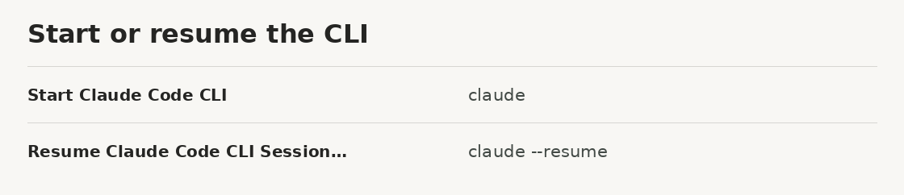

# Start or resume the CLI

In the palette choose **Start Claude Code CLI** or **Resume Claude Code CLI Session…**. Each opens a new terminal tab. Resume opens Claude’s session picker.



## Install

```sh
cmux setup install github.com/manaflow-ai/cmux/examples/looks/claude-code/cli@feat-cmux-next
```

To install from this pull request, replace `feat-cmux-next` with its head SHA.

## Remove

```sh
cmux setup remove manaflow-ai/claude-code-cli
```

## Source

[CLI flags](https://code.claude.com/docs/en/cli-reference) · [cmux implementation](https://github.com/manaflow-ai/cmux/blob/97069dfb49aa8e3eca0cd92c42bef96743d95829/Packages/macOS/CmuxNext/Sources/CmuxNextSettings/ConfigActionParser.swift#L46)
