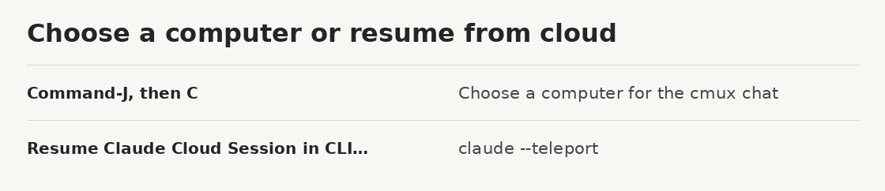

# Choose a computer or resume from cloud

With a chat focused, press ⌘J then C to open cmux’s computer picker. To bring a Claude-hosted conversation into a local CLI tab, choose **Resume Claude Cloud Session in CLI…** from the palette, then select the session. Claude handles sign-in and availability.



## Install

```sh
cmux setup install github.com/manaflow-ai/cmux/examples/looks/claude-code/cloud@feat-cmux-next
```

To install from this pull request, replace `feat-cmux-next` with its head SHA.

## Remove

```sh
cmux setup remove manaflow-ai/claude-code-cloud
```

## Source

[Claude Code on the web](https://code.claude.com/docs/en/claude-code-on-the-web) · [CLI flags](https://code.claude.com/docs/en/cli-reference) · [cmux implementation](https://github.com/manaflow-ai/cmux/blob/97069dfb49aa8e3eca0cd92c42bef96743d95829/webviews/src/agent-session/acpmux/shortcuts.ts#L18)
