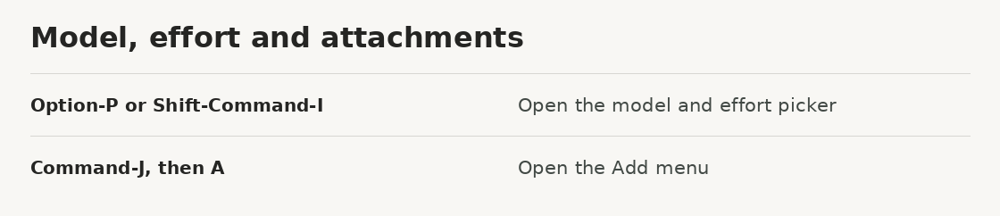

# Model, effort and attachments

With a chat focused, press ⌥P (CLI) or ⇧⌘I (Desktop) to open the model picker with your draft in place. Press ⌘J then A to open the attachment and command menu. Choose an effort level in the model picker when the model supports it.



## Install

```sh
cmux setup install github.com/manaflow-ai/cmux/examples/looks/claude-code/composer-controls@feat-cmux-next
```

To install from this pull request, replace `feat-cmux-next` with its head SHA.

## Remove

```sh
cmux setup remove manaflow-ai/claude-code-composer-controls
```

## Source

[Interactive controls](https://code.claude.com/docs/en/interactive-mode) · [Desktop shortcuts](https://code.claude.com/docs/en/desktop#keyboard-shortcuts) · [cmux implementation](https://github.com/manaflow-ai/cmux/blob/97069dfb49aa8e3eca0cd92c42bef96743d95829/Packages/macOS/CmuxNext/Sources/CmuxNextApp/Handlers/AgentHandlers.swift#L265)
