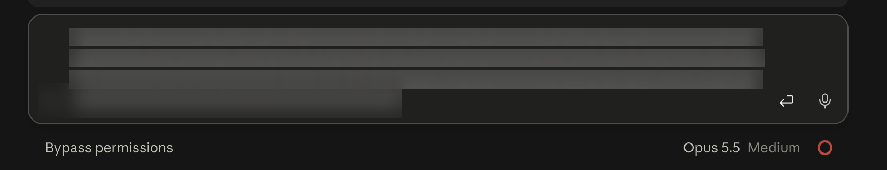

# Claude Code composer

A charcoal prompt field with a one-point edge, 12 pt corners and a context-usage ring.



The prompt field and permission and model controls in the Code tab. [Original desktop capture](https://github.com/manaflow-ai/cmux-design-references/blob/3d0278494adbf4d67517f168aecf8add198c4bcd/apps/claude/live/composer-bottom-controls.png)

## Apply

```sh
cmux setup install github.com/manaflow-ai/cmux/examples/looks/claude-code/composer@feat-cmux-next
```

From a checkout, preview with `cmux customize use examples/looks/claude-code/composer/profile.json`. Use `cmux customize apply` to keep it or `cmux customize discard` to restore the previous setup.

## Mapped behavior

The stylesheet applies the measured field fill, placeholder, hover color and edge. The ring uses the host’s live context usage.

## Limits

This appearance package changes the field’s paint. Mode, model and effort controls are separate actions.
