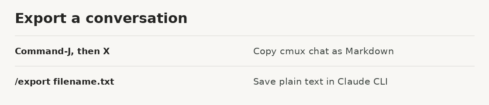

# Export a conversation

With a cmux conversation focused, press ⌘J then X to copy it as Markdown. For a Claude CLI conversation, run `/export` in its terminal for the copy or save dialog, or `/export filename.txt` to write plain text.



## Install

```sh
cmux setup install github.com/manaflow-ai/cmux/examples/looks/claude-code/export@feat-cmux-next
```

To install from this pull request, replace `feat-cmux-next` with its head SHA.

## Remove

```sh
cmux setup remove manaflow-ai/claude-code-export
```

## Source

[Slash commands](https://code.claude.com/docs/en/commands) · [cmux implementation](https://github.com/manaflow-ai/cmux/blob/97069dfb49aa8e3eca0cd92c42bef96743d95829/Packages/macOS/CmuxNext/Sources/CmuxNextApp/Handlers/AgentChatCopyHandlers.swift)
