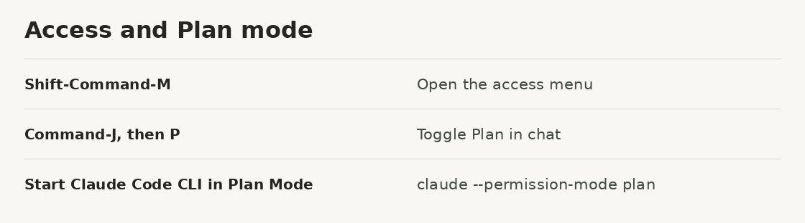

# Access and Plan mode

With a cmux chat focused, press ⇧⌘M to open the access menu, or ⌘J then P to toggle Plan. For the CLI’s Shift-Tab mode cycle, choose **Start Claude Code CLI in Plan Mode** from the palette. Claude handles available modes and approval prompts.



## Install

```sh
cmux setup install github.com/manaflow-ai/cmux/examples/looks/claude-code/modes@feat-cmux-next
```

To install from this pull request, replace `feat-cmux-next` with its head SHA.

## Remove

```sh
cmux setup remove manaflow-ai/claude-code-modes
```

## Source

[Desktop shortcuts](https://code.claude.com/docs/en/desktop#keyboard-shortcuts) · [Permission modes](https://code.claude.com/docs/en/permission-modes) · [cmux implementation](https://github.com/manaflow-ai/cmux/blob/97069dfb49aa8e3eca0cd92c42bef96743d95829/webviews/src/agent-session/acpmux/shortcuts.ts#L18)
