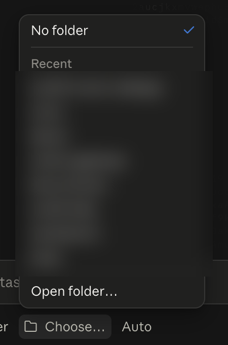

# Claude Code project picker

Choose the working folder from the focused chat and expose the workspace menu beside the sidebar’s plus button.



The Code tab’s recent folders menu above the prompt. [Original desktop capture](https://github.com/manaflow-ai/cmux-design-references/blob/3d0278494adbf4d67517f168aecf8add198c4bcd/apps/claude/live/folder-picker-recent.png)

## Apply

```sh
cmux setup install github.com/manaflow-ai/cmux/examples/looks/claude-code/project-picker@feat-cmux-next
```

From a checkout, preview with `cmux customize use examples/looks/claude-code/project-picker/profile.json`. Use `cmux customize apply` to keep it or `cmux customize discard` to restore the previous setup.

## Mapped behavior

Press Option-Command-O in a chat with an editable working folder. The binding invokes the built-in Choose Folder action. The sidebar chevron opens the New Workspace menu.

## Limits

The host and session determine which folders are available. A running session can restrict changes to its working directory.
