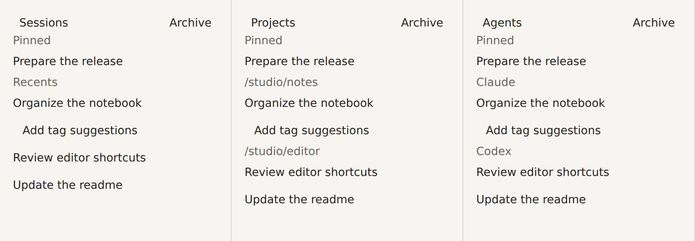

# Session Recents



Install this setup to add Recents to the sidebar. Click a session to open it. The Sessions menu switches between a nested list, projects and agents. Right-click a row to pin it, then drag it within Pinned to change its position.

```sh
cmux setup install github.com/manaflow-ai/cmux/examples/looks/claude-code/session-recents@lane/cc-recents-features
cmux setup remove manaflow-ai/session-recents
```

The Archive menu can archive all unpinned recent sessions, archive sessions whose last activity was more than seven days ago, or show archived sessions. Each row also offers Archive or Restore. On a parent, choose “with nested sessions” to include its descendants on the same machine. Archiving keeps the transcript. Removing the setup restores the previous customization and preserves session archive marks.

The setup uses `cmux.section/1`, `chat.list` with archived sessions included, `chat.pin`, `chat.archive`, `agent.openSessionTab`, and the reorderable list. It stores the pin order in the customize app’s local storage. Allow chat writes, local storage and Run actions in Settings → Apps when prompted.

The preview shows the three views in the web scene renderer with example sessions. The source references show the session menu and the indentation of linked sessions. [Session actions](https://github.com/manaflow-ai/cmux-design-references/blob/3d0278494adbf4d67517f168aecf8add198c4bcd/apps/claude/live/sidebar-session-context-menu.png) · [Nested sessions](https://github.com/manaflow-ai/cmux-design-references/blob/3d0278494adbf4d67517f168aecf8add198c4bcd/apps/claude/live/sidebar-linked-session-nesting.png)
