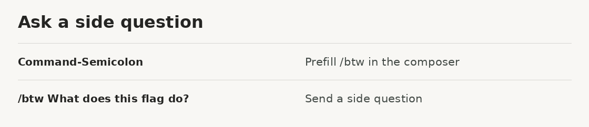

# Ask a side question

In a chat with side sessions available, press ⌘;. The composer opens with `/btw ` ready for your question. Send it when ready.



## Install

```sh
cmux setup install github.com/manaflow-ai/cmux/examples/looks/claude-code/side-question@feat-cmux-next
```

To install from this pull request, replace `feat-cmux-next` with its head SHA.

## Remove

```sh
cmux setup remove manaflow-ai/claude-code-side-question
```

## Source

[Slash commands](https://code.claude.com/docs/en/commands) · [cmux implementation](https://github.com/manaflow-ai/cmux/blob/97069dfb49aa8e3eca0cd92c42bef96743d95829/webviews/src/agent-session/acpmux/App.tsx#L8178)
