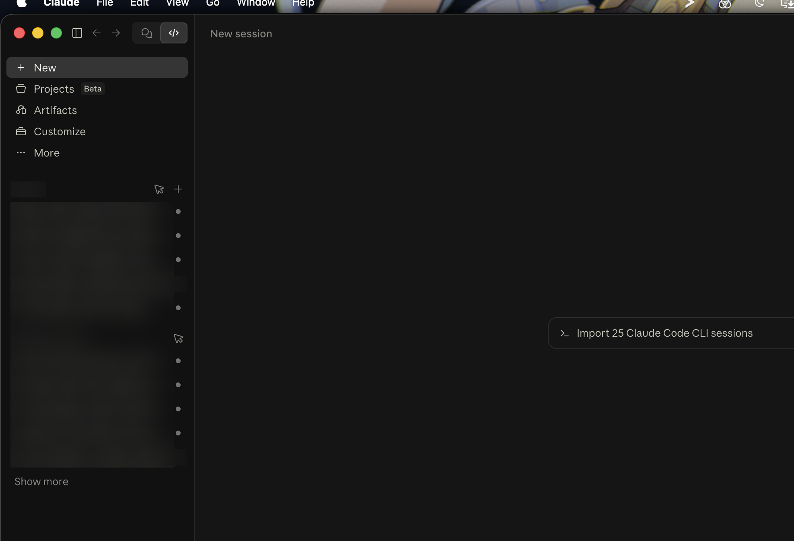

# Claude Code project sidebar

A 284 pt sidebar groups sessions by project folder and nests related sessions beneath their parent.



Code sessions arranged beneath project headings. [Original desktop capture](https://github.com/manaflow-ai/cmux-design-references/blob/3d0278494adbf4d67517f168aecf8add198c4bcd/apps/claude/live/sidebar-project-groups-status-dots.png)

## Apply

```sh
cmux setup install github.com/manaflow-ai/cmux/examples/looks/claude-code/sidebar@feat-cmux-next
```

From a checkout, preview with `cmux customize use examples/looks/claude-code/sidebar/profile.json`. Use `cmux customize apply` to keep it or `cmux customize discard` to restore the previous setup.

## Mapped behavior

At a 1,440 pt window width the reference sidebar occupies about one fifth of the window. The profile selects title-only rows, quiet group headings and controls on hover. Expand a parent session to see its children.

## Limits

Archiving, sorting and notification policies are separate features.
