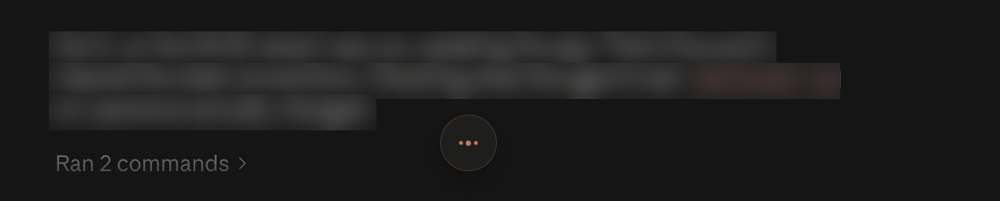

# Claude Code transcript

Read replies in an 800 pt column with collapsed tool activity and a compact harness label.



A collapsed command group in the desktop transcript. [Original desktop capture](https://github.com/manaflow-ai/cmux-design-references/blob/3d0278494adbf4d67517f168aecf8add198c4bcd/apps/claude/live/transcript-agent-text-and-collapsed-tool-row.png)

## Apply

```sh
cmux setup install github.com/manaflow-ai/cmux/examples/looks/claude-code/transcript@feat-cmux-next
```

From a checkout, preview with `cmux customize use examples/looks/claude-code/transcript/profile.json`. Use `cmux customize apply` to keep it or `cmux customize discard` to restore the previous setup.

## Mapped behavior

Normal transcript view keeps tool activity behind disclosures. The profile sets the system font at 14 pt, hides the minimap and keeps the transcript presentation.

## Limits

The cmux renderer owns individual tool rows and disclosure labels. The desktop width selector is covered by the separate transcript-width feature.
