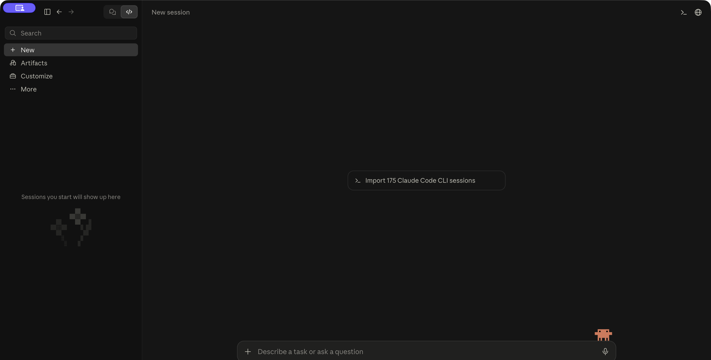

# Claude Code

The Code tab’s project sidebar, transcript and prompt field, with the Claude demo’s New Tab, usage section and session status line.



The Code home with a narrow session sidebar and the prompt docked below the conversation. [Original desktop capture](https://github.com/manaflow-ai/cmux-design-references/blob/3d0278494adbf4d67517f168aecf8add198c4bcd/apps/claude/live/code-home-overview.png)

## Apply

```sh
cmux setup install github.com/manaflow-ai/cmux/examples/looks/claude-code/whole@feat-cmux-next
```

From a checkout, preview with `cmux customize use examples/looks/claude-code/whole/profile.json`. Use `cmux customize apply` to keep it or `cmux customize discard` to restore the previous setup.

## Mapped behavior

Command-N starts a Claude chat. Command-Shift-M, I and E open the mode, model and effort menus respectively. Option-Command-O opens the focused chat’s folder chooser. New Tab shows recent Claude chats, Session Info includes the working folder and branch, and the sidebar shows account usage when available.

## Limits

The whole look combines appearance, navigation and the existing demo views. Optional lifecycle policies, worktree operations and external editor integrations have separate packages.
