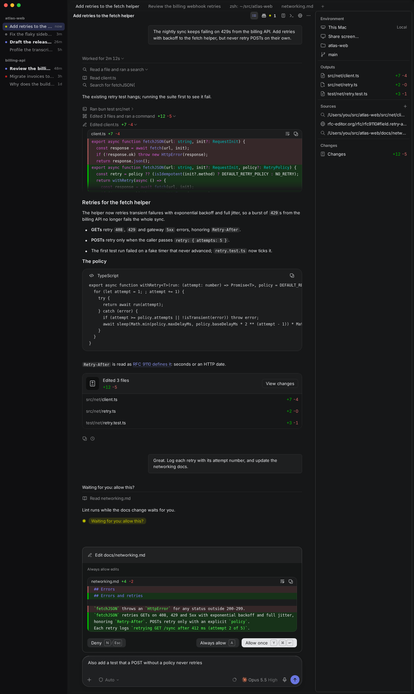
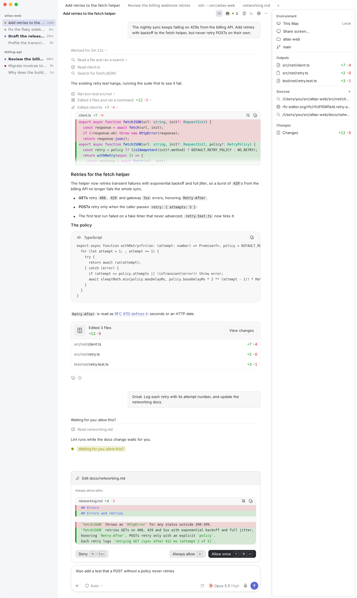

# Docket





A dense, calm issue-tracker look. The window and sidebar are a near-black `#0F0F11`; the work sits in
one raised panel (`#161718`) with a hairline outline, inset 8 px. Text is a cool off-white with two
gray steps under it, and a single indigo (`#5E6AD2`) marks focus, selection and links. Nothing else
carries color. Type is Inter at 13 px. The sidebar is 220 px wide with 28 px rows and reads like an
inbox: the state glyph before the title, the time since the last change at the right, a count on each
group header. The chat column is narrow, the prompt is a barely raised block with a small corner, and
color changes are short ease-outs at the fast speed. It ships Dark (the default) and Light.

It is built only from public surfaces, so you can copy any part of it:

| File | What it does |
| --- | --- |
| `cmux-setup.json` | Picks the theme file. Sets the chat in Inter at 13 px with a 1.5 line height, code at 0.92, a 680 px column and no minimap. Makes the sidebar an inbox: compact one-line rows with their icon, agent state, unread mark, PR and the time at the right, sections by folder under plain headings with member and unread counts. Gives the address field a 6 px corner at 32 px |
| `themes/docket.json` | Default, Dark. Panel `#161718`, text `#E4E5E8`, indigo `#5E6AD2`, selection `#6D7298`. The sidebar and tab strip are on the window's `#0F0F11`, the browser bar and docks one step up at `#1A1B1D`, hairlines `#2B2C31`. Settings and pages use the panel tone |
| `themes/docket-light.json` | Light. White panel, text `#282A2F`, the same indigo, selection `#DFE1F7`. Sidebar, tab strip, browser bar and docks are `#FDFEFF`, hairlines `#E3E4E8`, settings and pages white |
| `agent-pane/theme.css` | The prompt is a 6 px block with a 4% text tint and an 8% hairline. Cards are a 3% fill with a 9% ring. Secondary and dim text are 72% and 66% of the text color, links the indigo a step toward the text. It also sets the tracker's menus (pending, below). Only `cmux.agentPane.style/1` tokens, every color mixed from the theme's own |
| `customize/` | A hover card laid out like one inbox notification (title and age, then why it wants you in gray, the task, then gray facts) and rows in regular weight with the thin arc for work in progress |
| `markdown/theme.css` | The Markdown viewer's paint: dense and calm. Medium-weight headings with no rule, code on a barely raised fill with a small 4 px corner, quotes on an indigo rule. Only `--cmux-md-*` properties on `:root`, every color mixed from the page's own |

The rest of cmux wears the look too. The terminal is SF Mono at 13 pt (the system's monospaced face beside Inter) with a full sixteen-color palette at a muted chroma, colors 1 to 7 and 9 to 14 held to WCAG AA over its page (8, the dim gray, to 3:1); the Markdown viewer opens in the system face at 14 px with the chat's line height and code scale in a 95-character column, and `markdown/theme.css` paints it; diffs use muted colors with change bars; sidebar group colors are grays. Its `customize/` view also puts an **Inbox** at the top of the sidebar (only the chats that want you: a question, a failure, an unread finished turn, each a state glyph, the title and its age; a click shows the chat once you turn on `workspace:write` in Settings > Apps) and a **Properties** list in Session Info (folder, branch and agent as label and value).

Both theme files set the same proportions, measured from the references:

- The window: a 44 px title area, a 32 px tab strip with 13 px titles, 13 px chrome text.
- The sidebar: 220 px wide with 28 px rows.
- Spacing: an 8 px gap around the outlined panel (`appearance.chromeStyle: "card-outlined"`) and 1 px hairlines.
- State: `compact` density, the focused pane ringed in the indigo, work in progress drawn as a thin arc.

```sh
cmux setup install github.com/manaflow-ai/cmux-docket-look
cmux settings set appearance.themeFile docket-light    # docket (Dark) is the default
cmux setup remove manaflow-ai/docket-look
```

While it is installed, its `customize/` view stands in for your own sidebar view, if you have one;
`cmux setup remove` puts yours back.

## References

The look was drawn from 11 captures in the private cmux design references: colors
sampled from their pixels, sizes measured on them. The captures themselves, by number, are on
the look's private references page.

| Ref | What this look took from it |
| --- | --- |
| R1 | The layout: a near-black window (`#0F0F11`) around a raised `#161718` panel with a `#25262A` hairline (the outlined card, the sidebar and tab-strip tone). The prompt is a `#1A1B1D` block with no color and a small corner (the bubble tokens), body text is `#E4E4E7`, and open chats sit in a strip under the panel (the tab strip on the window tone) |
| R2 | The usage pattern. Rows show identity, subject and reason on two lines with the time at the right and an indigo unread dot (the hover card, timestamps, unread counts). Capsule view switchers carry a count (`tabShape: rounded`, pending). Titles are `#D2D7E1` and secondary text `#8C919A` (the gray steps) |
| R3 | The prompt: a tall `#141416` box with attach and a round send at the bottom right (`composerMinHeight` 64, pending; the composer-look gap below). Under it, a suggestion list in a darker panel with gray descriptions after the title (the menu subtitle and shortcut gray) |
| R4 | Light: a white list, a `#F5F6F8` group band (the light sidebar), a neutral `#F1F3F8` selected row (`selection: neutral`, pending), titles `#282A2F`, grays `#6C6F75` and `#3D4148`, a pale indigo link. Proportions at 1.2x: a 263 px sidebar, a 35 px item pitch, 53 px list rows and a 67 px header (220 px, 28 px, 44 px two-line rows) |
| R5 | Dark is the preselected style (so the dark file is the default). The indigo is `#575EC0` on the primary button (the accent, rounded to the system's `#5E6AD2`) |
| R6 | A focused field is a thin indigo ring (`#31355D` on `#151620`; the focused pane's ring). Inputs have small 6 px corners (the address field's corner) |
| R7 | A group header ("Urgent issues 3") is a rounded band with a gray count, and each row puts its state glyph before the title (member counts, detailed status icons, the arc indicator) |
| R8 | Popovers are a dark panel with a hairline, a small corner and the key named in a gray keycap (the `--menu-*` panel, border and shortcut color). Dates sit right-aligned on each row |
| R9 | Looked at and not used for color: it shows the tracker's issue drawn inside another app's panel, so its fonts and tones are that app's |
| R10 | A related keyboard-first palette: a neutral gray highlight with a rounded corner, section labels in small gray type, key hints in keycaps (the menu hover fill, label and shortcut tokens) |
| R11 | A related compact menu: a right-aligned shortcut column, separators edge to edge, a chevron for a submenu (`--menu-separator-inset: 0`, the shortcut column, the submenu offset) |

## Contrast

Every pair is checked to WCAG AA in both theme files, resolved opaque: body text 4.5:1, UI 3:1. That
covers the text on every surface the look sets, the secondary and dim text over the page and over a
card, links on the page and inside the prompt block, the prompt block's text, the selection, and the
menu rows on the panel and on the highlighted row. The captures' quietest gray (`#5F6062` on
`#161718`) is under 4.5:1. The chat's dim text is the darkest step that passes, 66% of the text color.

## With a newer cmux

The setup carries only settings every current cmux NEXT build has, because `cmux setup install`
refuses a key the running build does not know. These are in review; each sits in the files as a
comment naming its pull request:

| Part | Where | Needs |
| --- | --- | --- |
| Capsule view switchers ("Priority 4", "Other 12") | `"appearance.tabShape": "rounded"` in the theme files | cmux #46780 |
| A neutral gray selected row, never a colored one | `"appearance.selection": "neutral"` in the theme files | cmux #46516 |
| Keyboard-first menus. An 8 px panel one step off the page with a hairline and a 4 px inset. 32 px rows with a neutral 6 px highlight, gray shortcuts at the right and small medium-weight section labels. Separators run edge to edge, and submenus sit 4 px off their row | the `--menu-*` tokens in `agent-pane/theme.css`, set now and inert until then | cmux #46846 |
| Two-line inbox rows (44 px), 8 px row insets, 28 px toolbar buttons with a 6 px corner, the header hairline and a tall 64 px prompt box | the `appearance.metrics.*` comment lines at the end of the theme files | cmux #46861 |

## Not yet possible

| Part | Why |
| --- | --- |
| The tall prompt box with attach and a round send inside its bottom right | `agentPane.composerLook` (#46738) offers auto, codex and claude only; claude's is the nearest and is named in the comment |
| The inbox row shapes (avatar with a badge, two lines, unread dot) as one sidebar preset | `sidebar.look` (#46805) offers cmux, claude, codex and studio only |
| Shortcut hints drawn as keycaps with their own fill | `--menu-shortcut-color` colors the shortcut text; there is no keycap fill or border token |
| A per-row state glyph by kind (backlog ring, half-filled in progress, done check) | Row decorations can set an indicator style, not a glyph per state; the arc stands in for in progress |
| The view header's 67 px height and a separate list-row height | `titlebarHeight` stops at 56 and there is no list-row metric outside the sidebar; the look uses 44 |

How looks like this one are written: [look-addons.md](https://github.com/manaflow-ai/cmux/blob/639a429492936ae3b4f0d4a1e6d7fbf66e708520/docs/cmux-next/look-addons.md).
