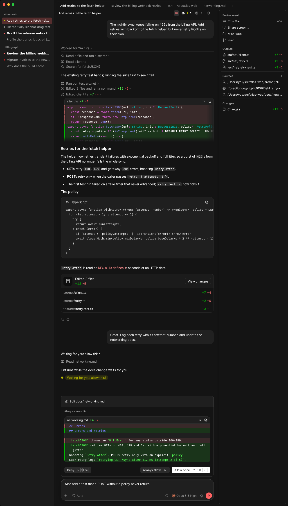
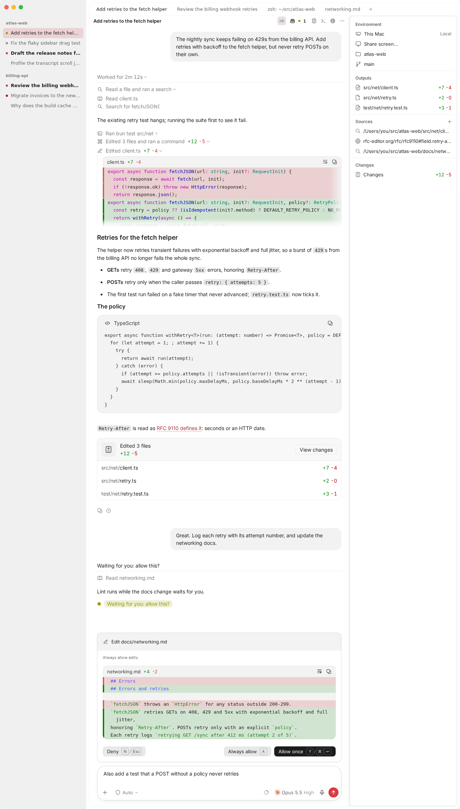

# Ember





A floating command-surface look. The window is dark glass (`#141414`) that floats over a blurred
desktop. The sidebar is a lighter inset panel (`#1B1B1B`), and every pane is a rounded card with one
even gap and no borders. Titles are white over a quiet gray. The selected row is a neutral gray
(`#363636`), never a color. One warm coral red (`#FF6363`) is kept for focus and the few marks that
need it. Rows are compact 32 px one-liners in a 260 px sidebar, grouped by recency (Yesterday, This
Week). The prompt is a soft borderless block with 16 px corners, menus work like a launcher's action
panel, and motion is a quick spring at the fast speed. It ships Dark (the default) and Light.

It is built only from public surfaces, so you can copy any part of it:

| File | What it does |
| --- | --- |
| `cmux-setup.json` | Picks the theme file. Sets the chat in Inter at 14 px with a 1.5 line height, code at 0.92, a 680 px column and no minimap. Makes the sidebar chat history: compact one-line rows with no icon or facts, grouped by recency under muted labels, a pulsing dot for work in progress. Makes the address field a launcher's search bar: 40 px tall, 15 px text, a 10 px corner, floating on a shadow |
| `themes/ember.json` | Default, Dark. Window `#141414` at 96% over glass, titles `#FFFFFF`, coral `#FF6363` (links, red marks; selection, focus and Send stay neutral gray), selection `#363636`. The sidebar is `#1B1B1B` at 86%, the browser bar and docks are `#1B1B1B`, Settings is graphite `#1C1C1E`, and pane cards are floating with no borders |
| `themes/ember-light.json` | Light. White at 96% over glass, titles `#1C1C1C`, coral a step deeper (`#E5484D`, which holds 3:1 on white), selection `#E3E3E3`. The sidebar is `#F0F0F0` at 86%, the browser bar and docks are `#F5F5F5`, and Settings is `#F6F6F6` |
| `agent-pane/theme.css` | The prompt is a borderless 16 px block with a 6% text tint. Cards are a 5% fill with a faint ring. Secondary and dim text are 70% and 64% of the text color, links the coral a step toward the text. It also sets the action-panel menus and the gray prompt ink (pending, below). Only `cmux.agentPane.style/1` tokens, every color mixed from the theme's own |
| `customize/` | A hover card laid out like a launcher result row (title with an accessory at the right, a gray subtitle, then the task, short) and plain regular-weight rows with a pulsing dot for work in progress |
| `markdown/theme.css` | The Markdown viewer's paint: code as soft borderless blocks with 10 px corners, headings with no rule, quotes on a coral rule. Only `--cmux-md-*` properties on `:root`, every color mixed from the page's own |

The rest of cmux wears the look too. The terminal is SF Mono at 13 pt (the system's monospaced face, as a launcher's script output uses) with a full sixteen-color palette at a warm, lively chroma, colors 1 to 7 and 9 to 14 held to WCAG AA over its page (8, the dim gray, to 3:1); the Markdown viewer opens in the system face at 14 px with the chat's line height and code scale in a 88-character column, and `markdown/theme.css` paints it; diffs use theme colors with change bars; sidebar group colors are glass tints.

Both theme files set the same proportions, measured from the references (2x captures):

- The window: a 44 pt title area, a 32 pt tab strip with 13 pt titles, 13 pt chrome text.
- The sidebar: 260 pt wide with 32 pt rows.
- Spacing: an 8 pt gap around the floating panes (`appearance.chromeStyle: "floating"`) and 1 pt dividers.
- State: `cozy` density, the focused pane marked on its tab.

```sh
cmux setup install github.com/manaflow-ai/cmux-ember-look
cmux settings set appearance.themeFile ember-light    # ember (Dark) is the default
cmux setup remove manaflow-ai/ember-look
```

While it is installed, its `customize/` view stands in for your own sidebar view, if you have one;
`cmux setup remove` puts yours back.

## References

The look was drawn from 9 captures in the private cmux design references: colors
sampled from their pixels, sizes measured on them. The captures themselves, by number, are on
the look's private references page.

| Ref | What this look took from it |
| --- | --- |
| R1 | The layout and usage pattern. The window is `#141414` and the lighter inset sidebar `#1B1B1B`, with a neutral `#363636` selected row on a rounded corner and chat history grouped by recency under muted gray labels (`groupBy: recents`, sections). Rows are 32 pt (64 px pitch at 2x) in a 260 pt sidebar under a 44 pt title area. The prompt is a borderless `#202020` block with large corners and gray `#A6A6A6` ink (bubble tokens, the pending bubble ink). The composer is a `#222222` rounded field with + and a mic |
| R2 | How results read: tool use as a quiet gray line with a count chip, tables and lists on the page with no card chrome (a faint card fill and ring), white titles over `#727272`-`#A7A7A7` grays (the muted and dim steps, raised to pass 4.5:1). The header buttons sit grouped in one capsule (the toolbar metrics, pending) |
| R3 | Settings: a graphite window with rounded group panels, a capsule search field in the sidebar and a red destructive row ("Sign Out"). This gave the Settings surface tone, `--menu-destructive` and the capsule search. It also shows a surface drawn on the web that still reads native, which is why the look keeps one consistent glass |
| R4 | The coral red (`#FD6262`, the accent) used sparingly: a pill tag and the progress mark, never body text. A restrained footer bar of `#211D1D` carries the one button |
| R5 | The habit is a hotkey: large keycaps, a quick open and close (fast motion, a short spring). Toggle rows have a title and a gray subtitle (the hover card's title and subtitle) |
| R6 | The surface appears on a keypress and floats over the desktop (the glass window, the floating chrome style) |
| R7 | Looked at and not used: it is the operating system's own permission dialog, not the launcher's design |
| R8 | A related command surface: a centered floating panel, one neutral gray highlighted row with an 8 px corner, small gray section labels and key hints at the right and in a footer (the action-panel menu tokens: hover fill, hover radius, label, shortcut column) |
| R9 | A related compact menu with a search field on top, a right-aligned shortcut column and a submenu chevron (the shortcut column, the separators and the submenu offset) |

## Contrast

Every pair is checked to WCAG AA in both theme files, resolved opaque: body text 4.5:1, UI 3:1. That
covers:

- the text on every surface the look sets, and the translucent sidebar and pane over a black, a white and a mid-gray desktop;
- the secondary and dim text over the page and over a card;
- links on the page and inside the prompt;
- the prompt's text and its pending gray ink;
- the selection;
- the menu rows, section labels, shortcuts and destructive row on the panel and on the highlighted row.

The captures' placeholder gray (`#727272` on `#141414`, 3.9:1) is under 4.5:1. The chat's dim text is
64% of the text color. The coral is `#FF6363` in Dark (6.3:1) and `#E5484D` in Light (3.9:1).

## With a newer cmux

The setup carries only settings every current cmux NEXT build has, because `cmux setup install`
refuses a key the running build does not know. These are in review; each sits in the files as a
comment naming its pull request:

| Part | Where | Needs |
| --- | --- | --- |
| Capsule header buttons and chips | `"appearance.tabShape": "rounded"` in the theme files | cmux #46780 |
| A neutral gray selected row | `"appearance.selection": "neutral"` in the theme files | cmux #46516 |
| The action panel and context menus. A 12 px panel one step up from the page with a 6 px inset. 34 px rows with a neutral 8 px highlight, gray shortcut hints at the right and small semibold section labels. Separators run edge to edge between sections, the destructive row is coral, and submenus sit 4 px off their row | the `--menu-*` tokens in `agent-pane/theme.css`, set now and inert until then | cmux #46846 |
| Your own prompt drawn in gray, a step under the reply's white, so the answer reads first | `--cv-user-bubble-text` in `agent-pane/theme.css`, set now and inert until then | cmux #46490 |
| A 10 pt row inset so the selected row floats as a capsule, 44 pt two-line rows, grouped 28 pt header buttons on an 8 pt corner, no header hairline | the `appearance.metrics.*` comment lines at the end of the theme files | cmux #46861 |

## Not yet possible

| Part | Why |
| --- | --- |
| The launcher's one wide prompt field with + at the left and the mic at the right | `agentPane.composerLook` (#46738) offers auto, codex and claude only |
| The search-first launcher list (a big query field over compact result rows with an accessory and a shortcut hint at the right) as the sidebar | `sidebar.look` (#46805) offers cmux, claude, codex and studio only; rows have no right-hand accessory slot beyond the time |
| Shortcut hints drawn as keycaps, and the action panel's own footer bar ("Actions ⌘K") | `--menu-shortcut-color` colors the shortcut text only; there is no keycap fill token and no menu footer |
| The large window corner of a floating launcher | The window corner radius is not a public surface |
| Light and dark coral from one stylesheet value | The accent comes from the theme file, so each file carries its own coral |
| A gray selected row in every renderer | The theme files set `appearance.accent: "neutral"`, which grays selection, focus and Send. The screenshots come from the web gallery, which still tints the selected sidebar row from `colors.accent`. `appearance.selection` (#46516) makes the gray row explicit |

How looks like this one are written: [look-addons.md](https://github.com/manaflow-ai/cmux/blob/639a429492936ae3b4f0d4a1e6d7fbf66e708520/docs/cmux-next/look-addons.md).
