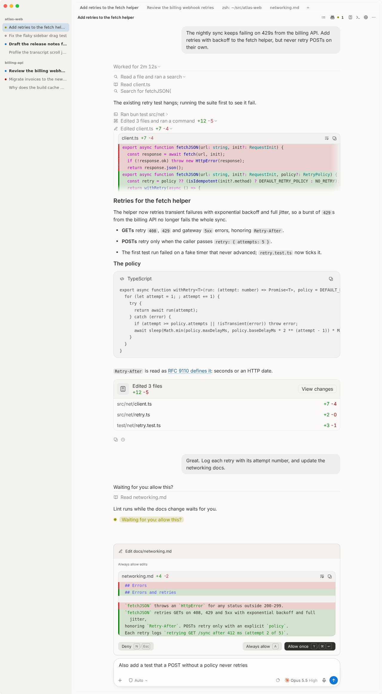
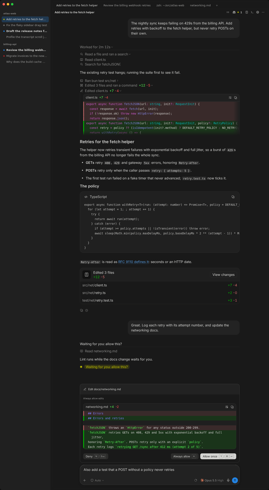

# Folio





cmux as a document workspace: the agent chat reads like a page in a team wiki. A warm off-white
page with warm near-black ink, the system sans at a document's 16 px with a 1.5 line height in a
column about a page wide, a quiet sidebar a shade under the page that lists your workspaces as a
tree of pages (one line each, sub-pages nested, buttons only on hover), a flat window with one
hairline between the sidebar and the page, blue only where something can be clicked, a soft gray
prompt bubble, slash-menu menus (gray section labels, 28 px rows, a gray inset highlight) and
short, quiet motion. It ships Light (the default) and Dark.

It is built only from public surfaces, so you can copy any part of it:

| File | What it does |
| --- | --- |
| `cmux-setup.json` | Picks the theme file; sets the chat in the system sans at 16 px with a 1.5 line height, inline code at 0.85, a 760 px column, no minimap; the sidebar as a tree of pages: compact one-line rows with their icon, agent-started workspaces nested under their parent, plain section headings, buttons on hover, no timestamps, counts or branch lines; a page-preview hover card; a small rounded address field |
| `themes/folio.json` | Default, Light. Page `#FBFAF8`, ink `#32302C`, link blue `#2383E2`, selection `#CFE2F6`, the sidebar, tab strip and docks `#F3F2EE`, Settings, New Tab, Home and pages on the same page, a `#E5E4E0` rule |
| `themes/folio-dark.json` | Dark. Page `#191919`, ink `#D4D4D2`, the same blue, selection `#1F3D5C`, the sidebar, tab strip and docks `#202020`, a `#2E2E2D` rule |
| `agent-pane/theme.css` | A 16 px prompt bubble in the ink at 6% with no edge, cards at 4% with a 9% rule, secondary ink as dark as reads at 4.5:1, links in the blue a step toward the ink, and slash-menu menus (pending, below): `cmux.agentPane.style/1` tokens only, every color mixed from the theme's own |
| `customize/` | A hover card laid out like a page preview (the title as a heading, an "edited" line, the page's text, its properties as a short table, what needs you in the link blue) and page rows in regular weight with a small dot, not a spinner, while work runs |
| `markdown/theme.css` | The Markdown viewer's paint: headings with no rule, code on a soft gray with 4 px corners, quotes behind a bar in the ink's own color, tables with a plain header. Only `--cmux-md-*` properties on `:root`, every color mixed from the page's own |

The rest of cmux wears the look too. The terminal is SF Mono at 13 pt (the face a wiki page sets its code blocks in) with a full sixteen-color palette at a document's soft chroma, colors 1 to 7 and 9 to 14 held to WCAG AA over its page (8, the dim gray, to 3:1); the Markdown viewer opens in the system face at 16 px with the chat's line height and code scale in a 86-character column, and `markdown/theme.css` paints it; diffs use muted colors with change bars; sidebar group colors come from the theme's palette. Its `customize/` view also adds **Page properties** to Session Info: the agent, folder and branch as the same short table the hover card ends with.

Both theme files set the same proportions, measured from the references (the traffic lights'
12 pt as the ruler): a 33 pt tab strip with 14 pt titles in tabs about 190 pt wide, a 44 pt top
bar, a 240 pt sidebar with 30 pt rows in 14 pt text, no gutter, a 1 pt divider, the tab strip a
step apart from the page (`appearance.titleAreaTone: "subtleTone"`), the focused pane marked on
its tab, a small breathing dot for work in progress, and a short ease-out (120 ms) for color
changes.

```sh
cmux setup install github.com/manaflow-ai/cmux-folio-look
cmux settings set appearance.themeFile folio-dark    # folio (Light) is the default
cmux settings set agentPane.display.font.preset serif # the document's serif style, if you prefer it
cmux setup remove manaflow-ai/folio-look
```

While it is installed, its `customize/` view stands in for your own sidebar view, if you have one;
`cmux setup remove` puts yours back.

## Contrast

Every pair is checked to WCAG AA, resolved opaque (body text 4.5:1, UI 3:1), in both theme files:
the ink on every surface the look sets, the secondary and dim ink over the page and over a card,
links on the page and inside the bubble, the bubble's text, the selection, and the menu rows,
labels and shortcuts on the panel and on the highlighted row. The documents' own secondary gray
(the ink at about 65%) falls just under 4.5:1 on the off-white page, so the chat's secondary ink is
the ink at 72% and its quietest at 68%.

## With a newer cmux

The setup carries only settings every current cmux NEXT build has, because `cmux setup install`
refuses a key the running build does not know. These are in review; each sits in the files as a
comment naming its pull request:

| Part | Where | Needs |
| --- | --- | --- |
| A document's square tabs, the active one in the page's color | `"appearance.tabShape": "block"` in the theme files | cmux #46780 |
| The selected page in the tree as a gray wash, not an accent capsule | `"appearance.selection": "neutral"` in the theme files | cmux #46516 |
| Slash-menu menus: 10 px corners, a 4 px inset, 28 px rows, a gray 6 px inset highlight, 12 px medium gray section labels, gray shortcuts and subtitles, near edge-to-edge separators, submenus 4 px beside | the `--menu-*` tokens in `agent-pane/theme.css`, set now and inert until then | cmux #46846 |
| 28 pt top-bar buttons with a 6 pt gray wash, no rule under the top bar at rest, page rows inset 4 pt, a roomy composer card | the `appearance.metrics.*` comment lines at the end of the theme files | cmux #46861 |

## Not yet possible

| Part | Why |
| --- | --- |
| A floating composer card with a context chip row above the field and an attach, mode and sources row under it | `agentPane.composerLook` (#46738) offers auto, codex and claude only |
| A page tree's disclosure triangles and per-page emoji as one sidebar preset | `sidebar.look` (#46805) offers cmux, claude, codex and studio only; a row decoration's `icon` would replace the icon you chose |
| A slash menu's icon tiles (a bordered square per block type) and its markdown-shortcut column | No menu row icon-tile or shortcut-format token in #46846 |
| A menu panel that is white over an off-white page, and lighter than the page in Dark | Menu fills are mixed from the theme's page and ink, so they can only sit a hair off the page |
| Version-history attribution colors (a colored dot per author) | The transcript has no per-author color surface |
| A per-scheme stylesheet (`light-dark()`) | The stylesheet is mixed from the theme's colors, so one file covers both |

## References

The look was drawn from 11 captures in the private cmux design references: colors
sampled from their pixels, sizes measured on them. The captures themselves, by number, are on
the look's private references page.

| Ref | What this look took from it |
| --- | --- |
| R1 | The proportions (33 pt tab strip, 44 pt breadcrumb bar, a ~190 pt tab, measured against the 12 pt traffic lights), the ink `#2C2C2B`/`#31302C`, the tab strip `#F8F8F7` a step apart from the page, chips and pills at `#F0EFED` (the ink at ~6%, the bubble), the placeholder gray `#A7A39B`, the floating composer card with a context chip row (the composer-look gap) |
| R2 | The warm frame `#F6F5F3` behind the page (the sidebar's tone), the secondary gray `#7D7A75` (darkened to pass 4.5:1), the selected row as a gray wash with no accent (`selection: neutral`), the change blue `#387DCA` and selection blue `#E5F1FD`, a hairline rule `#F0EFED` between list rows, bold sans headings over a roomy page |
| R3 | A docs editor's menu: a plain white panel with a soft shadow and ~8 px corners, a gray highlighted row (`#E8E8E8`), full-width separators, a bold section label over gray text: the menu's quiet gray highlight and near edge-to-edge separators |
| R4 | Blue reserved for the one action and the focused field, everything else neutral: why the accent appears only on links, focus and Send |
| R5 | A document-style light sidebar: quiet gray section headings ("Your teams"), one-line rows with an icon, nested child rows, the selected row as a gray wash (`#F1F3F8`): the tree-of-pages sidebar and compact density |
| R6 | A dark document page (`#1B1D21`) with a large title, gray property labels ("Description", "Status") over body text, a link in a light blue (`#52A1C8`): the dark page's ink, labels and the property table in the hover card |
| R7 | A dark agent chat beside a document: the prompt as a block one step off the page (`#1A1B1D` on `#0F0F11`), "Thinking..." as plain gray text: the dark bubble as a small ink wash, not a color |
| R8 | Suggested prompts as a title plus a gray description in one row: the slash menu's title-and-subtitle rows in gray |
| R9 | Light and dark as the same layout in two tones, the sidebar a step off the page in each: Folio and Folio Dark share every proportion |
| R10 | A slash menu over the composer: one row per command with a name and a gray description, a gray inset highlight with rounded corners, 28 px rows: the menu row height and highlight |
| R11 | A plan document beside a chat: breadcrumbs over a page with bold headings and links in a muted blue, the chat as reading text: the page-wide column and link color a step toward the ink |
