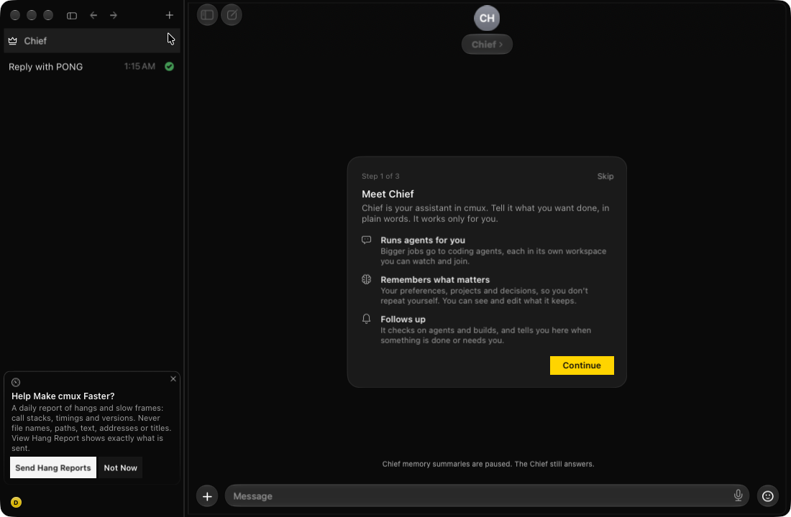
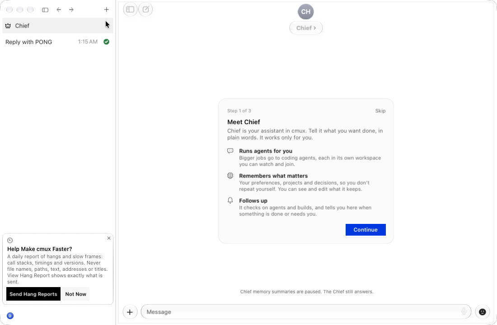

# Grid

A Swiss grid for the whole of cmux. Every corner is square. Panes, the sidebar and cards are parted by
1 px rules, never by shadows, fills or glass. Every height sits on an 8 px grid. One accent colour does
all the signalling, and type is a heavy grotesk. It ships three theme files:





| Theme | Page | Ink | The one accent |
| --- | --- | --- | --- |
| `grid` (the default) | black `#0a0a0a` | white `#f5f5f5` | signal yellow `#ffd400` |
| `grid-light` | white | black | ultramarine `#0038e0` |
| `grid-signal` | white | black | signal red-orange `#e63b00` |

It is built only from public surfaces, so you can copy any part of it:

| File | What it does |
| --- | --- |
| `cmux-setup.json` | Picks the theme file. Sets the chat in Hanken Grotesk (bundled with cmux) at 16 px on a 24 px line, code at 14 px, a 768 px column. Puts the Markdown viewer on the same 16/24 grid. Sets diffs in the theme's colours with change bars, gray sidebar groups, plain section headings over rules, toasts as flat bars, and a square, flat address field |
| `themes/grid.json` | Default, dark. Every surface is the page colour, opaque (no wallpaper, blur or glass). `flat` chrome: no card, a 1 px rule between panes and on the sidebar's edge. Pane corners at 0 with no inset, the selected tab flush, focus shown on the tab and the pane edge. The selected row is a gray block (`appearance.selection: neutral`) so the accent stays for Send, focus and the work dot, which holds still. Proportions on 8 px steps: a 256 px sidebar, 32 px rows, a 40 px title bar, a 32 px tab strip, 8 px gaps |
| `themes/grid-light.json` | The same on white, with an ultramarine accent |
| `themes/grid-signal.json` | The same on white, with a signal red-orange accent |
| `agent-pane/theme.css` | Cards with no fill inside a 1 px rule of the ink at 32%. The prompt as a square box ruled in the ink itself, with no tint. Two quieter ink levels (72%, 62%) in place of size steps. Links in the ink, underlined. Only `cmux.agentPane.style/1` tokens, every colour mixed from the theme's own |
| `markdown/theme.css` | Headings at weight 800 over a 2 px rule. Code on a faint fill with square corners. Quotes on a 4 px bar, tables in 1 px rules, no popover shadow. Only `--cmux-md-*` properties |
| `customize/` | A hover card set like a table: a bold title, then a label column and a value on 8 px steps, with the accent only on what the chat waits on. Sidebar rows in semibold with a still dot while work runs |

```sh
cmux setup install github.com/manaflow-ai/cmux/examples/looks/grid@feat-cmux-next
cmux settings set appearance.themeFile grid-light     # or grid-signal; grid (dark) is the default
cmux setup remove manaflow-ai/grid
```

While it is installed, its `customize/` view stands in for your own sidebar view, if you have one.
`cmux setup remove` puts yours back, along with every other setting the look changed.

## With a newer cmux

| Part | Where | Needs |
| --- | --- | --- |
| Toasts as a flat bar: opaque, a 1 px edge, no shadow, rim or glass | `"notifications.toast.style": "flat"` in `cmux-setup.json`, as a comment | cmux#49661 merged the key, but the generated settings schema a build embeds does not list it yet, so install would refuse the whole look. Uncomment it once your build has it |

## Not yet possible

| Part | Why |
| --- | --- |
| Square tabs, composer, menus, popovers and tooltips | No setting reaches the tab's shape (cmux#46780), the composer's corner (cmux#46738) or the native menus' material. They keep the app's own corners |
| A 0 px toast corner | `flat` draws the toast opaque, with a 1 px edge and no shadow, but at the button corner radius. No key sets the toast's corner |
| Opaque popovers and menus | No key sets a popover's or a menu's opacity |
| The grotesk in the sidebar, tabs and Settings | Those are native text. Only the chat (`agentPane.display.font.ui`) takes a bundled face |
| A heavier body weight in the chat | Weight is not a setting. Headings in the Markdown viewer are 800; the chat's body stays regular |
