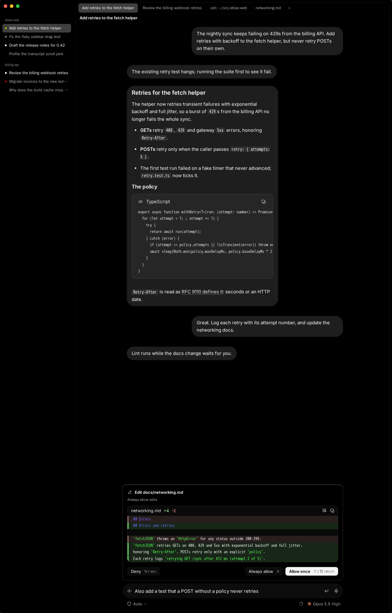

# Grok

cmux as a Grok bot. Install it and cmux opens like a Grok app: every New Tab is the Grok home, Command-N
starts a Grok chat, and the window takes Grok's colors and chat shape. Under it, each chat is a real
Grok (xAI's agent, the `grok` harness) session in cmux, with its tools, files and terminal.



```sh
cmux setup install github.com/manaflow-ai/cmux/examples/looks/grok@feat-cmux-next
cmux setup remove manaflow-ai/grok-look   # everything you had comes back
```

It needs the Grok harness installed and signed in (Settings > Agents). Without it, the prompt box
says why the chat did not start.

## What it sets

| Surface | File | What |
| --- | --- | --- |
| Theme file | [themes/grok.json](themes/grok.json) | A true black page and sidebar, off-white ink and white as the only accent |
| Settings | [cmux-setup.json](cmux-setup.json) | The Grok home as the New Tab app, messages presentation, prompts in bubbles, a pill message box centered in an empty chat, a quiet header, a sidebar of titles only, no tab strip for a lone chat |
| View | [customize/](customize) | `cmux.newtab/1`: a greeting, one prompt box that starts a Grok chat (`palette.newAgentChat` with `harness: "grok"`), suggestion chips (Explain this repo, Find the bug, Roast my code) and your recent Grok chats |
| Chat paint | [agent-pane/theme.css](agent-pane/theme.css) | `cmux.agentPane.style/1` tokens only: bubble tint and corners, card ring, link color |
| Keys | [keybindings.json](keybindings.json) | Command-N: new Grok chat |

## Make your own bot

Copy this folder and change three things: the harness id (`HARNESS` in customize/main.js and the
`harness` in keybindings.json), the words (`agentPane.composerPlaceholder`, the greeting) and the
theme file's colors. Every other key is shared with the other chat-assistant looks
([halo](../halo)).

## What this look could not set

- The bot's own name and avatar beside replies: the sender icon follows the harness's family
  (`agentPane.display.senderIcon.lead`), and no key renames it.
- Its colors are picked to evoke the Grok app, not measured from a capture of it.
- A default harness for the palette's New Agent Chat: `agent.defaultHarness` is refused to looks, so
  only Command-N and the New Tab home start Grok.
