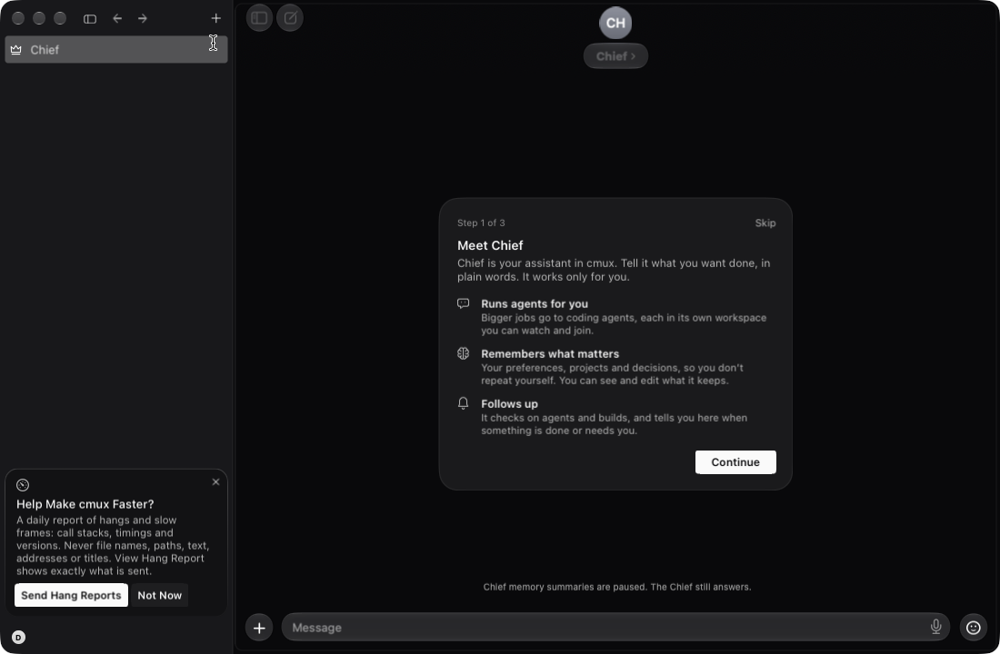
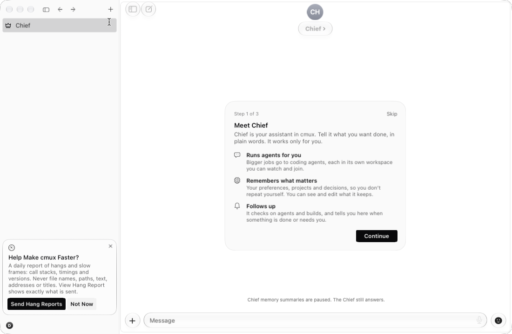
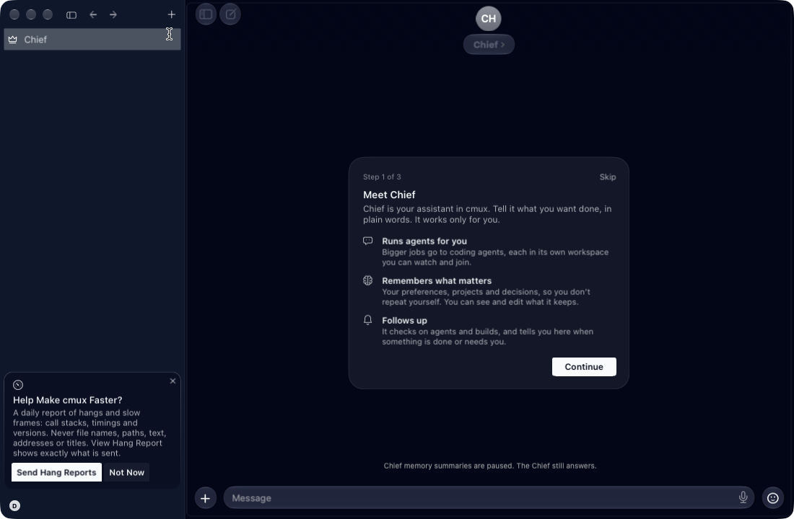
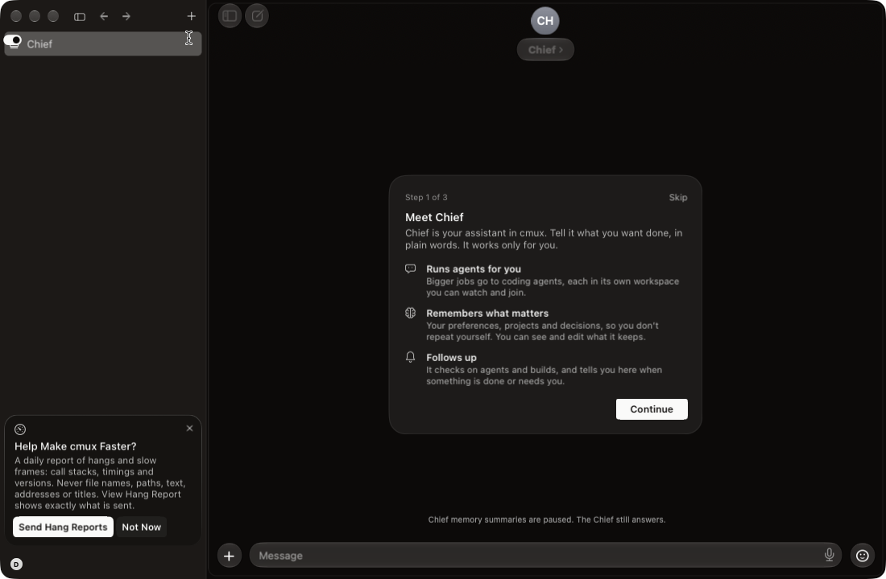
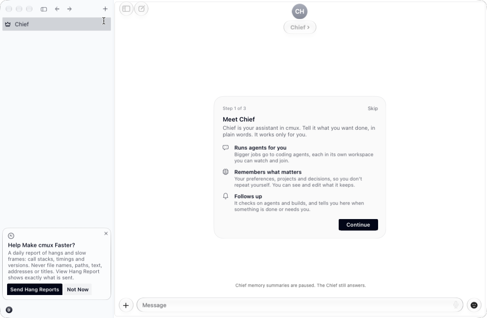
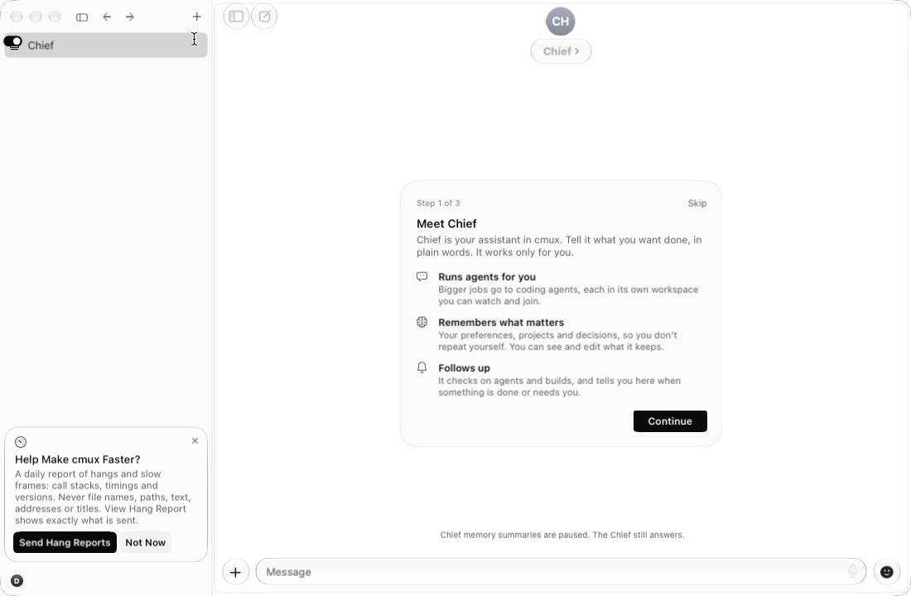

# Hairline

cmux flat and quiet. Every surface is an opaque neutral fill: no glass, no wallpaper and no shadows.
Edges are one-pixel lines. One corner radius runs through panes, tabs, cards, the composer and
popovers, and buttons sit 2 px inside it. Focus is a two-pixel ring, not a glow or a tint. Text
comes in two weights of gray: the foreground and a muted gray for everything secondary. The only
accent is the text color itself, so links are underlined text, not blue. The chat uses a dense Inter
at 14 px.





It ships three palettes, each with a dark and a light theme file:

| Theme file | Grays | Radius |
| --- | --- | --- |
| `hairline` (default), `hairline-light` | zinc: page `#09090B` / `#FFFFFF`, sidebar `#18181B` / `#FAFAFA`, lines `#27272A` / `#E4E4E7`, muted text `#A1A1AA` / `#71717A` | 8 px |
| `hairline-slate`, `hairline-slate-light` | cool slate: page `#020617` / `#FFFFFF`, lines `#1E293B` / `#E2E8F0` | 6 px |
| `hairline-stone`, `hairline-stone-light` | warm stone: page `#0C0A09` / `#FFFFFF`, lines `#292524` / `#E7E5E4` | 10 px |

| Slate | Stone |
| --- | --- |
|  |  |
|  |  |

It is built only from public surfaces, so you can copy any part of it:

| File | What it does |
| --- | --- |
| `cmux-setup.json` | Picks the theme file. Turns on a 2 px focus ring in the standard contrast. Sets the chat in Inter at 14 px with a 1.55 line height, code at 0.9 and a 760 px column. Gives the Markdown viewer the same size and line height in the system font (it has no Inter choice). Sets diffs in theme colors, a grayscale sidebar palette, plain section headings, dots for status and workspace colors, and a flat 6 px address field. |
| `themes/*.json` | Color, the terminal palette and proportions for each palette: a 36 pt title bar and tab bar, a 256 pt sidebar with 28 pt rows, 13 pt chrome text, panes on 1 pt lines. Each also sets the pane radius (`layout.paneCornerRadius`), a 1 px pane border and `ui.reducedBackgrounds`, so switching palettes switches the corner too. |
| `agent-pane/theme.css` | Takes the chat's card, composer, popup and control radii from the host's button radius (the pane radius less 2 px), so they follow the palette. Cards, your prompt and code blocks are one-pixel outlines on an almost invisible fill. The composer has no shadow and gets a 2 px ring when focused. Links are underlined text. |
| `markdown/theme.css` | Headings over a hairline, code on a faint fill with 6 px corners, quotes on a one-pixel rule, tables in one-pixel lines, links in the text color, no popover shadow. |

```sh
cmux setup install github.com/manaflow-ai/cmux/examples/looks/hairline@feat-cmux-next
cmux settings set appearance.themeFile hairline-slate    # or hairline-stone, or any -light
cmux setup remove manaflow-ai/hairline-look
```

## Not yet possible

| Part | Why |
| --- | --- |
| A flat toast (opaque, 1 px border, the look's radius, no shadow) | The toast is drawn natively, and no setting or theme key reaches its material, border or shadow yet. #49661 adds `notifications.toast.style` with a `flat` choice; the look will set it once that lands. |
| Opaque menus and popovers | Native menus and popovers are always glass. Only the system's Reduce Transparency makes them opaque. |
| Inter in the window chrome | No setting picks the chrome's font family. `appearance.metrics.chromeFontSize` sets only its size. |
| The focus ring from a theme file | `focusRing.*` are not theme-file keys, so the setup sets them and they don't change when you switch palettes. |
