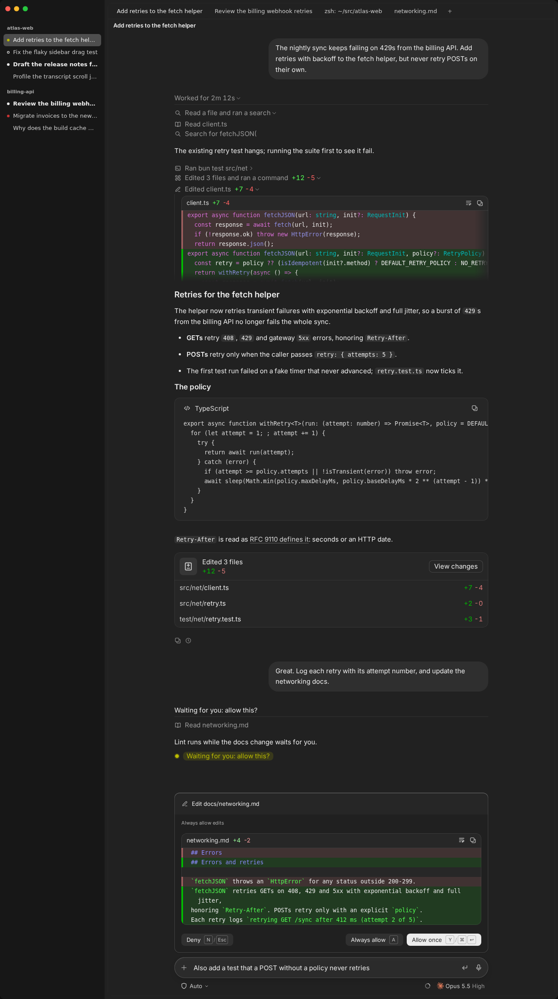
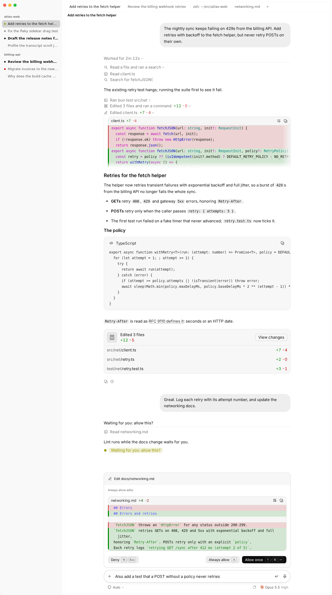
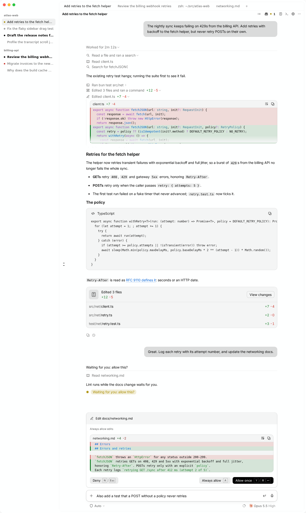
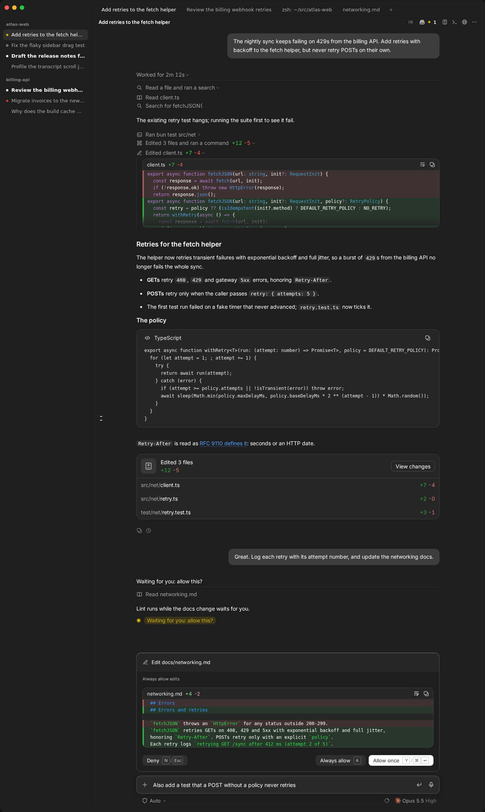

# Halo v1

A minimal look for agent chats in cmux, after a minimal chat assistant desktop app: near-monochrome
(white or near-black), airy spacing in a centered column, prompts in soft gray bubbles, a pill
message box, a header that shows its tools only on hover, and a sidebar of plain titles.




## Design intent

Halo v1 optimizes for calm and focus: nothing on screen but the conversation, no color but the content's, generous space around every line. Density is spacious (36 pt sidebar rows, spacious chrome). Type is the system face at 15 px with a 1.65 line height in a centered 720 px column. It sets all three chat layout keys: `agentPane.display.layout.messages` `bubbles`, `.composer` `pill`, `.header` `quiet`.

## What game cmux plays under this look

Under Halo, cmux plays the quiet room: one question, one answer, nothing else on screen. It removes everything that is not the conversation: no color but the content's, no timestamps, icons or group colors in the sidebar, no header tools until the pointer asks for them, and generous space around every line. The prompt is a soft bubble and the message box a pill, the most familiar shapes for talking to an assistant, so a newcomer has nothing to learn. It is the look to hand someone on their first day.

## Whom it serves

Aziz: he has been shaping the sidebar and tab hierarchy and moving work toward production artifacts; a minimal, near-monochrome baseline shows what cmux looks like with the hierarchy stripped to essentials, the clearest starting point for that design work.

## Screenshots

Drawn by the `golden:looks` harness (`webviews/scripts/gallery/golden-looks.ts`, run 45026447442 on
the fleet), one mock app window per scheme: sidebar, tab strip, agent pane and composer, on the same
worked turn. The default look is beside each for comparison.

| Scheme | Halo v1 | Default look |
| --- | --- | --- |
| Light |  |  |
| Dark |  |  |

Per surface:

- Agent pane and composer: shown above, light and dark, drawn by the webviews the app uses.
- Sidebar and tabs: shown above only as the harness's mock, which draws the row text, timestamps and
  palette but not sidebar density, grouping, the session tree or the native tab bar's metrics. The
  native Swift sidebar and tab bar need a Mac (`golden:looks --native`); missing from this VM.
- Settings: missing. No harness on this VM draws the Settings window.
- Agent pane close-ups (`compare.mjs worked-turn --open --look`): missing; the script needs the
  reference prototype checkout (`--reference`), which the fleet runner does not have.

## What this look could not set

- The composer's own look and where the message box sits in an empty chat: `agentPane.composerLook` and `agentPane.emptyChatComposerPosition` are in review (#45843).
- Tab shape (capsule or square tabs): `appearance.tabShape` is in review (#46780).
- The selected sidebar row's fill (neutral or accent): `appearance.selection` is in review (#46516).
- Sidebar row inset, padding and gap, toolbar button size and corners, the header divider, the composer's padding and minimum height: in review (#46861).
- Which facts sit on which line of a sidebar row: `sidebar.workspaceRow.lines` validates but is not drawn (#42244).
- A whole sidebar look (row shape, header style) beyond density and content: `sidebar.look` is in review (#46805).
- The color of your own prompt's text: `--cv-user-bubble-text` is in review (#46490).
- Menus and context menus: the `--menu-*` tokens are in review (#46846).
- Font family per surface: only the chat (`agentPane.display.font.ui`, `.preset`, `.proseFamily`), the Markdown viewer (`markdown.font.preset`) and the terminal (`terminal.fontFamily`) take one; the sidebar, tab strip, header and Settings stay on the system face.
- The prompt bubble's width: the chat's row estimate assumes 70%, so no setting or token changes it.
- Buttons in the composer's toolbar and the model picker: no setting or interface draws them.
- Corner radius across the app (panes, cards, buttons): only the prompt bubble (`--cv-user-bubble-radius`) and the message box (`agentPane.display.layout.composer`) take a corner.
- Avatars or sender labels beside messages, and a reply drawn as a card of its own: the message layout key moves only your prompt (`bubbles`, `flat`, `card`); the reply is always plain prose.
- Hiding the sidebar's section headers: no key hides them (the look does hide a lone chat's tab with `tabs.hideLoneChatTab`).
- The empty chat centered with the message box in the middle of the window: `agentPane.emptyChatComposerPosition` (#45843).

## What it reshapes

| Part | How |
| --- | --- |
| Chat layout | `agentPane.display.layout.messages` `bubbles`, `.composer` `pill`, `.header` `quiet` |
| Chat type | `agentPane.display.font.preset` `system` at 15 px with a 1.65 line height, `width` 720, no minimap |
| Sidebar | `sidebar.density` `comfortable`, no grouping, no timestamps, no icon, branch, folder, status, pull request or notification on a row, `groupPalette` `grayscale`, `controlsOnHover`; `tabs.hideLoneChatTab` |
| Chrome | `appearance.chromeStyle` `flat`, no borders, `density` `spacious`, a 260 pt sidebar of 36 pt rows (theme files) |
| Color | `themes/halo.json` (white, near-black ink, no accent color) and `themes/halo-dark.json` (near-black, off-white ink); pick the dark one with `appearance.themeFile` `halo-dark` |
| The chat's paint | `agent-pane/theme.css`: a soft gray bubble with no outline and 22 px corners, barely-there cards, links in the text's own color |
| Sidebar view | `customize/`: a hover card of the title and the last reply only; regular rows with a small dot |

With cmux#45843 also set `agentPane.composerLook` and `agentPane.emptyChatComposerPosition` (the
message box centered in an empty chat); they are not keys yet, so this look leaves them out.

```sh
cmux setup install github.com/manaflow-ai/cmux/examples/looks/halo@feat-cmux-next
cmux setup remove manaflow-ai/halo-look
```

How looks like this one are written: [docs/cmux-next/look-addons.md](../../../docs/cmux-next/look-addons.md).
