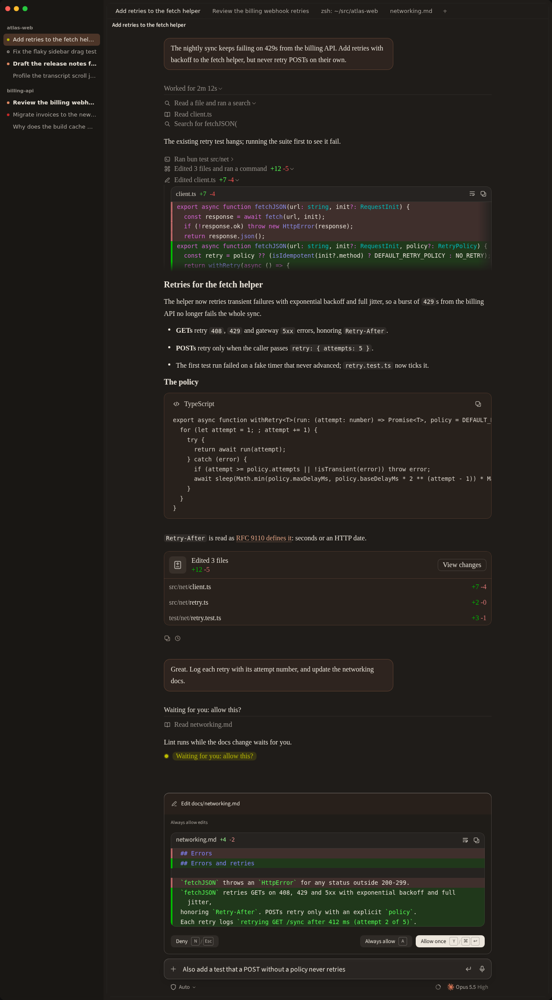
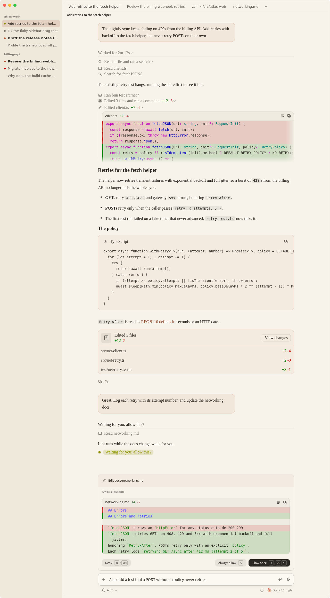
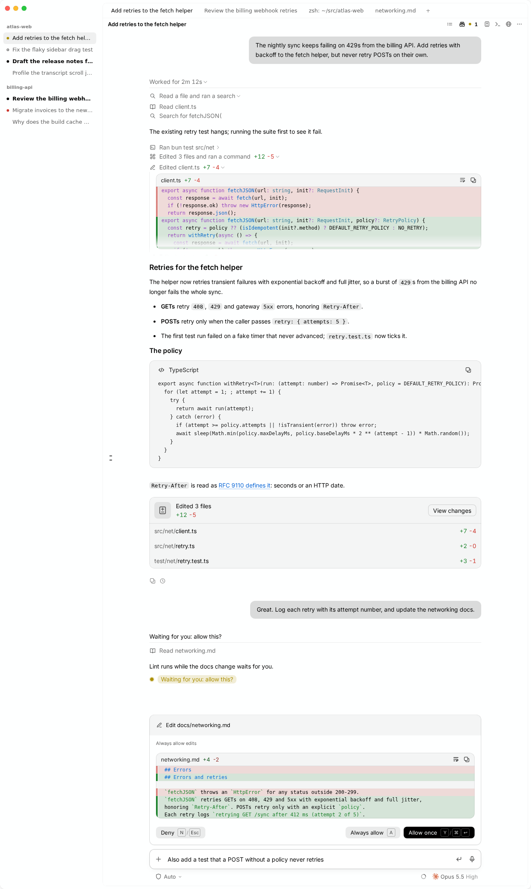
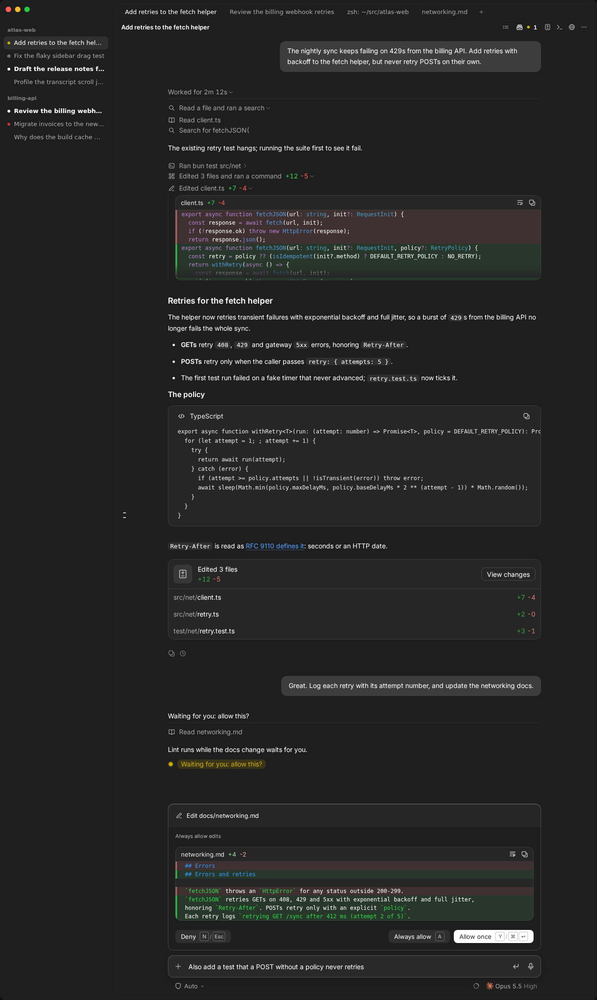

# Hearth v1

A warm reading look for agent chats in cmux, after a warm chat assistant desktop app: serif prose
on cream paper (or a warm brown dark), your prompts as soft outlined cards on the leading edge with
the reply flowing under them, a rounded message box and a header that shows its tools only on hover.




## Design intent

Hearth v1 optimizes for reading and conversation: long replies set like a page, few controls in view, a calm warm palette in light and dark. Density is comfortable (32 pt sidebar rows, comfortable chrome). Type is serif prose at 16 px with a 1.7 line height in a roomy 760 px column, a humanist UI face around it. It sets all three chat layout keys: `agentPane.display.layout.messages` `card`, `.composer` `rounded`, `.header` `quiet`.

## What game cmux plays under this look

Under Hearth, cmux plays the long conversation: one person and one agent thinking something through, where the reply is the product. It optimizes for reading comfort over density: serif prose at a book's size and measure, warm paper that is easy on the eyes for an hour, your prompt set off as a soft card so the exchange reads like annotated pages, and the header's tools hidden until reached for. The sidebar is a calm list of conversations by recency rather than a project tree, because what matters is picking up where you left off.

## Whom it serves

Leo: he reads more agent output than anyone (briefs, reports, long replies across every lane) and asked for these looks, so a look built for reading long replies comfortably serves his day most directly.

## Screenshots

Drawn by the `golden:looks` harness (`webviews/scripts/gallery/golden-looks.ts`, run 45026447442 on
the fleet), one mock app window per scheme: sidebar, tab strip, agent pane and composer, on the same
worked turn. The default look is beside each for comparison.

| Scheme | Hearth v1 | Default look |
| --- | --- | --- |
| Light |  |  |
| Dark |  |  |

Per surface:

- Agent pane and composer: shown above, light and dark, drawn by the webviews the app uses.
- Sidebar and tabs: shown above only as the harness's mock, which draws the row text, timestamps and
  palette but not sidebar density, grouping, the session tree or the native tab bar's metrics. The
  native Swift sidebar and tab bar need a Mac (`golden:looks --native`); missing from this VM.
- Settings: missing. No harness on this VM draws the Settings window.
- Agent pane close-ups (`compare.mjs worked-turn --open --look`): missing; the script needs the
  reference prototype checkout (`--reference`), which the fleet runner does not have.

## What this look could not set

- The composer's own look and where the message box sits in an empty chat: `agentPane.composerLook` and `agentPane.emptyChatComposerPosition` are in review (#45843).
- Tab shape (capsule or square tabs): `appearance.tabShape` is in review (#46780).
- The selected sidebar row's fill (neutral or accent): `appearance.selection` is in review (#46516).
- Sidebar row inset, padding and gap, toolbar button size and corners, the header divider, the composer's padding and minimum height: in review (#46861).
- Which facts sit on which line of a sidebar row: `sidebar.workspaceRow.lines` validates but is not drawn (#42244).
- A whole sidebar look (row shape, header style) beyond density and content: `sidebar.look` is in review (#46805).
- The color of your own prompt's text: `--cv-user-bubble-text` is in review (#46490).
- Menus and context menus: the `--menu-*` tokens are in review (#46846).
- Font family per surface: only the chat (`agentPane.display.font.ui`, `.preset`, `.proseFamily`), the Markdown viewer (`markdown.font.preset`) and the terminal (`terminal.fontFamily`) take one; the sidebar, tab strip, header and Settings stay on the system face.
- The prompt bubble's width: the chat's row estimate assumes 70%, so no setting or token changes it.
- Buttons in the composer's toolbar and the model picker: no setting or interface draws them.
- Corner radius across the app (panes, cards, buttons): only the prompt bubble (`--cv-user-bubble-radius`) and the message box (`agentPane.display.layout.composer`) take a corner.
- Avatars or sender labels beside messages, and a reply drawn as a card of its own: the message layout key moves only your prompt (`bubbles`, `flat`, `card`); the reply is always plain prose.
- A serif face for the sidebar and tab titles to match the prose: neither takes a font family.
- The reply set in a narrower measure than the prompt, or drop caps and other prose ornaments: type is one size and width for the whole transcript.

## What it reshapes

| Part | How |
| --- | --- |
| Chat layout | `agentPane.display.layout.messages` `card`, `.composer` `rounded`, `.header` `quiet` |
| Chat type | `agentPane.display.font.preset` `serif` at 16 px with a 1.7 line height, `font.ui` `source-sans`, `code.scale` 0.85, `width` 760, no minimap |
| Sidebar | `sidebar.density` `comfortable`, `groupBy` `recents` under section headers, no icon, branch, folder or age on a row, `controlsOnHover` |
| Chrome | `appearance.chromeStyle` `flat`, no borders, `density` `comfortable`, a 272 pt sidebar of 32 pt rows (theme files) |
| Color | `themes/hearth.json` (cream paper, warm ink, terracotta) and `themes/hearth-dark.json` (warm brown-black, lifted terracotta); pick the dark one with `appearance.themeFile` `hearth-dark` |
| The chat's paint | `agent-pane/theme.css`: a warm-tinted prompt card with a gentle outline, ruled-page cards, warm secondary text |
| Markdown | `markdown.font.preset` `serif` at 16 px, a 72-character measure |
| Sidebar view | `customize/`: a reading hover card with the conversation in full; medium rows with a soft arc |

With cmux#45843 also set `agentPane.composerLook` and `agentPane.emptyChatComposerPosition` (the
message box centered in an empty chat); they are not keys yet, so this look leaves them out.

```sh
cmux setup install github.com/manaflow-ai/cmux/examples/looks/hearth@feat-cmux-next
cmux setup remove manaflow-ai/hearth-look
```

How looks like this one are written: [docs/cmux-next/look-addons.md](../../../docs/cmux-next/look-addons.md).
