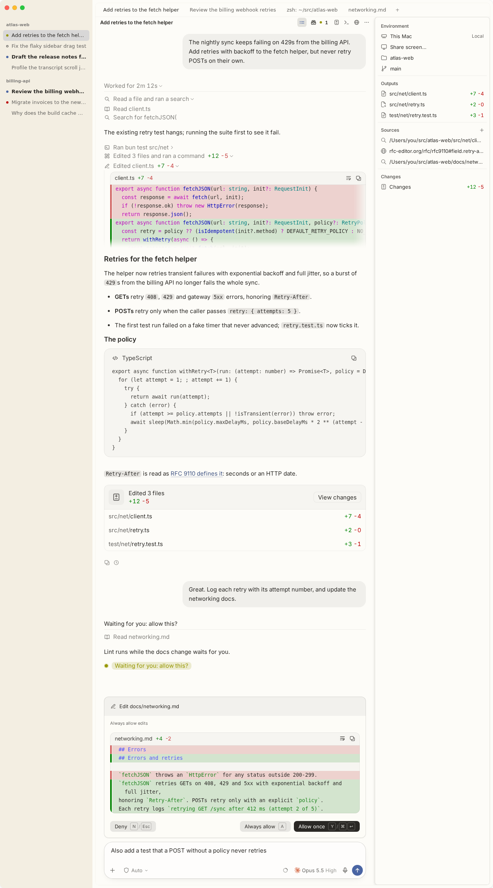
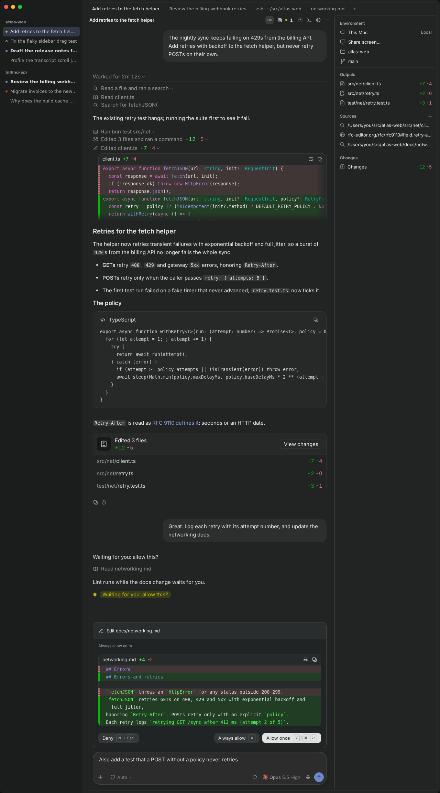

# Hush





A calm assistant-browser look: warm near-white everywhere, the work in one large rounded card that
separates from the sidebar by tone instead of a line, a sidebar whose buttons wait for the pointer,
a chat that reads like a quiet side panel (roomy 15 px type, a soft gray prompt pill, cards that
are barely there), generous rounded menus, one muted slate accent kept for Send, focus and links,
a small breathing dot for work in progress, and slow, even color changes with nothing that
bounces. It ships Light (warm white, the default) and Dark (a cool graphite).

It is built only from public surfaces, so you can copy any part of it:

| File | What it does |
| --- | --- |
| `cmux-setup.json` | Picks the theme file; the chat in the system font at 15 px with a 1.6 line height, code at 0.88, a 680 px column, no minimap; the sidebar quiet: one-line rows with their icon and nothing else, groups as plain headings, no timestamps or detailed marks, its buttons shown only while you point at it (`sidebar.minimal`); a 12 px address field with no shadow |
| `themes/hush.json` | Default, Light. Card `#FDFCF8`, text `#2A2825` (warm graphite), accent `#4A65A3` (muted slate-blue), selection `#E9E5DC`, the sidebar, toolbar and tab strip `#F3EEE2` (parchment), pages `#FBF8F1`, no glass |
| `themes/hush-dark.json` | Dark. Card `#222424`, text `#E3E2E2`, accent `#6682C2`, selection `#3D4040`, the sidebar, toolbar and tab strip `#1B1D1D`, pages `#202222` |
| `agent-pane/theme.css` | An 18 px soft gray prompt pill (the text at 6%) with no edge, cards at 3% with a faint hairline, links in the accent a step toward the text, and roomy rounded menus (pending, below): `cmux.agentPane.style/1` tokens only, every color mixed from the theme's own |
| `customize/` | A two-line hover card (title and age, then one line of what it is doing, or what it asks of you in its place) and still rows in regular weight with a small dot while work runs |
| `markdown/theme.css` | The Markdown viewer's paint: quiet. Medium-weight headings with no rule, code on a barely-there fill with the card's 12 px corners, quotes on a soft gray line. Only `--cmux-md-*` properties on `:root`, every color mixed from the page's own |

The rest of cmux wears the look too. The terminal is SF Mono at 13 pt (the system's monospaced face, nothing louder) with a full sixteen-color palette at a hushed chroma, colors 1 to 7 and 9 to 14 held to WCAG AA over its page (8, the dim gray, to 3:1); the Markdown viewer opens in the system face at 16 px with the chat's line height and code scale in a 82-character column, and `markdown/theme.css` paints it; diffs use muted colors with change bars; sidebar group colors are grays.

Both theme files set the same proportions, measured from captures of the browsers this look comes
from: a 44 pt top band, a 200 pt sidebar with 32 pt rows, 13 pt chrome text, a 36 pt tab strip
with 13 pt titles, a 6 pt inset around the content card (`appearance.chromeStyle: "card"`), no
borders and no split divider, the focused pane marked on its tab, a dot (85% size) for work in
progress that is not repeated on the tabs, and a 450 ms ease-in-out for color changes.

```sh
cmux setup install github.com/manaflow-ai/cmux-hush-look
cmux settings set appearance.themeFile hush-dark    # hush (Light) is the default
cmux setup remove manaflow-ai/hush-look
```

While it is installed, its `customize/` view stands in for your own sidebar view, if you have one;
`cmux setup remove` puts yours back.

## Contrast

Every pair is checked to WCAG AA, resolved opaque (body text 4.5:1, UI 3:1), in both theme files:
the text on every surface the look sets, the secondary and dim text over the page and over a card,
links on the page and inside the prompt pill, the pill's text, the selection, Send's glyph on the
accent, and the menu rows on the panel and on the highlighted row. A calm look is a low-contrast
look by temperament, so the quiet text is the quietest step that still passes (72% and 67% of the
text), not the faint gray the sources use for placeholders.

## With a newer cmux

The setup carries only settings every current cmux NEXT build has, because `cmux setup install`
refuses a key the running build does not know. These are in review; each sits in the files as a
comment naming its pull request:

| Part | Where | Needs |
| --- | --- | --- |
| Soft rounded tab chips, the selected one in the card's tone | `"appearance.tabShape": "rounded"` in the theme files | cmux #46780 |
| The selected row as a light lift (white in Light), not an accent fill | `"appearance.selection": "neutral"` in the theme files | cmux #46516 |
| Menus and popovers: a near-opaque panel in the page's color, 14 px corners, a 6 px inset, 30 px rows, a soft gray highlight with 10 px corners, secondary-text shortcuts and labels, separators inset 12 px | the `--menu-*` tokens in `agent-pane/theme.css`, set now and inert until then | cmux #46846 |
| Rows inset 6 pt with 10 pt corners, 28 pt square toolbar buttons with an 8 pt fill and even gaps, a 56 pt card composer, 10% more air everywhere | `appearance.metrics.sidebarRowInset` and the rest, as comments at the end of the theme files | cmux #46861 |

## Not yet possible

| Part | Why |
| --- | --- |
| The card and the composer floating on a soft drop shadow | The content card's and the composer's shadow are not public surfaces; the card separates by tone instead |
| A floating-card composer with a pill "add files" chip and a round gray Send that darkens when there is text | `agentPane.composerLook` (#46738) offers auto, codex and claude only |
| The chat as a side panel beside a page, opened from a toolbar button | A look cannot place panes; split the window yourself |
| The highlighted menu row raised white on a shadow | No menu row shadow token in #46846; the highlight is a soft gray fill |
| A calm-browser sidebar preset (pinned app tiles on top, a "Chats" drawer at the bottom) | `sidebar.look` (#46805) offers cmux, claude, codex and studio only |
| A per-scheme stylesheet (`light-dark()`) | The stylesheet is mixed from the theme's colors, so one file covers both |

## References

The look was drawn from 6 captures in the private cmux design references: colors
sampled from their pixels, sizes measured on them. The captures themselves, by number, are on
the look's private references page.

| Ref | What this look took from it |
| --- | --- |
| R1 | The whole temperament: a warm page (`#FDF8EC`) as one large rounded card beside a parchment sidebar (`#F7E9C1`) with no line between them, the 6 pt inset, 32 pt rows (43 px at its 1.35 scale), the sidebar about 18% of the window, a white composer card on a soft shadow with a pill chip and a gray round Send (`#ECECEC`/`#A8A8A8`), placeholder gray `#9E9E9E`, and the usage: one assistant field in a calm, empty canvas |
| R2 | The menu: a near-white panel (`#F5F5F5` to `#FDFDFD`) with generous corners, roomy rows, the hovered row a white lift with 10 px corners and a close button only on hover; neutral dark chips for the space switcher; tabs as rounded chips with the selected one white |
| R3 | The dark scheme: chrome `#1E2020`, the selected row `#353636` with about 10 pt corners inset 5 pt, 30 pt rows (60 px at 2x), text `#E3E2E2`, the "New Tab" row dim, a close button only on the selected row (hence `sidebar.minimal`) |
| R4 | Toolbar buttons as even squares: 28 pt (56 px at 2x), an 8 pt rounded fill (`#353737` on `#1E2020`), the same padding on every side: the pending toolbar-button metrics |
| R5 | A quiet assistant side panel: a floating card with large corners on a soft shadow, starter rows without chrome, the composer a bordered card with a context chip and a pale round Send; the narrow 680 px column and the barely-there cards |
| R6 | A calm vertical-tab sidebar: plain gray section headings, the selected tab a white pill with 8 pt corners on a gray sidebar (the pending neutral selection), 36 pt rows, a page that is one flat sheet |
