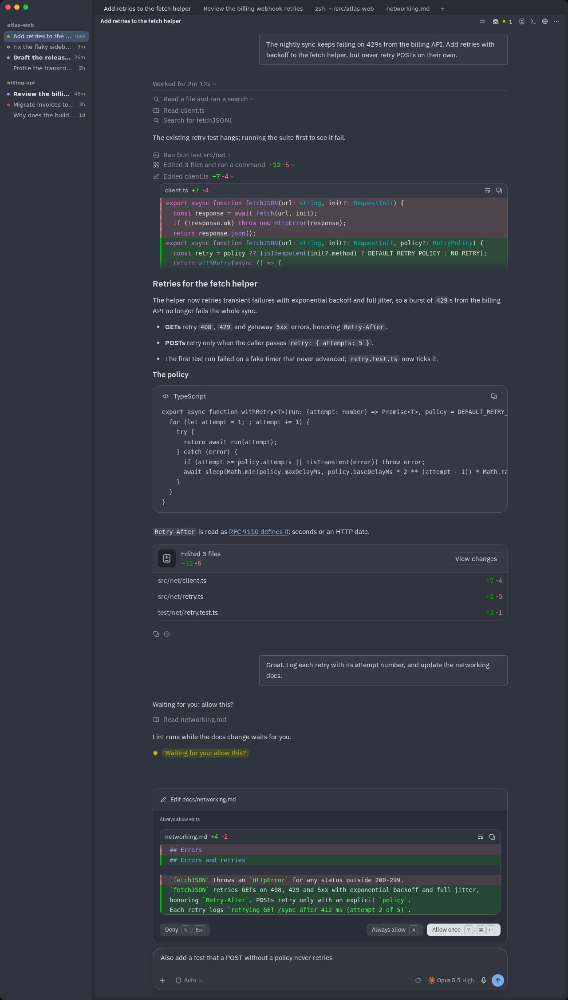
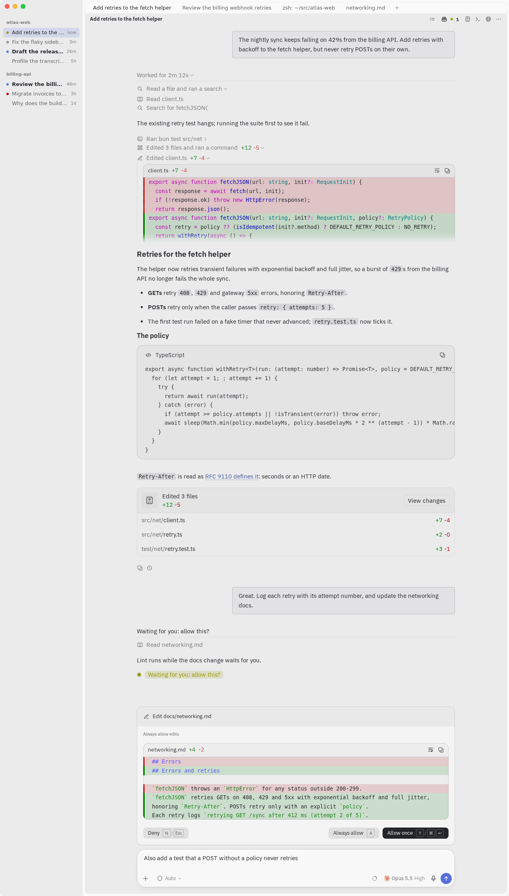

# Kerf





cmux as a fast native editor: tight, flat and quiet. Slate panels sit a step above a deeper editor,
every edge is a one-pixel line and nothing casts a shadow; the title bar and tab bar are the
lightest slate, the active tab takes the editor's own color. A soft sky blue is the only accent
(focus, links, Send, the working arc). The chat is the agent panel: Plex Sans at a reading size,
your prompt in a hairline box, tool calls as one-line rows, cards as outlines. The sidebar is a
threads list grouped by project, each thread with its branch and age. It ships Dark (the default,
after the One family's dark) and Light (after One Light).

It is built only from public surfaces, so you can copy any part of it:

| File | What it does |
| --- | --- |
| `cmux-setup.json` | Picks the theme file; sets the chat in Plex Sans (`plex`) at 15 px with a 1.6 line height, code at 0.9, an 800 px column, the compact harness rail, no minimap; the sidebar as a threads list: grouped by folder under plain headings, two lines a thread (title, then branch and age), timestamps on, no member counts; a 4 px flat address field |
| `themes/kerf.json` | Default, Dark. Editor `#282C33`, panels and sidebar `#2F343E`, title and tab bars `#3B414D`, borders `#464B57`, text `#DCE0E5`, blue `#74ADE8`, selection `#3A4B5E`, the One palette in the terminal (`ghostty`) |
| `themes/kerf-light.json` | Light. Editor `#FAFAFA`, panels and sidebar `#EBEBEC`, title and tab bars `#DCDCDD`, borders `#C9C9CA`, text `#242529`, blue `#5C78E2`, selection `#D3DAF5`, the One Light palette deepened where a color would not read on white |
| `agent-pane/theme.css` | The prompt in a hairline box (text at 20% for the edge, 4% inside, 4 px corners), cards as one-pixel outlines on an almost invisible fill, the panel's muted gray for secondary text, links in the accent pulled toward the text, and editor menus (pending, below): `cmux.agentPane.style/1` tokens only, every color mixed from the theme's own |
| `customize/` | A compact, list-like hover card (title and age, then branch and pull request with small icons, status, task, what it waits on in the accent, the agent), and rows in regular weight with the thin arc |
| `markdown/theme.css` | The Markdown viewer's paint: flat and outlined like the editor. Code on a faint fill with 4 px corners, headings over a hairline, quotes on a one-pixel rule, nothing raised. Only `--cmux-md-*` properties on `:root`, every color mixed from the page's own |

The rest of cmux wears the look too. The terminal is SF Mono at 13 pt (the system's own monospaced face, as a native editor uses) with its own sixteen-color palette, unchanged; the Markdown viewer opens in the system face at 15 px with the chat's line height and code scale in a 97-character column, and `markdown/theme.css` paints it; diffs use theme colors with + and - marks; sidebar group colors come from the theme's palette.

Both theme files set the same proportions, measured from the references at their 3x scale: a
34 pt title bar, a 260 pt threads sidebar with 24 pt rows (the project panel's), 13 pt chrome and
tab text, a 32 pt tab bar whose tabs size to their title (96 to 200 pt), panes that abut on
1 pt lines (`appearance.chromeStyle: "flat"`, no gutter), the focused pane shown by its tab,
compact density, and almost no motion: fast, with 80 ms linear color changes.

```sh
cmux setup install github.com/manaflow-ai/cmux-kerf-look
cmux settings set appearance.themeFile kerf-light    # kerf (Dark) is the default
cmux setup remove manaflow-ai/kerf-look
```

While it is installed, its `customize/` view stands in for your own sidebar view, if you have one;
`cmux setup remove` puts yours back.

## References

The look was drawn from 5 captures in the private cmux design references: colors
sampled from their pixels, sizes measured on them. The captures themselves, by number, are on
the look's private references page.

| Ref | What this look took from it |
| --- | --- |
| R1 | The palette, sampled: title and status bars `#3A3F4B`, agent and project panels `#2E343D`, the editor `#282B33`, the selected project row `#464B55`, borders `#474C56`, secondary text `#B1B6C2`, the blue `#85B1E9`, syntax purple, blue and cyan. The proportions: a 34 pt title bar, a 260 pt threads sidebar, 24 pt project rows, a 32 pt tab bar with the active tab in the editor's color. The prompt in a hairline box and subagent rows as outlined cards |
| R2 | How it is used: threads grouped under plain project headings, two lines each (title, then branch, change count and age), so `groupBy: folder`, `sections` headings and the branch and age facts; tool calls as one line with an icon; the composer's placeholder and toolbar row (the composer gap) |
| R3 | The context menu: a `#31343E` panel with a one-pixel border, about 24 pt rows, a section label ("External Agents") in the muted gray at regular weight, a shortcut at the right, separators edge to edge: the menu tokens. Terminal threads beside chat threads in one list |
| R4 | Settings and onboarding open as a page in the editor's own color with one-pixel outlined controls and dense aligned rows: the settings and page surfaces |
| R5 | The same editor-family habits: the prompt in a one-pixel box, tool rows as a verb then a muted object, a menu with a shortcut column and full-width separators |

## Contrast

Every pair is checked to WCAG AA, resolved opaque (body text 4.5:1, UI 3:1), in both theme files
and over both the editor (the page) and the agent panel's slate: the text on every surface the
look sets, the secondary and dim text over each and over a card, links over each and inside the
prompt box, the prompt box's text, Send, the selection, every menu row, and the terminal's
foreground, cursor, selection and ANSI colors. The prompt box's edge is a decorative hairline
(1.2:1 and up), as the panel's own borders are.

## With a newer cmux

The setup carries only settings every current cmux NEXT build has, because `cmux setup install`
refuses a key the running build does not know. These are in review; each sits in the files as a
comment naming its pull request:

| Part | Where | Needs |
| --- | --- | --- |
| Square tabs flush on the bar, the active one in the editor's color | `"appearance.tabShape": "block"` in the theme files | cmux #46780 |
| The selected row in the neutral selected-element slate, not the accent | `"appearance.selection"` in the theme files | cmux #46516 |
| Editor menus: 6 px corners, a one-pixel border, 24 px rows, a gray 4 px hover, regular-weight muted labels, edge-to-edge separators | the `--menu-*` tokens in `agent-pane/theme.css`, set now and inert until then | cmux #46846 |
| 52 pt two-line thread rows, 24 pt icon buttons, one-pixel lines under headers, a short composer | `appearance.metrics.*` comment lines at the end of the theme files | cmux #46861 |

## Not yet possible

| Part | Why |
| --- | --- |
| A borderless composer with a toolbar row under it (add, mode, model, a red stop square) | `agentPane.composerLook` (#46738) offers auto, codex and claude only |
| A threads-list sidebar preset | `sidebar.look` (#46805) offers cmux, claude, codex and studio only |
| The prompt in the monospaced face, as the panel draws it | The chat has one body font; the bubble has no font token |
| The editor's monospaced font (Plex Mono) for code | `agentPane.display.code.family` takes an installed font by name; the look keeps the chat's default code font rather than name one you may not have |
| Change counts (+25 -15) on thread rows | No row fact carries line counts |
| A status bar | cmux has no status bar surface |
| A per-scheme stylesheet (`light-dark()`) | The stylesheet is mixed from the theme's colors, so one file covers both |

How looks like this one are written: [look-addons.md](https://github.com/manaflow-ai/cmux/blob/639a429492936ae3b4f0d4a1e6d7fbf66e708520/docs/cmux-next/look-addons.md).
