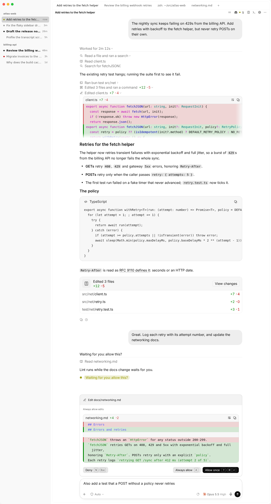
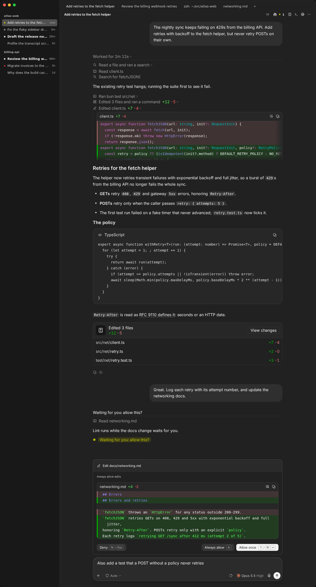

# Linen





A soft, consumer chat look with almost no chrome. One centered 768 px reading column on a plain
page, in larger 16 px type. Your prompts are gray pills on the right with 20 px corners; the
replies are plain text with no bubble and no frame. While work runs the status line says
Thinking and stays on it, a thin ring spins on the chat's row and tab, and the work folds into
one gray line ("Worked for 17s") you can open. The sidebar is a history: a soft gray (#f9f9f9)
panel with no line beside it, your chats grouped by how recent they are under plain gray
headings, one line each with its age at the right and pin and archive on hover. There is no
brand hue: Send is a round black button (white in Dark), links are the text's own color with an
underline, menus are soft and round (16 px corners). It ships Light (the default) and Dark.

It is built only from public surfaces, so you can copy any part of it:

| File | What it does |
| --- | --- |
| `cmux-setup.json` | Picks the theme file; sets the chat in the system font at 16 px on a 1.6 line, code at 0.9, one centered 768 px column, no minimap, work folded with the status staying on Thinking, "work locally" under the composer at its left, the session panel pushing the column aside, a made file as one folded card; the sidebar as a history grouped by recency under plain headings, one line per chat with its age, pin and archive on hover, a search button, a compact hover card; a capsule address field |
| `themes/linen.json` | Default, Light. Page `#ffffff`, text `#0d0d0d`, the sidebar `#f9f9f9` with no border, code on `#f9f9f9`, accent black `#0d0d0d` with white on it, selection `#cfe0fc`, the unread blue, toast green and Delete red as the terminal palette |
| `themes/linen-dark.json` | Dark. Page `#212121`, text `#f3f3f3`, the sidebar a step darker `#181818`, code on `#181818`, accent near-white `#f3f3f3` with the page color on it, selection `#28446e`, the palette lifted for the dark page |
| `agent-pane/theme.css` | The gray prompt pill (the text at 7% over the page, no edge, 20 px corners), cards on a faint fill with a 10% hairline, gray secondary text at 66% and 58%, links in the text color, and the soft menus (pending, below): `cmux.agentPane.style/1` tokens only, every color mixed from the theme's own |
| `customize/` | A hover card that reads like a message preview (title and age, then two or three gray lines of the chat's last reply or prompt, then where it runs) and history rows in regular weight with a thin spinning ring |
| `markdown/theme.css` | The Markdown viewer's paint: plain text with no frame. Headings with no rule, code in a soft gray block with 12 px corners, quotes on a gray line, links in the text's own color. Only `--cmux-md-*` properties on `:root`, every color mixed from the page's own |

The rest of cmux wears the look too. The terminal is SF Mono at 13 pt (the system's monospaced face, as the chat's code blocks use) with a full sixteen-color palette at a plain chroma, colors 1 to 7 and 9 to 14 held to WCAG AA over its page (8, the dim gray, to 3:1); the Markdown viewer opens in the system face at 16 px with the chat's line height and code scale in a 87-character column, and `markdown/theme.css` paints it; diffs use theme colors with change bars; sidebar group colors are grays.

Both theme files set the same proportions: a 52 pt header, the 260 pt history sidebar with 32 pt
rows and 14 pt text, 13 pt tab titles in a 36 pt strip, a 1 pt divider and no gutter
(`appearance.chromeStyle: "flat"`), the focused pane shown by its tab, and colors that ease in
and out over 250 ms at the standard speed.

```sh
cmux setup install github.com/manaflow-ai/cmux-linen-look
cmux settings set appearance.themeFile linen-dark    # linen (Light) is the default
cmux setup remove manaflow-ai/linen-look
```

While it is installed, its `customize/` view stands in for your own sidebar view, if you have one;
`cmux setup remove` puts yours back.

## Contrast

Every pair is checked to WCAG AA, resolved opaque (body text 4.5:1, UI 3:1), in both theme files:
the text on every surface the look sets, the secondary and dim text over the page and over a
card, links on the page and inside the prompt pill, the pill's text, Send's glyph on the accent,
the terminal colors used for status and diffs, the selection, and the menu rows. The gray the
references use for "Worked for" (`#8b8b8b` on white) is 3.5:1, under 4.5:1, so the look's
secondary text is the lightest gray that passes on both pages (66% and 58% of the text).

## With a newer cmux

The setup carries only settings every current cmux NEXT build has, because `cmux setup install`
refuses a key the running build does not know. These are in review; each sits in the files as a
comment naming its pull request:

| Part | Where | Needs |
| --- | --- | --- |
| The pill composer: a rounded field with + at its left and a round Send at its right | `"agentPane.composerLook": "codex"` in `cmux-setup.json` | cmux #46738 |
| The history sidebar as one preset | `"sidebar.look": "codex"` in `cmux-setup.json` | cmux #46805 |
| Tabs as rounded pills with their close button | `"appearance.tabShape": "rounded"` in the theme files | cmux #46780 |
| The selected history row as a gray rounded fill, not the accent | `"appearance.selection": "neutral"` in the theme files | cmux #46516 |
| Soft menus: 16 px corners, a 6 px inset, 28 px rows, a 10 px rounded gray highlight, gray regular section labels, gray shortcuts at the right, 12 px separator inset | the `--menu-*` tokens in `agent-pane/theme.css`, set now and inert until then | cmux #46846 |
| 36 pt round toolbar buttons, history rows inset 6 pt, a pill composer at least 52 pt tall, no hairline under the header | `appearance.metrics.*` lines at the end of each theme file | cmux #46861 |

## Not yet possible

| Part | Why |
| --- | --- |
| The "Thinking" line's moving shimmer | The status line's animation is not a public surface; `statusVerbs.mode: "thinking"` keeps its word |
| A white popover in Light over a white page, set apart by a shadow only | The stylesheet has no menu shadow color of its own; the menu takes 5% of the text over the page so it shows on white |
| The unread blue dot on a finished chat's row | Status marks take their colors from the app, not from a look; the blue is set as the terminal palette's |
| Grouping history into "Pinned" and dated sections by name | `sidebar.groupBy: "recents"` groups by recency with the app's own headings |
| The send button turning into a spinner-ringed Stop while work runs | The composer's buttons are not a public surface |

How looks like this one are written: [look-addons.md](https://github.com/manaflow-ai/cmux/blob/639a429492936ae3b4f0d4a1e6d7fbf66e708520/docs/cmux-next/look-addons.md).

## References

The look was drawn from 17 captures in the private cmux design references: colors
sampled from their pixels, sizes measured on them. The captures themselves, by number, are on
the look's private references page.

| Ref | What this look took from it |
| --- | --- |
| R1 | A history row's 30 pt hover fill `#303030` with rounded corners (32 pt rows with their gap), pin and archive revealed on hover (`sidebar.controlsOnHover`), the age at the right and the unread dot `#4d81ef` (palette 4) |
| R2 | The hover card as a preview (title, where it runs, age, then recent activity) for `customize/` |
| R3 | The menu: panel a shade lifted off the page (`#2c2b2b`), a corner measured at about 15 pt on the curve (16 px), 28.5 pt rows with icons, `#3d3c3c` separators inset about 13 pt, gray shortcuts `#969595` at the right |
| R4 | Section labels in regular gray (`#969696`), the highlighted row a round lighter fill (`#3d3d3d` on `#2d2d2d`, the 7% hover mix) |
| R5 | Menu rows with a gray second line (`#959494`, `--menu-subtitle-color`), a check at the right, the orange of a risky choice (palette 3) |
| R6 | "Working for 11m 26s" over grouped tool rows in two grays (`#8b8b8b`, `#a3a3a3`) and a plain "Thinking" at the bottom: `statusVerbs.mode: "thinking"` and the two secondary steps |
| R7 | "Worked for 17s >" as a fold above the answer on the dark page, the round icon actions under it |
| R8 | The rounded composer with + at its bottom left (the pending pill composer look) |
| R9 | A status bar docked on the composer and a round jump-to-bottom button: round controls everywhere |
| R10 | The session panel beside the column, code as a card on the page |
| R11 | The dark page `#202020` (`#212121`), the column staying centered as a panel pushes in (`sessionInfo.placement: "push"`) |
| R12 | The blue of selected text (the selection colors) |
| R13 | The confirmation green `#008635` (palette 2) |
| R14 | Light: the history under plain gray headings with ages at the right (`groupBy: "recents"`), hover `#f2f2f2` and selected `#e8e8e8` rows, "Work locally" under the composer at its left |
| R15 | Light: the prompt pill `#f3f3f3`, the white page, the round black Send with a white arrow (the black accent) |
| R16 | Replies as plain text on white, "Worked for 2m 30s" in `#898989`, a made file as one bordered card, the 734 px column (768 px) |
| R17 | Settings as a white sheet with a capsule search field and pill buttons: white settings and pages, the capsule address field |
