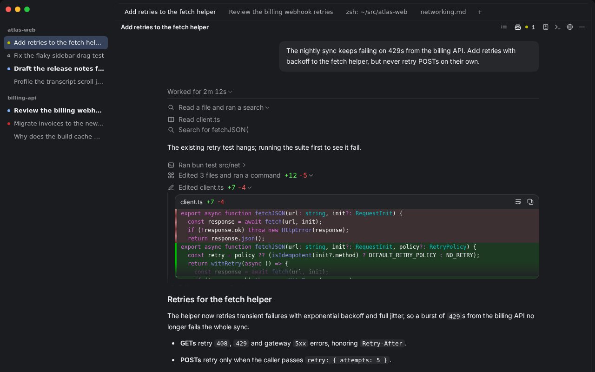
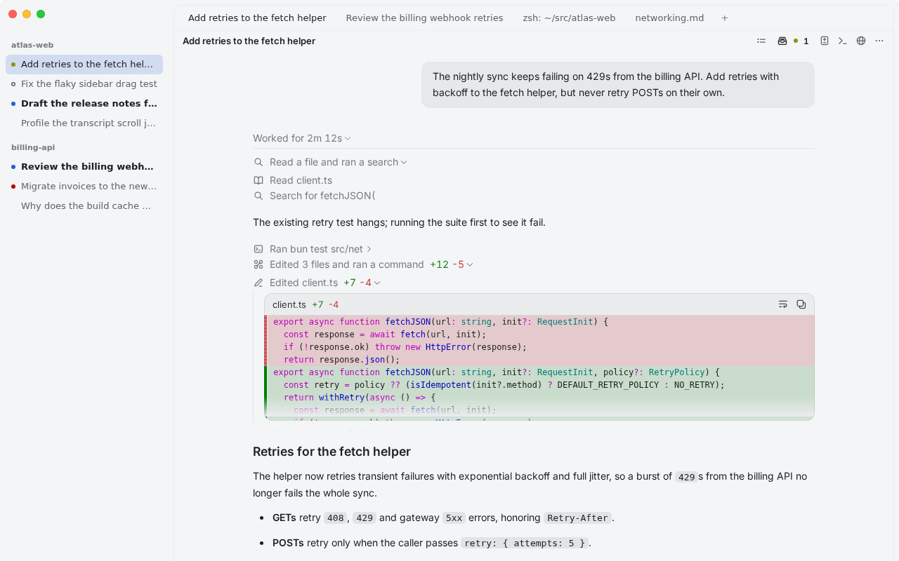

# Lumen





cmux is open all day over your own wallpaper, so Lumen makes the app out of light. The window is
system glass in one neutral tint; the sidebar, tab bar and title area are simply that glass. Your
work sits on a calm, near-solid plane framed by it. Nothing is painted on to look like glass: no
rims, sheens, gradients or glows. Depth is the only hierarchy. It ships Lumen (dark, the default)
and Lumen Light. Version 0.1.

```sh
cmux setup install github.com/manaflow-ai/cmux/examples/looks/lumen@feat-cmux-next
cmux settings set appearance.themeFile lumen-light    # lumen (Dark) is the default
cmux setup remove manaflow-ai/lumen-look
```

Remove it and everything you had comes back. It changes no default.

## Three materials

| Material | What is made of it | How Lumen sets it |
| --- | --- | --- |
| Window glass | The window, the sidebar, the tab bar, the title area | `appearance.backgroundBlur: "glass"`, `appearance.background: "none"` (your wallpaper is the art), a neutral tint (`#1b1c1f` dark, `#f4f5f7` light) at `appearance.backgroundOpacity` 0.84 dark, 0.8 light, and `appearance.wallpaperTint: false` so the glass never takes the desktop's colour cast |
| Floating glass | Menus, popovers, toasts, dialogs, the palette | Not settable by a look yet; left as the app draws it |
| Content | The agent chat, terminal, editor, diffs, Markdown, the browser's bar, docks, Settings, internal pages, Home, the New Tab page | `appearance.surfaces.<surface>.color` the same tint, `.opacity` 0.96, no blur of its own |

The sidebar and tab bar set the tint at the window's own fill (0.84 dark, 0.8 light). A surface's
opacity is its fill over the glass in place of the window's, not a second layer on top (an unset
one shows the window's value), so they add no second tone, and the fill under sidebar text is 0.84
dark and 0.8 light: never lower.

Two tone in Lumen is material, not hue: chrome is glass, content is the plane. The selected tab
takes the plane's fill and joins it (`appearance.cornerFlush: "flush"`, no goo);
`appearance.twoTone` is off.

**Chrome style: `card`.** It draws the content as one inset rounded plane on the window, with no
outline on a lone pane and no extra shade. `panes` outlines every pane, which is the extra line
Lumen avoids; `floating` paints a darker shade over the chrome, a second tone on the glass. Lumen
also turns off the sidebar's edge line (`sidebar.border: false`): the change of material is the
edge. A line stays only between two content panes, where both sides are the same material.

## Other settings

- Corners from one rule, inner = outer minus inset: `layout.cornerPadding` 8 and
  `layout.paneCornerRadius` 8 (a 16 pt window corner minus the 8 pt gap), the address field at 8
  (`browser.omnibar.cornerRadius`) with no shadow and no accent in its glass tint
  (`browser.omnibar.glassTint: "none"`).
- A selected row spends one lever, its fill: `appearance.selection: "neutral"`.
  `appearance.accent: "theme"`, `appearance.titleAreaTone: "oneColor"`.
- Sidebar: `sidebar.look: "cmux"`, `sidebar.sectionLook: "quiet"`, standard style.
- The chat keeps the app's own type scale and sizes; tool rows at the normal level of detail
  (`agentPane.display.transcriptView: "normal"`). Density is left as it is.
- `agent-pane/theme.css`: cards at 5% of the text's colour with no outline, the prompt bubble at 6%
  with no edge and 12 px corners, secondary and dim text both at 74% of the text, links the accent
  mixed 85% with the text. Only `cmux.agentPane.style/1` tokens, every colour mixed from the
  theme's own.

## Legibility

Text holds 4.5:1 and large marks 3:1 over light, dark and busy pictures. Every pair is measured on
the content plane at 0.96 over both a pure black and a pure white backdrop, and the worse of the two
counts.

- Body text: 13.8:1 dark, 14.3:1 light. Secondary and dim text (74%): 8.2:1 dark, 6.6:1 light.
  Links: 7.9:1 dark, 5.8:1 light (in light the mix is `#1e55bb`).
- Text on the selection: 8.9:1 dark (`#2c4466`), 12.3:1 light (`#cfdcf5`).
- Terminal colours 1 to 7 and 9 to 15, quiet and neutral, each solved in OKLCH: at least 4.70:1
  dark and 4.71:1 light. Colour 8, the dim gray, at least 3.2:1.

## Cannot set yet

- A glass level per role, and a radius for floating panels (menus, popovers, toasts, dialogs)
  apart from the one pane radius.
- Elevation or shadow.
- The composer's paint.
- Menu tokens.
- The tab's shape.
- The type scale.
